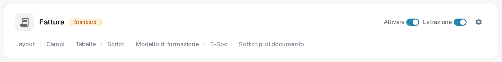
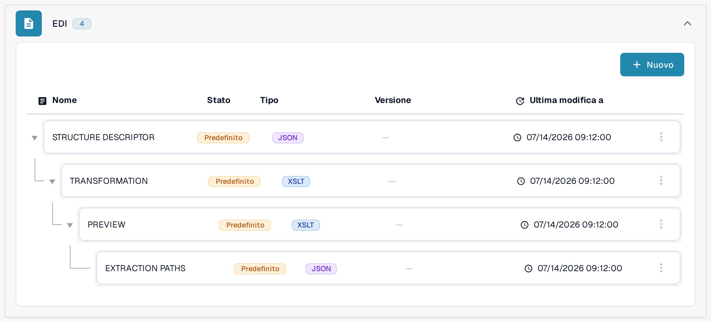

# Mappature EDI

Le pagine delle mappature EDI mostrano come i campi di DocBits si collegano ai campi dei tipi di messaggio EDI più diffusi. Usarle come riferimento quando si prepara o si rivede la trasformazione di un tipo di documento EDI; in [Impostazioni EDI: Panoramica e Benefici](../README.md) è descritto come si configura l'EDI.

Per trovare la gerarchia delle mappature nell'applicazione attuale:

1. Aprire **Impostazioni → Tipi Di Documento** e individuare il tipo di documento usato per il documento elettronico, ad esempio **Fattura**.
2. Selezionare **E-Doc** nella scheda di quel tipo di documento. La vista successiva raggruppa le parti di mappatura disponibili per formato di documento elettronico.
3. Trovare **EDI** nell'elenco dei formati e aprire il gruppo. La gerarchia illustrata contiene **Structure Descriptor**, **Transformation**, **Preview** ed **Extraction Paths**. Le colonne mostrano nome, stato, tipo, versione e data dell'ultima modifica di ciascuna parte.

<figure><figcaption>
Selezionare E-Doc nella scheda del tipo di documento interessato. Questo esempio usa Fattura nell'ambiente di prova in italiano.
</figcaption></figure>

<figure><figcaption>
Il gruppo EDI aperto nell'ambiente di prova in italiano. L'indicazione Predefinito descrive la configurazione di prova mostrata; nessuna mappatura è stata modificata e nessuno scambio EDI è stato provato.
</figcaption></figure>

I nomi delle parti della mappatura, ad esempio **Structure Descriptor** o **Extraction Paths**, compaiono ancora in inglese nell'interfaccia attuale del prodotto.

Aprire la pagina del tipo di messaggio con cui si lavora:

* [Mappatura EDI 810 (Fattura)](edi-810-invoice-mapping.md)
* [Mappatura EDI 850 (Ordine di Acquisto)](edi-850-purchase-order-mapping.md)
* [Mappatura EDI 855 (Conferma Ordine di Acquisto)](edi-855-purchase-order-acknowledgement-mapping.md)
* [Mappatura EDI 856 (Avviso di Spedizione Anticipata)](edi-856-advance-shipment-notice-mapping.md)

Verificare ogni mappatura con la guida di implementazione del proprio partner e provarla con un file rappresentativo prima di farvi affidamento.
