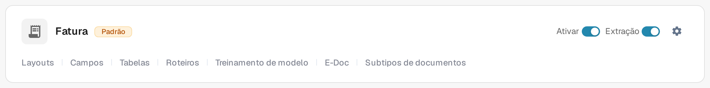
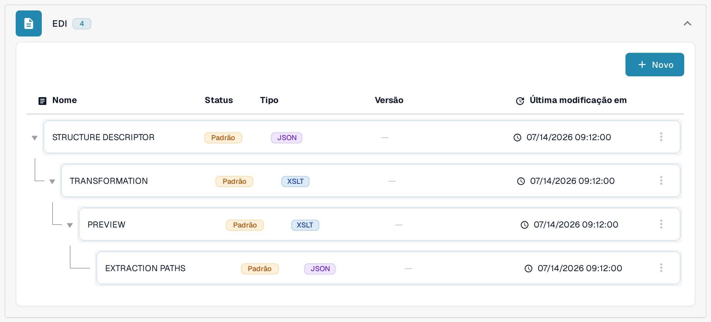

# Mapeamentos EDI

As páginas de mapeamentos EDI mostram como os campos do DocBits se relacionam com os campos dos tipos de mensagem EDI mais comuns. Utilize-as como referência quando preparar ou rever a transformação de um tipo de documento EDI; a configuração do EDI está descrita em [Configurações de EDI: Visão Geral e Benefícios](../README.md).

Para encontrar a hierarquia de mapeamentos na aplicação atual:

1. Abra **Configurações → Tipos de documento** e localize o tipo de documento que utiliza para o documento eletrónico, por exemplo **Fatura**. Os botões do cartão e as ligações no rodapé estão explicados em [Tipos de documento](../../../README.md).
2. Selecione **E-Doc** no cartão desse tipo de documento. A vista seguinte agrupa as partes de mapeamento disponíveis por formato de documento eletrónico.
3. Localize **EDI** na lista de formatos e expanda o grupo. A hierarquia apresentada contém [**STRUCTURE DESCRIPTOR**](../edi-structure-descriptor-file-guide/README.md), [**TRANSFORMATION**](../edi-transformation-file-guide.md), [**PREVIEW**](../edi-preview-file-guide.md) e [**EXTRACTION PATHS**](../edi-extraction-paths-file-guide.md); cada ligação abre o guia dessa parte. As colunas mostram, para cada parte, o nome, o Status, o Tipo, a Versão e a data da última modificação (**Última modificação em**).

<figure><figcaption>
Selecione E-Doc no cartão do tipo de documento adequado. Este exemplo mostra o tipo de documento Fatura na interface portuguesa da sandbox com dados de exemplo inventados. As ligações visíveis no rodapé dependem do tipo de documento, das permissões e dos módulos ativados.
</figcaption></figure>

<figure><figcaption>
O grupo EDI expandido na interface portuguesa da sandbox com dados de exemplo inventados. O selo Padrão e as datas descrevem a configuração de exemplo apresentada; não foi alterado nenhum mapeamento nem testada qualquer troca EDI.
</figcaption></figure>

Abra a página do tipo de mensagem com que trabalha:

* [Mapeamento EDI 810 (Fatura)](edi-810-invoice-mapping.md)
* [Mapeamento EDI 850 (Pedido de Compra)](edi-850-purchase-order-mapping.md)
* [Mapeamento EDI 855 (Confirmação de Pedido de Compra)](edi-855-purchase-order-acknowledgement-mapping.md)
* [Mapeamento EDI 856 (Aviso Prévio de Embarque)](edi-856-advance-shipment-notice-mapping.md)

Confirme cada mapeamento com o guia de implementação do seu parceiro e teste com um ficheiro representativo antes de confiar nele.
