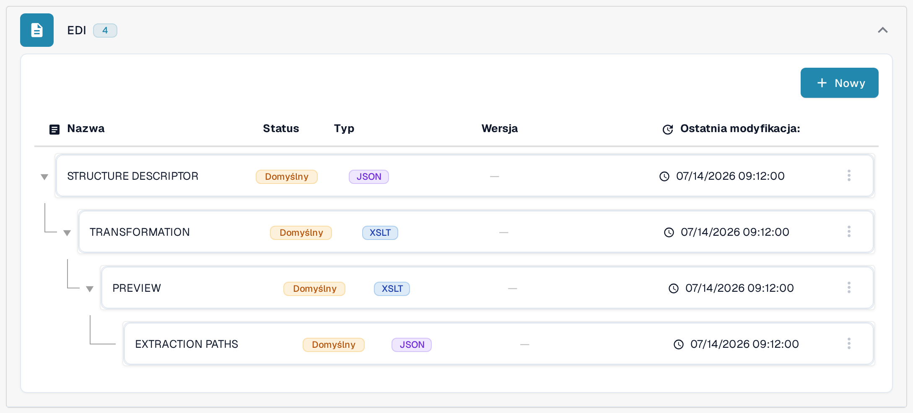

# Mapowania EDI

Strony mapowań EDI pokazują, jak pola DocBits odpowiadają polom typowych typów komunikatów EDI. Używaj ich jako odniesienia, gdy przygotowujesz lub sprawdzasz transformację dla typu dokumentu EDI; sposób konfiguracji EDI opisuje strona [Ustawienia EDI: Przegląd i Korzyści](../README.md).

Aby znaleźć hierarchię mapowań w bieżącej aplikacji:

1. Otwórz **Ustawienia → Typy dokumentów** i znajdź typ dokumentu, którego używasz dla dokumentu elektronicznego, na przykład **Faktura**. Przyciski na karcie i linki w jej stopce opisuje strona [Typy dokumentów](../../../README.md).
2. Wybierz **E-dokument** w stopce karty tego typu dokumentu. Następny widok grupuje dostępne części mapowania według formatu dokumentu elektronicznego.
3. Znajdź **EDI** na liście formatów i rozwiń grupę. Pokazana hierarchia zawiera [**STRUCTURE DESCRIPTOR**](../edi-structure-descriptor-file-guide/README.md), [**TRANSFORMATION**](../edi-transformation-file-guide.md), [**PREVIEW**](../edi-preview-file-guide.md) i [**EXTRACTION PATHS**](../edi-extraction-paths-file-guide.md); każdy link prowadzi do przewodnika po danym elemencie. Kolumny pokazują nazwę, status, typ, wersję oraz datę ostatniej modyfikacji (**Ostatnia modyfikacja:**) każdej części.

<figure><figcaption>
Wybierz E-dokument w stopce karty odpowiedniego typu dokumentu. Ten przykład pokazuje typ dokumentu Faktura w polskim interfejsie sandboxa z wymyślonymi danymi przykładowymi. Linki widoczne w stopce karty zależą od typu dokumentu, uprawnień i aktywowanych modułów.
</figcaption></figure>

<figure><figcaption>
Rozwinięta grupa EDI w polskim interfejsie sandboxa z wymyślonymi danymi przykładowymi, z typami JSON i XSLT. Plakietki Domyślny opisują pokazaną konfigurację przykładową; żadne mapowanie nie zostało zmienione i nie testowano wymiany EDI.
</figcaption></figure>

Otwórz stronę typu komunikatu, z którym pracujesz:

* [Mapowanie EDI 810 (Faktura)](edi-810-invoice-mapping.md)
* [Mapowanie EDI 850 (Zamówienie Zakupu)](edi-850-purchase-order-mapping.md)
* [Mapowanie EDI 855 (Potwierdzenie Zamówienia Zakupu)](edi-855-purchase-order-acknowledgement-mapping.md)
* [Mapowanie EDI 856 (Zawiadomienie o Wysyłce)](edi-856-advance-shipment-notice-mapping.md)

Sprawdź każde mapowanie z przewodnikiem wdrożeniowym swojego partnera i przetestuj je na reprezentatywnym pliku, zanim na nim polegasz.
