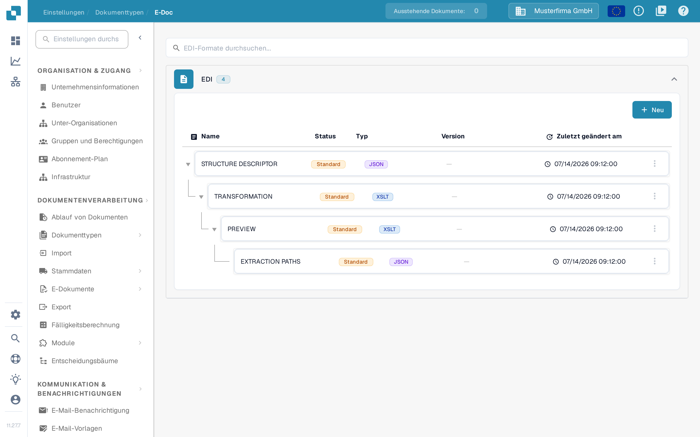

# EDI-Zuordnungen

Die Seiten zu den EDI-Zuordnungen zeigen, wie DocBits-Felder den Feldern gängiger EDI-Nachrichtentypen zugeordnet sind. Nutzen Sie sie als Referenz, wenn Sie die Transformation für einen EDI-Dokumenttyp vorbereiten oder prüfen. Wie EDI eingerichtet wird, lesen Sie unter [EDI-Einstellungen: Überblick & Vorteile](../README.md).

So finden Sie die Zuordnungshierarchie in der aktuellen Anwendung:

1. Öffnen Sie **Einstellungen → Dokumenttypen** und suchen Sie den Dokumenttyp, den Sie für das elektronische Dokument verwenden, zum Beispiel **Rechnung**. Die Schaltflächen auf der Karte und die Verknüpfungen in ihrer Fußzeile erklärt [Dokumenttypen](../../../README.md).
2. Wählen Sie in der Karte dieses Dokumenttyps **E-Doc**. Die nächste Ansicht gruppiert die verfügbaren Zuordnungsteile nach elektronischem Dokumentformat.
3. Suchen Sie in der Formatliste **EDI** und klappen Sie die Gruppe auf. Die angezeigte Hierarchie enthält [**STRUCTURE DESCRIPTOR**](../edi-structure-descriptor-file-guide/README.md), [**TRANSFORMATION**](../edi-transformation-file-guide.md), [**PREVIEW**](../edi-preview-file-guide.md) und [**EXTRACTION PATHS**](../edi-extraction-paths-file-guide.md); jeder Link führt zur Anleitung für den jeweiligen Teil. Die Spalten zeigen den Namen, den Status, den Typ, die Version und das Datum der letzten Änderung (Spalte **Zuletzt geändert am**).

<figure><figcaption>
Wählen Sie auf der Karte des passenden Dokumenttyps E-Doc. Dieses Beispiel zeigt den Dokumenttyp Rechnung in der deutschen Oberfläche der Sandbox mit erfundenen Beispieldaten. Welche Verknüpfungen in der Fußzeile erscheinen, hängt vom Dokumenttyp, den Berechtigungen und den aktivierten Modulen ab.
</figcaption></figure>

<figure><figcaption>
Die aufgeklappte EDI-Gruppe in der deutschen Oberfläche der Sandbox mit erfundenen Beispieldaten. Statusmarken und Datumswerte gehören zur dargestellten Beispielkonfiguration; es wurde keine Zuordnung bearbeitet und kein EDI-Austausch getestet.
</figcaption></figure>

Öffnen Sie die Seite für den Nachrichtentyp, mit dem Sie arbeiten:

* [EDI 810 (Rechnung) Mapping](edi-810-invoice-mapping.md)
* [EDI 850 (Bestellung) Mapping](edi-850-purchase-order-mapping.md)
* [EDI 855 (Bestellbestätigung) Mapping](edi-855-purchase-order-acknowledgement-mapping.md)
* [EDI 856 (Lieferavis) Mapping](edi-856-advance-shipment-notice-mapping.md)

Prüfen Sie jede Zuordnung gegen den Implementierungsleitfaden Ihres Partners und testen Sie sie mit einer repräsentativen Datei, bevor Sie sich darauf verlassen.
