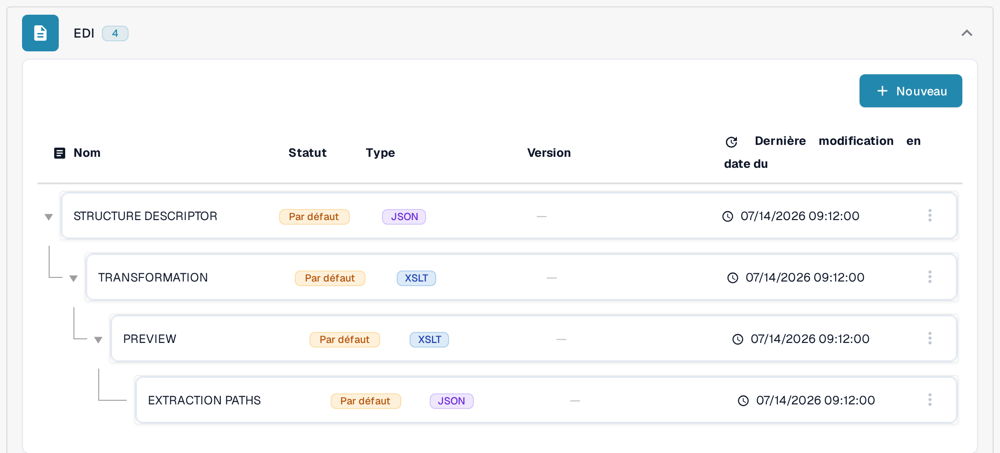

# Mappages EDI

Les pages de mappages EDI indiquent à quels champs des types de messages EDI courants correspondent les champs DocBits. Utilisez-les comme référence lorsque vous préparez ou vérifiez la transformation d'un type de document EDI ; la configuration générale est décrite dans [Paramètres EDI : Aperçu & Avantages](../README.md).

Pour retrouver la hiérarchie des mappages dans l'application actuelle :

1. Ouvrez **Paramètres → Types De Documents** et cherchez le type de document que vous utilisez pour le document électronique, par exemple **Facture**. Les boutons de la carte et les liens de son pied de carte sont expliqués dans [Types de documents](../../../README.md).
2. Sélectionnez **E-Doc** sur la carte de ce type de document. La vue suivante regroupe les éléments de mappage disponibles par format de document électronique.
3. Cherchez **EDI** dans la liste des formats et développez le groupe. La hiérarchie affichée contient [**STRUCTURE DESCRIPTOR**](../edi-structure-descriptor-file-guide/README.md), [**TRANSFORMATION**](../edi-transformation-file-guide.md), [**PREVIEW**](../edi-preview-file-guide.md) et [**EXTRACTION PATHS**](../edi-extraction-paths-file-guide.md) ; chaque lien mène au guide de l'élément correspondant. Les colonnes indiquent le nom, le statut, le type, la version et la date de la dernière modification (**Dernière modification en date du**).

<figure><figcaption>
Sélectionnez E-Doc sur la carte du type de document approprié. Cet exemple montre le type de document Facture dans l'interface française de la sandbox avec des données d'exemple inventées. Les liens visibles dans le pied de carte dépendent du type de document, des autorisations et des modules activés.
</figcaption></figure>

<figure><figcaption>
Le groupe EDI développé dans l'interface française de la sandbox avec des données d'exemple inventées. Les badges Par défaut et les dates décrivent la configuration d'exemple affichée ; aucun mappage n'a été modifié et aucun échange EDI n'a été testé.
</figcaption></figure>

Ouvrez la page du type de message avec lequel vous travaillez :

* [Mappage EDI 810 (Facture)](edi-810-invoice-mapping.md)
* [Mappage EDI 850 (Bon de commande)](edi-850-purchase-order-mapping.md)
* [Mappage EDI 855 (Accusé de réception de bon de commande)](edi-855-purchase-order-acknowledgement-mapping.md)
* [Mappage EDI 856 (Avis d'expédition)](edi-856-advance-shipment-notice-mapping.md)

Vérifiez chaque mappage par rapport au guide d'implémentation de votre partenaire et testez-le avec un fichier représentatif avant de vous y fier.
