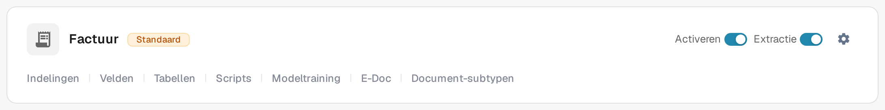
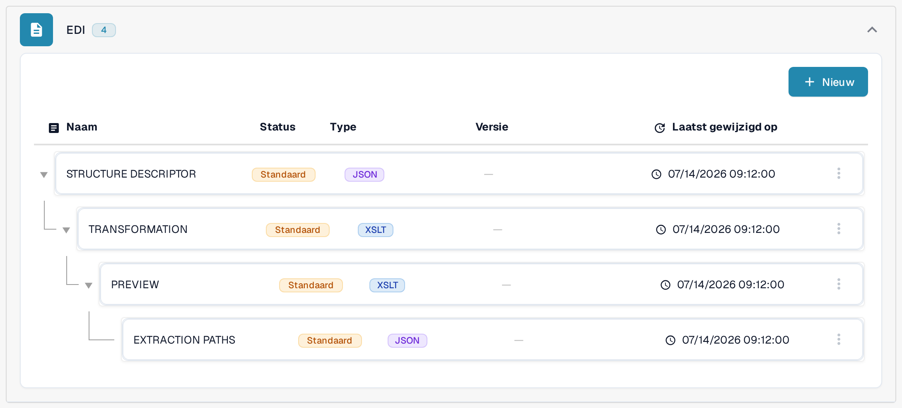

# EDI-mappings

De pagina's met EDI-mappings laten zien hoe velden van DocBits samenhangen met de velden van gangbare EDI-berichttypen. Gebruik ze als naslagwerk wanneer u de transformatie voor een EDI-documenttype voorbereidt of controleert; hoe EDI wordt ingesteld, staat in [EDI-instellingen: Overzicht & Voordelen](../README.md).

Om de mappinghiërarchie in de huidige applicatie te vinden:

1. Open **Instellingen → Documenttypen** en zoek het documenttype dat u voor het elektronische document gebruikt, bijvoorbeeld **Factuur**. De knoppen op de kaart en de links in de voettekst worden uitgelegd in [Documenttypen](../../../README.md).
2. Selecteer **E-Doc** op de kaart van dit documenttype. De volgende weergave groepeert de beschikbare mappingonderdelen per elektronisch documentformaat.
3. Zoek **EDI** in de lijst met indelingen en klap de groep uit. De getoonde hiërarchie bevat [**STRUCTURE DESCRIPTOR**](../edi-structure-descriptor-file-guide/README.md), [**TRANSFORMATION**](../edi-transformation-file-guide.md), [**PREVIEW**](../edi-preview-file-guide.md) en [**EXTRACTION PATHS**](../edi-extraction-paths-file-guide.md); elke link brengt u naar de handleiding van dat onderdeel. De kolommen tonen per onderdeel de naam, status, type, versie en de datum van de laatste wijziging (**Laatst gewijzigd op**).

<figure><figcaption>
Selecteer E-Doc op de kaart van het juiste documenttype. Dit voorbeeld toont het documenttype Factuur in de Nederlandse interface van de sandbox met verzonnen voorbeeldgegevens. Welke links in de voettekst zichtbaar zijn, hangt af van het documenttype, de rechten en de geactiveerde modules.
</figcaption></figure>

<figure><figcaption>
De uitgeklapte EDI-groep in de Nederlandse interface van de sandbox met verzonnen voorbeeldgegevens. De badges Standaard en de datums beschrijven de getoonde voorbeeldconfiguratie; er is geen mapping gewijzigd en er is geen EDI-uitwisseling getest.
</figcaption></figure>

Open de pagina van het berichttype waarmee u werkt:

* [EDI 810-factuurmapping](edi-810-invoice-mapping.md)
* [EDI 850-inkoopordermapping](edi-850-purchase-order-mapping.md)
* [EDI 855-mapping voor inkooporderbevestigingen](edi-855-purchase-order-acknowledgement-mapping.md)
* [EDI 856-mapping voor verzendberichten](edi-856-advance-shipment-notice-mapping.md)

Controleer elke mapping aan de hand van de implementatiehandleiding van uw zakenpartner en test met een representatief bestand voordat u erop vertrouwt.
