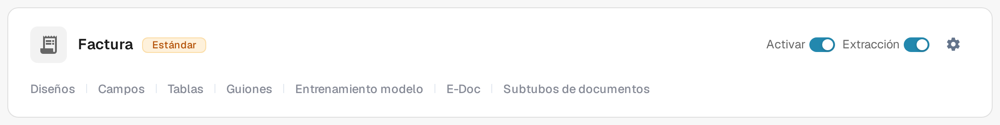
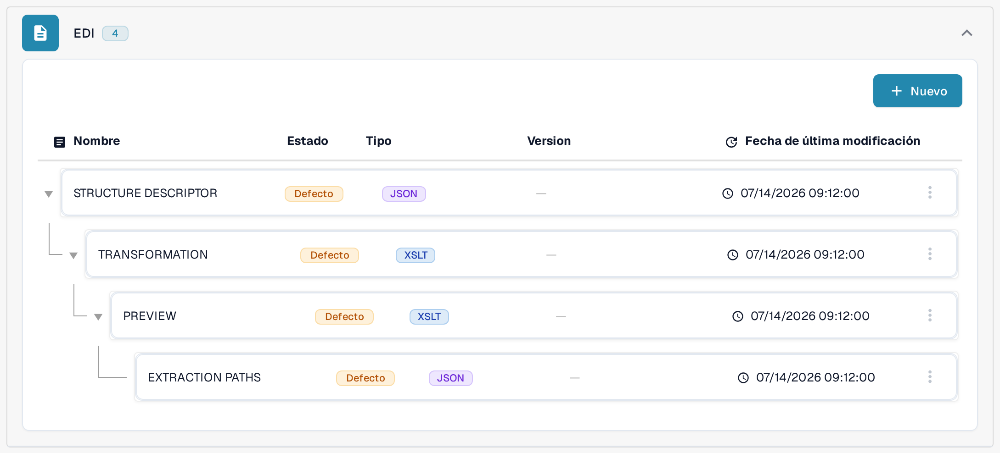

# Mapeos EDI

Las páginas de mapeos EDI muestran cómo se relacionan los campos de DocBits con los campos de los tipos de mensaje EDI habituales. Úselas como referencia cuando prepare o revise la transformación de un tipo de documento EDI; en [Configuración de EDI: Visión general y beneficios](../README.md) se explica cómo se configura EDI.

Para encontrar la jerarquía de mapeos en la aplicación actual:

1. Abra **Ajustes → Tipos de Documento** y busque el tipo de documento que usa para el documento electrónico, por ejemplo **Factura**.
2. Seleccione **E-Doc** en la tarjeta de ese tipo de documento. La vista siguiente agrupa las partes de mapeo disponibles por formato de documento electrónico.
3. Busque **EDI** en la lista de formatos y despliegue el grupo. La jerarquía ilustrada contiene **Structure Descriptor**, **Transformation**, **Preview** y **Extraction Paths**. Las columnas muestran el nombre, el estado, el tipo, la versión y la fecha de la última modificación de cada parte.

<figure><figcaption>Seleccione E-Doc en la tarjeta del tipo de documento correspondiente. Este ejemplo usa Factura en el entorno de pruebas en español.</figcaption></figure>

<figure><figcaption>El grupo EDI desplegado en el entorno de pruebas en español. Los distintivos «Defecto» describen la configuración de prueba mostrada; no se editó ningún mapeo ni se probó un intercambio EDI.</figcaption></figure>

Los nombres de las partes del mapeo y algunas etiquetas, como Version, siguen apareciendo en inglés en la interfaz actual del producto.

Abra la página del tipo de mensaje con el que trabaja:

* [Mapeo EDI 810 (Factura)](edi-810-invoice-mapping.md)
* [Mapeo EDI 850 (Orden de Compra)](edi-850-purchase-order-mapping.md)
* [Mapeo EDI 855 (Acuse de Recibo de Orden de Compra)](edi-855-purchase-order-acknowledgement-mapping.md)
* [Mapeo EDI 856 (Aviso de Envío Anticipado)](edi-856-advance-shipment-notice-mapping.md)

Compruebe cada mapeo con la guía de implementación de su socio y pruébelo con un archivo representativo antes de confiar en él.
