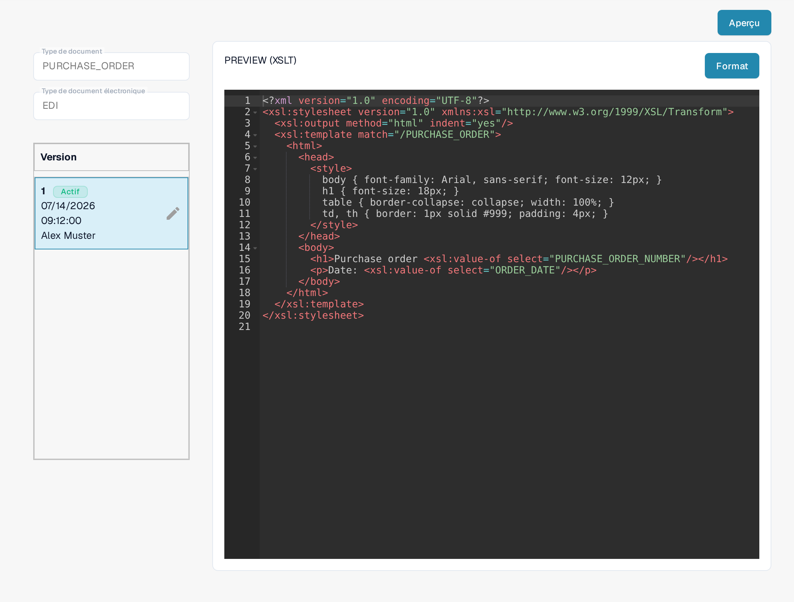

# Guide de fichier d'aperçu EDI

Le fichier **PREVIEW** détermine comment un document EDI structuré est affiché pour qu'une personne puisse le lire. Dans DocBits, il s'agit d'une configuration **XSLT**, distincte de la correspondance JSON **EXTRACTION PATHS**. Ce guide s'adresse aux personnes qui gèrent les formats de documents électroniques pour leur organisation.

## Trouver le fichier d'aperçu

1. Allez dans **Paramètres → Types de Documents** et ouvrez **E-Doc** pour le type de document concerné.
2. Dépliez le format électronique, par exemple **EDI** pour les factures.
3. Sélectionnez la ligne **PREVIEW** de type **XSLT**. Ne cliquez pas encore sur **Aperçu** : ce bouton ouvre un panneau de test une fois la configuration en place.

<figure><figcaption>Choisissez la ligne PREVIEW de type XSLT dans la liste EDI.</figcaption></figure>

## Comprendre l'éditeur et les versions

La page de détail affiche à gauche le **Type de document**, le **Type de document électronique** et la section **Version** avec les versions disponibles. **Actif** indique la version actuellement utilisée. L'éditeur situé à droite contient une feuille de style XSLT. Son HTML et son CSS contrôlent la mise en page et l'apparence ; le XSLT insère les valeurs du document structuré. **Format** réorganise le code source pour la lecture et n'active aucune version.

<figure><figcaption>Vue de détail d'une configuration d'aperçu : à gauche le type de document, le type de document électronique et les versions, à droite la feuille de style XSLT.</figcaption></figure>

Le crayon à côté de la version active crée un **brouillon** pour les modifications. Une fois vos changements vérifiés, activez le brouillon avec sa coche. Une version activée remplace la précédente. L'icône de corbeille n'apparaît sur un brouillon que s'il existe plus d'une version ; n'y supprimez qu'un brouillon inutile.

## Tester un aperçu

Cliquez sur **Aperçu** en haut à droite pour ouvrir un panneau de test. Saisissez dans le champ **Document Id...** l'identifiant d'un document EDI importé, puis cliquez sur **Test**. Vérifiez le document affiché : les libellés, les valeurs et les lignes du tableau sont-ils lisibles ? L'image montre le panneau de test avec un identifiant d'exemple fictif ; aucun résultat de test rendu n'y figure.

<figure><figcaption>Testez une version d'aperçu avant son activation avec l'identifiant d'un document EDI importé ; l'identifiant affiché est un exemple fictif.</figcaption></figure>

Pour la correspondance entre les champs et le XML, utilisez le [Guide du fichier des chemins d'extraction EDI](edi-extraction-paths-file-guide.md). Pour l'étape de conversion de la source, consultez le [Guide de fichier de transformation EDI](edi-transformation-file-guide.md). La page [Vidéos EDI](edi-videos.md) propose une démonstration pas à pas.

Ces vues montrent une configuration et une version existantes. Les paramètres varient selon le type de document et le format. Validez les modifications dans un brouillon avant leur activation.
