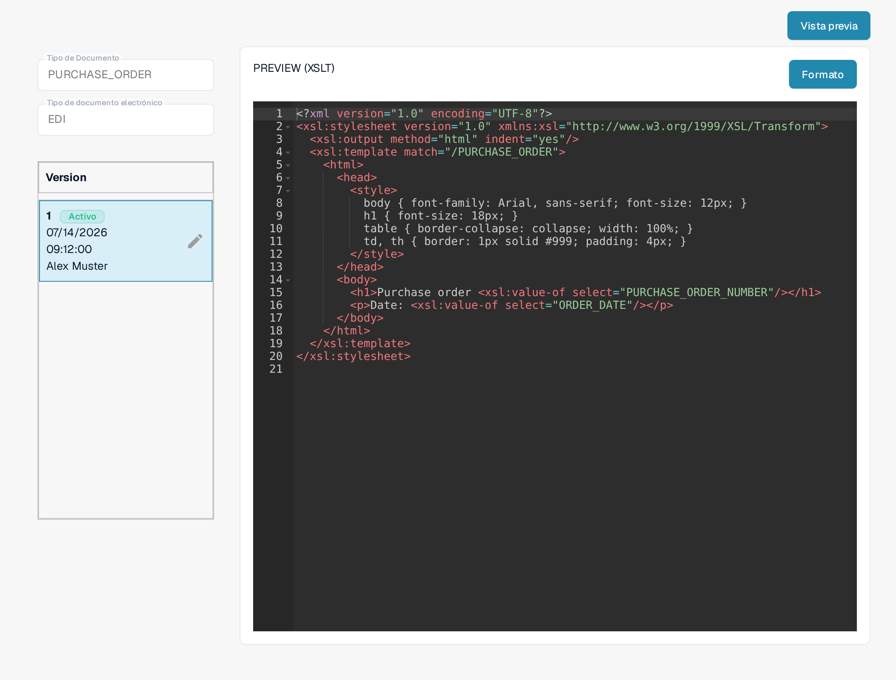
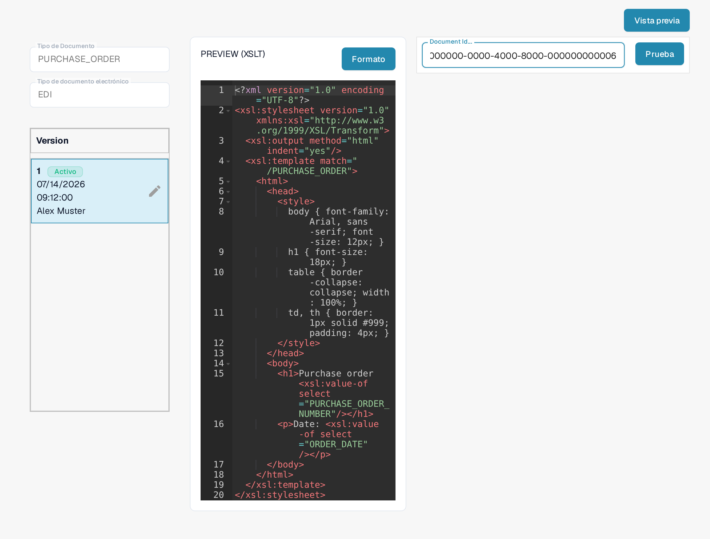

# Guía de Archivo de Vista Previa EDI

El archivo **PREVIEW** determina cómo se muestra un documento EDI estructurado para que una persona pueda leerlo. En DocBits es una configuración **XSLT**, independiente de la asignación JSON **EXTRACTION PATHS**. Esta guía se dirige a las personas que mantienen los formatos de documentos electrónicos de su organización.

## Encontrar el archivo de vista previa

1. Vaya a **Ajustes → Tipos De Documento** y abra **E-Doc** para el tipo de documento correspondiente.
2. Despliegue el formato electrónico, por ejemplo **EDI**.
3. Seleccione la fila **PREVIEW** con el tipo **XSLT**. Todavía no pulse **Vista previa**; ese botón abre un panel de prueba una vez introducida la configuración.

<figure><figcaption>En la lista EDI, seleccione la fila PREVIEW con el tipo XSLT.</figcaption></figure>

## Entender el editor y las versiones

La página de detalle muestra a la izquierda los campos **Tipo de Documento**, **Tipo de documento electrónico** y las **Version**es existentes. **Activo** marca la versión que se está usando. El editor de la derecha contiene una hoja de estilo XSLT. Su HTML y CSS controlan el diseño y el aspecto; XSLT inserta valores del documento estructurado. **Formato** ordena el código fuente para leerlo y no activa ninguna versión.

<figure><figcaption>Detalle de una configuración de vista previa: a la izquierda el tipo de documento, el tipo de documento electrónico y las versiones; a la derecha la hoja de estilo XSLT.</figcaption></figure>

El icono del lápiz junto a la versión activa crea un **borrador** para los cambios. Cuando haya comprobado sus cambios, active el borrador con la marca de verificación. Una versión activada sustituye a la anterior. El icono de la papelera aparece en cuanto existe más de una versión; utilícelo solo para eliminar un borrador no deseado.

## Probar una vista previa

Pulse **Vista previa** arriba a la derecha para abrir el panel de prueba. Introduzca en el campo **Document Id...** el ID de un documento EDI ya cargado y pulse **Prueba**. Revise la vista previa mostrada: ¿se leen bien las etiquetas, los valores y las filas de la tabla? La imagen muestra el panel de prueba con un ID de ejemplo inventado; no se muestra un resultado renderizado.

<figure><figcaption>Pruebe una versión de vista previa antes de activarla con el ID de un documento EDI ya cargado; el ID mostrado es un ejemplo inventado.</figcaption></figure>

Para la asignación de campos al XML, utilice la [Guía de Archivos de Rutas de Extracción EDI](edi-extraction-paths-file-guide.md). El paso de conversión del origen se describe en la [Guía de Archivo de Transformación EDI](edi-transformation-file-guide.md). Una demostración paso a paso ofrece la página [Videos EDI](edi-videos.md).

Las vistas muestran una configuración y una versión existentes. Los ajustes varían según el tipo de documento y el formato. Compruebe los cambios en un borrador antes de activarlos.
