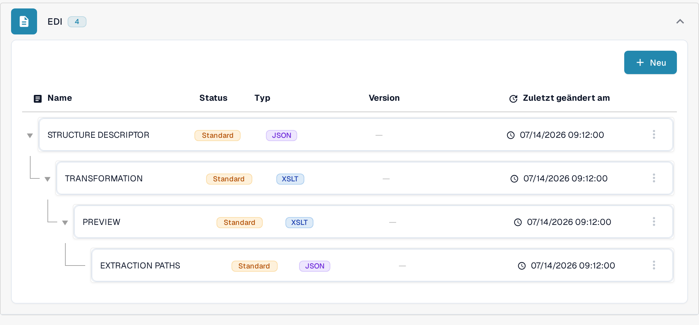
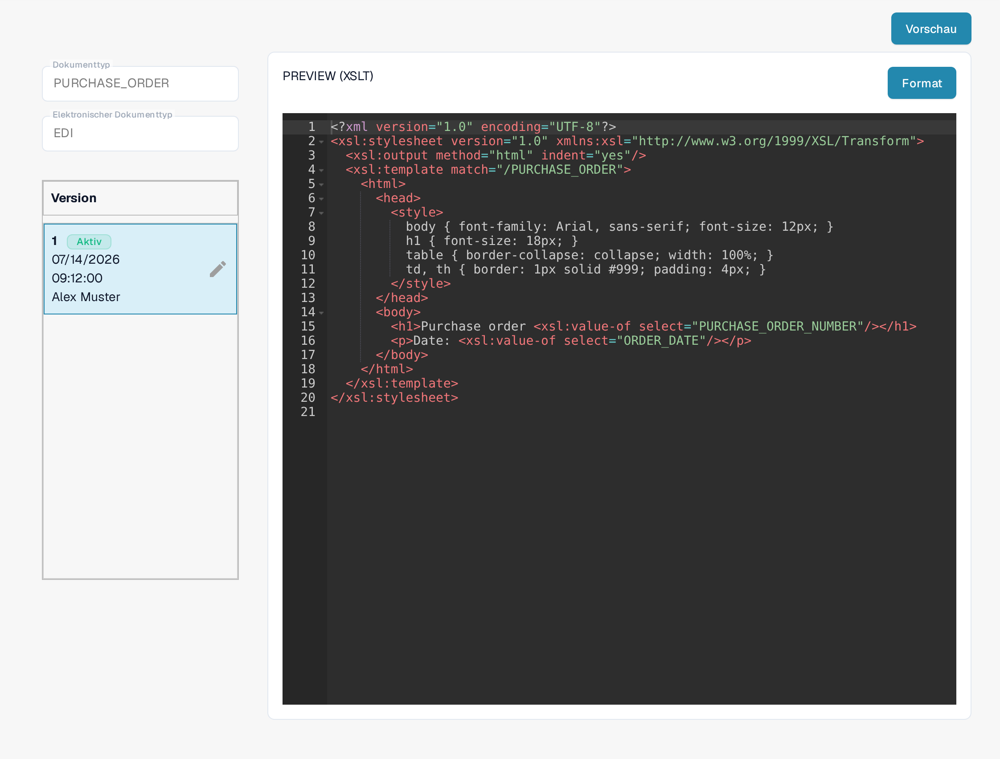

# EDI-Vorschau-Datei-Leitfaden

Die **PREVIEW**-Datei bestimmt, wie ein strukturiertes EDI-Dokument für Menschen lesbar angezeigt wird. In DocBits ist sie eine **XSLT**-Konfiguration und getrennt von der JSON-Zuordnung **EXTRACTION PATHS**. Dieser Leitfaden richtet sich an Personen, die elektronische Dokumentformate für ihre Organisation pflegen.

## Vorschau-Datei finden

1. Gehen Sie zu **Einstellungen → Dokumenttypen** und öffnen Sie **E-Doc** für den betreffenden Dokumenttyp.
2. Klappen Sie den Bereich des elektronischen Formats auf, zum Beispiel **EDI**.
3. Wählen Sie die Zeile **PREVIEW** mit dem Typ **XSLT**. Klicken Sie noch nicht auf **Vorschau**; diese Schaltfläche öffnet erst dann einen Testbereich, wenn die Konfiguration eingetragen ist.

<figure><figcaption>Wählen Sie in der EDI-Liste die Zeile PREVIEW mit dem Typ XSLT.</figcaption></figure>

## Editor und Versionen verstehen

Die Detailseite zeigt links die Felder **Dokumenttyp**, **Elektronischer Dokumenttyp** und die vorhandenen **Versionen**. **Aktiv** kennzeichnet die derzeit verwendete Version. Der Editor rechts enthält ein XSLT-Stylesheet. Sein HTML und CSS steuern Layout und Aussehen; XSLT fügt Werte aus dem strukturierten Dokument ein. **Format** ordnet den Quelltext zum Lesen und aktiviert keine Version.

<figure><figcaption>Detailansicht einer Vorschau-Konfiguration: links Dokumenttyp, elektronischer Dokumenttyp und Versionen, rechts das XSLT-Stylesheet.</figcaption></figure>

Das Stiftsymbol neben der aktiven Version erstellt einen **Entwurf** für Änderungen. Wenn Sie Ihre Änderungen geprüft haben, aktivieren Sie den Entwurf über das Häkchen. Eine aktivierte Version ersetzt die bisher aktive. Das Papierkorb-Symbol erscheint, sobald mehr als eine Version vorhanden ist; löschen Sie damit nur einen unerwünschten Entwurf.

## Vorschau testen

Klicken Sie rechts oben auf **Vorschau**, um den Testbereich zu öffnen. Geben Sie im Feld **Document Id...** die Dokument-ID eines hochgeladenen EDI-Dokuments ein und klicken Sie auf **Test**. Prüfen Sie die angezeigte Vorschau: Sind Beschriftungen, Werte und Tabellenzeilen lesbar? Die Abbildung zeigt den Testbereich mit einer erfundenen Beispiel-ID; ein gerendertes Testergebnis ist nicht dargestellt.

<figure><figcaption>Testen Sie eine Vorschau-Version vor der Aktivierung mit der Dokument-ID eines hochgeladenen EDI-Dokuments; die gezeigte ID ist ein erfundenes Beispiel.</figcaption></figure>

Für die Zuordnung von Feldern zum XML verwenden Sie den [Leitfaden für Extraktionspfade](edi-extraction-paths-file-guide.md). Den Schritt der Quellumwandlung beschreibt die [Anleitung zur Transformation](edi-transformation-file-guide.md). Eine Schritt-für-Schritt-Vorführung bietet die Seite [EDI-Videos](edi-videos.md).

Die Ansichten zeigen eine vorhandene Konfiguration und Version. Die Einstellungen unterscheiden sich je nach Dokumenttyp und Format. Prüfen Sie Änderungen in einem Entwurf vor der Aktivierung.
