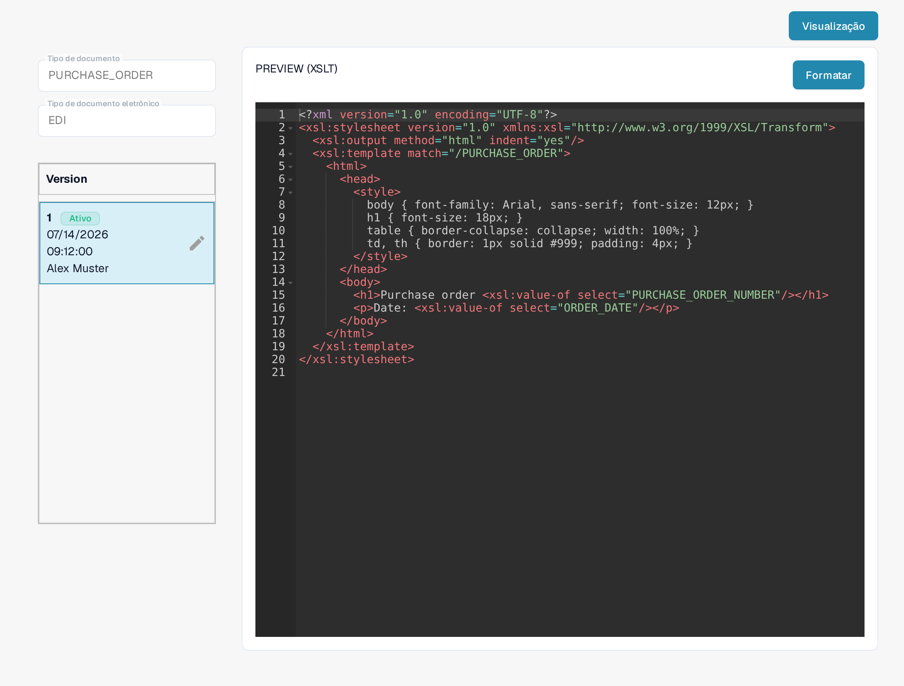
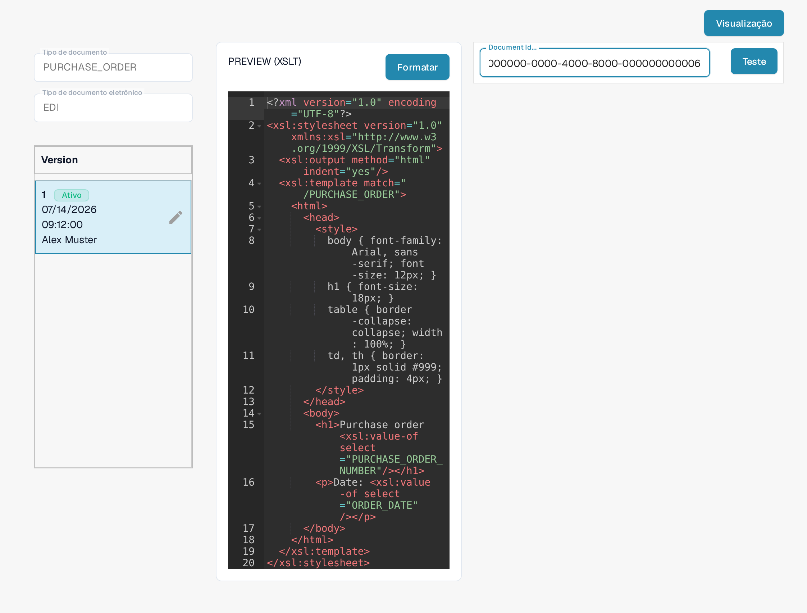

# Guia do Arquivo de Pré-visualização EDI

O arquivo **PREVIEW** controla como um documento EDI estruturado é exibido para que uma pessoa possa lê-lo. No DocBits ele é uma configuração **XSLT**, separada do mapeamento JSON **EXTRACTION PATHS**. Use este guia se você mantém formatos de documentos eletrônicos para a sua organização.

## Encontrar o arquivo de pré-visualização

1. Vá para **Configurações → Tipos de documentos** e abra **E-Doc** para o tipo de documento desejado.
2. Expanda o formato eletrônico, por exemplo **EDI** para o tipo de documento **PURCHASE_ORDER** mostrado abaixo.
3. Selecione a linha **PREVIEW** marcada como **XSLT**. Não clique ainda no botão **Visualização**: esse botão abre um painel de teste depois que você informa a configuração.

<figure><figcaption>
Escolha PREVIEW (XSLT) na lista E-Doc.
</figcaption></figure>

## Entender o editor e as versões

A página de detalhes mostra à esquerda o **Tipo de documento**, o **Tipo de documento eletrônico** e a lista **Version** com as versões disponíveis. **Ativo** indica a versão em uso. O editor à direita contém a folha de estilo XSLT. O HTML e o CSS controlam o layout e a aparência; o XSLT insere os valores do documento estruturado. **Formatar** organiza o código-fonte para leitura e não ativa uma versão.

<figure><figcaption>
Configuração PREVIEW (XSLT) do tipo de documento PURCHASE_ORDER, com a versão ativa em modo somente leitura.
</figcaption></figure>

O ícone de lápis ao lado da versão ativa cria um **rascunho** para edição. Depois de conferir as alterações, ative o rascunho com o ícone de confirmação. A versão ativada substitui a anterior. O ícone de lixeira aparece apenas quando existe mais de uma versão; use-o somente para excluir um rascunho que não é mais necessário.

## Testar uma pré-visualização

Clique em **Visualização** no canto superior direito para abrir o painel de teste. Informe no campo **Document Id...** o ID de um documento EDI já carregado e clique em **Teste**. Confira o documento exibido para verificar se rótulos, valores e linhas de tabela estão legíveis. Na interface em português o campo mantém o rótulo **Document Id...**, como no aplicativo.

<figure><figcaption>
Painel de teste aberto: o campo contém um ID de exemplo inventado (visível apenas no final, 000000-0000-4000-8000-000000000006) e ainda não há resultado renderizado.
</figcaption></figure>

Para o mapeamento entre campos e XML, use o [Guia do Arquivo de Caminhos de Extração](edi-extraction-paths-file-guide.md). Para a etapa de conversão da origem, consulte o [Guia do Arquivo de Transformação](edi-transformation-file-guide.md). O [guia em vídeo do EDI](edi-videos.md) traz uma demonstração passo a passo.

As telas mostram uma configuração e uma versão existentes. As definições variam conforme o tipo de documento e o formato. Valide as alterações em um rascunho antes de ativá-las.
