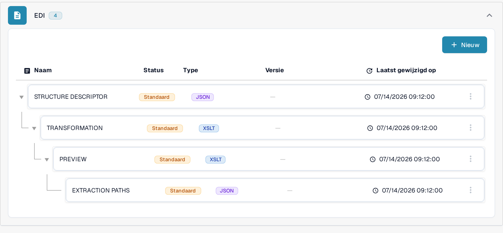
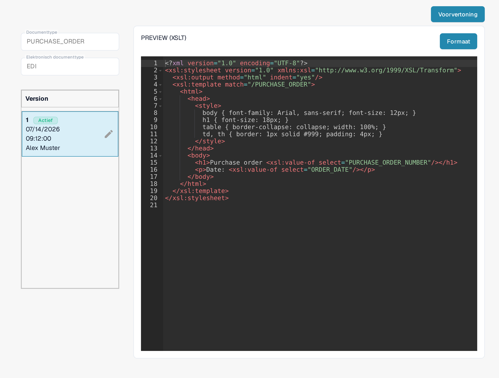

# EDI Voorbeeldbestand Gids

Het **PREVIEW**-bestand bepaalt hoe een gestructureerd EDI-document leesbaar voor mensen wordt weergegeven. In DocBits is het een **XSLT**-configuratie, los van de JSON-toewijzing **EXTRACTION PATHS**. Gebruik deze gids als u elektronische documentformaten voor uw organisatie beheert.

## Het voorbeeldbestand vinden

1. Ga naar **Instellingen → Documenttypen** en open **E-Doc** voor het betreffende documenttype.
2. Vouw het elektronische formaat uit, bijvoorbeeld **EDI**.
3. Selecteer de regel **PREVIEW** met het type **XSLT**. Klik nog niet op **Voorvertoning**; die knop opent pas een testpaneel als de configuratie is ingevuld.

<figure><figcaption>Kies in de EDI-lijst de regel PREVIEW met het type XSLT.</figcaption></figure>

## De editor en versies begrijpen

De detailpagina toont links de velden **Documenttype** en **Elektronisch documenttype** en daaronder het blok **Version** met de beschikbare versies. **Actief** markeert de versie die nu wordt gebruikt. De editor rechts bevat een XSLT-stylesheet. De HTML en CSS daarin bepalen de opmaak en het uiterlijk; XSLT voegt waarden uit het gestructureerde document in. Met **Formaat** zet u de brontekst leesbaar uiteen; dat activeert geen versie.

<figure><figcaption>Detailweergave van een voorbeeldconfiguratie: links documenttype, elektronisch documenttype en versies, rechts het XSLT-stylesheet.</figcaption></figure>

Het potloodpictogram naast de actieve versie maakt een **concept** voor wijzigingen. Als u uw wijzigingen hebt gecontroleerd, activeert u het concept met het vinkje. Een geactiveerde versie vervangt de vorige actieve versie. Verwijder alleen een ongewenst concept, met het prullenbakpictogram.

## Een voorbeeld testen

Klik rechtsboven op **Voorvertoning** om het testpaneel te openen. Voer in het veld **Document Id...** de document-ID van een geüpload EDI-document in en klik op **Test**. Controleer de weergegeven voorvertoning: zijn de labels, waarden en tabelrijen leesbaar? De afbeelding toont het testpaneel met een verzonnen voorbeeld-ID; een gerenderd resultaat is niet weergegeven.

<figure><figcaption>Test een voorbeeldversie vóór activering met de document-ID van een geüpload EDI-document; de getoonde ID is een verzonnen voorbeeld.</figcaption></figure>

Voor het toewijzen van velden aan de XML gebruikt u de [gids voor extractiepaden](edi-extraction-paths-file-guide.md). De stap van de bronconversie staat in de [gids voor transformatie](edi-transformation-file-guide.md). Een stap-voor-stap uitleg biedt de pagina [EDI-video's](edi-videos.md).

De weergaven tonen een bestaande configuratie en versie. De instellingen verschillen per documenttype en formaat. Controleer wijzigingen in een concept voordat u activeert.
