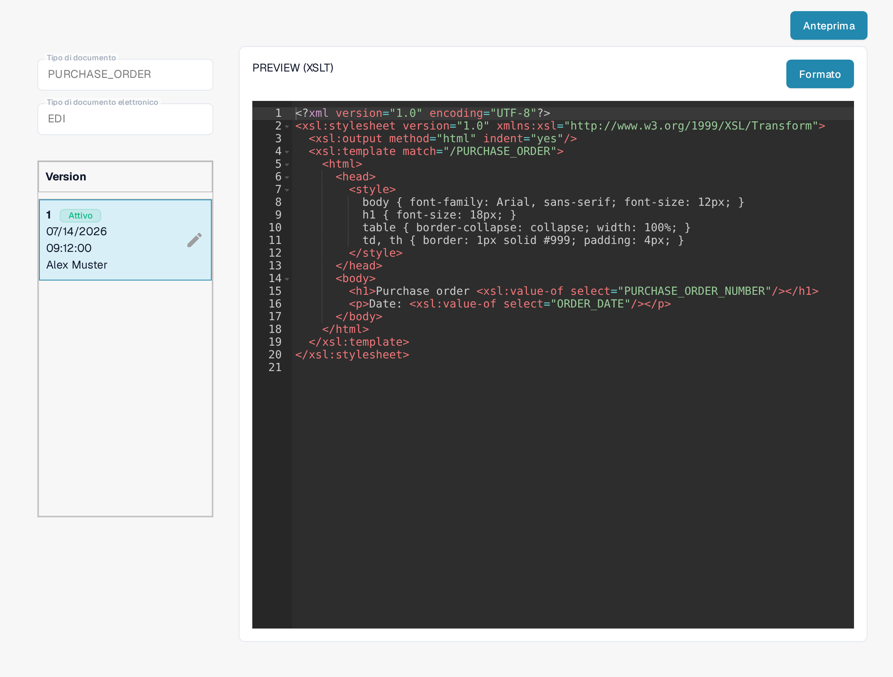

# Guida al File Anteprima EDI

Il file **PREVIEW** stabilisce come un documento EDI strutturato viene mostrato a una persona per la lettura. In DocBits è una configurazione **XSLT**, separata dalla mappatura JSON **EXTRACTION PATHS**. Questa guida si rivolge a chi gestisce i formati di documento elettronici per la propria organizzazione.

## Trovare il file di anteprima

1. Andare in **Impostazioni → Tipi Di Documento** e aprire **E-Doc** per il tipo di documento interessato.
2. Espandere il formato elettronico, per esempio **EDI**.
3. Selezionare la riga **PREVIEW** di tipo **XSLT**. Non fare ancora clic su **Anteprima**: quel pulsante apre un pannello di test solo dopo che la configurazione è stata inserita.

<figure><figcaption>Scegliere nell'elenco EDI la riga PREVIEW di tipo XSLT.</figcaption></figure>

## Capire l'editor e le versioni

La pagina di dettaglio mostra a sinistra **Tipo di documento**, **Tipo di documento elettronico** e le **Version** disponibili. **Attivo** contrassegna la versione attualmente in uso. L'editor a destra contiene un foglio di stile XSLT. Il suo HTML e CSS controllano impaginazione e aspetto; XSLT inserisce i valori dal documento strutturato. **Formato** dispone il codice sorgente per la lettura e non attiva alcuna versione.

<figure><figcaption>Vista di dettaglio di una configurazione di anteprima: a sinistra tipo di documento, tipo di documento elettronico e versioni, a destra il foglio di stile XSLT.</figcaption></figure>

La matita accanto alla versione attiva crea una **bozza** per le modifiche. Dopo aver controllato le modifiche, attivare la bozza con il segno di spunta. Una versione attivata sostituisce quella attiva in precedenza. Eliminare con l'icona del cestino solo una bozza indesiderata.

## Provare un'anteprima

Fare clic su **Anteprima** in alto a destra per aprire il pannello di test. Inserire nel campo **Document Id...** l'ID di un documento EDI caricato e fare clic su **Test**. Controllare l'anteprima mostrata: le etichette, i valori e le righe della tabella sono leggibili? L'immagine mostra il pannello di test con un ID di esempio inventato; non mostra alcun risultato di test renderizzato.

<figure><figcaption>Provare una versione di anteprima prima dell'attivazione con l'ID di un documento EDI caricato; l'ID mostrato è un esempio inventato.</figcaption></figure>

Per la mappatura dei campi verso il XML, usare la [Guida al File dei Percorsi di Estrazione EDI](edi-extraction-paths-file-guide.md). Per il passaggio di conversione del sorgente, vedere la [Guida al File di Trasformazione EDI](edi-transformation-file-guide.md). La pagina [Video EDI](edi-videos.md) offre una dimostrazione passo a passo.

Le viste mostrano una configurazione e una versione già esistenti. Le impostazioni variano in base al tipo di documento e al formato. Convalidare le modifiche in una bozza prima dell'attivazione.

Nell'interfaccia illustrata il titolo **Version** del riquadro delle versioni e il campo **Document Id...** restano in inglese; i nomi tecnici degli attributi e il codice di configurazione restano invariati.
