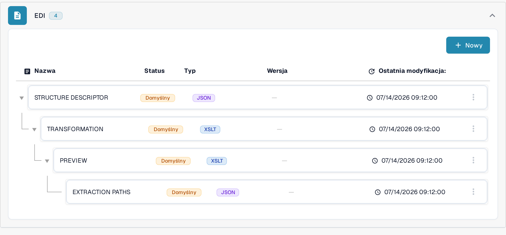
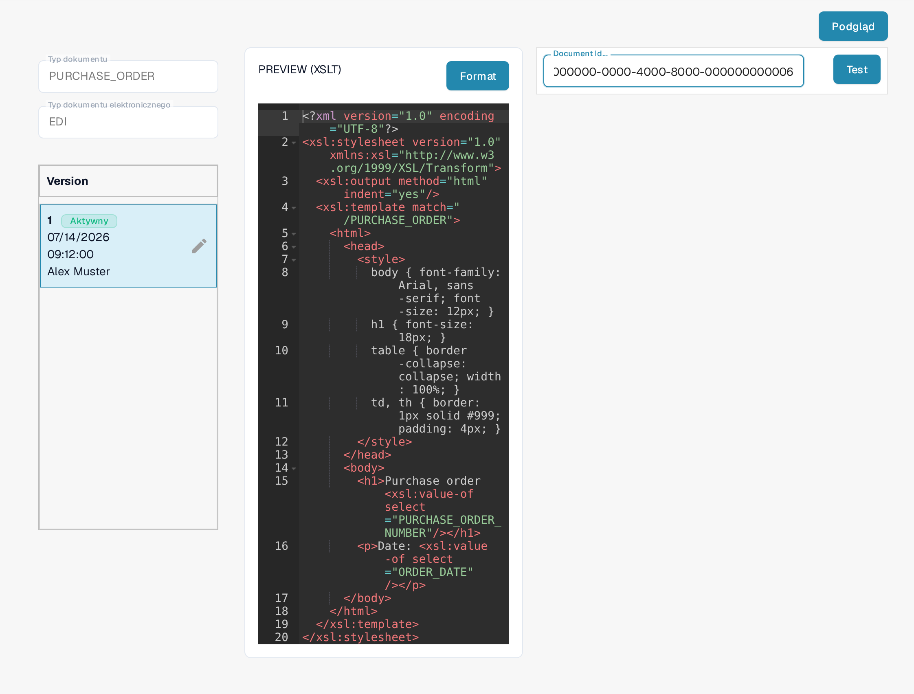

# Przewodnik pliku podglądu EDI

Plik **PREVIEW** określa, w jaki sposób ustrukturyzowany dokument EDI jest wyświetlany osobie, która go czyta. W DocBits jest to konfiguracja **XSLT**, oddzielona od mapowania JSON **EXTRACTION PATHS**. Skorzystaj z tego przewodnika, jeśli w swojej organizacji utrzymujesz elektroniczne formaty dokumentów.

## Znajdź plik podglądu

1. Przejdź do **Ustawienia → Typy Dokumentów** i otwórz **E-Doc** dla odpowiedniego typu dokumentu.
2. Rozwiń format elektroniczny, na przykład **EDI** dla wybranego typu dokumentu.
3. Wybierz wiersz **PREVIEW** oznaczony jako **XSLT**. Nie klikaj jeszcze przycisku **Podgląd**: otwiera on panel testowy dopiero po wprowadzeniu konfiguracji. Przycisk **Nowy** otwiera formularz nowego atrybutu EDI.

<figure><figcaption>Wybierz na liście EDI wiersz PREVIEW typu XSLT.</figcaption></figure>

## Poznaj edytor i wersje

Strona szczegółów pokazuje po lewej stronie pola **Typ dokumentu** i **Typ dokumentu elektronicznego** oraz dostępne wersje w sekcji **Version**. Oznaczenie **Aktywny** wskazuje wersję obecnie używaną. Edytor po prawej zawiera arkusz stylów XSLT. Jego HTML i CSS odpowiadają za układ i wygląd, a XSLT wstawia wartości z ustrukturyzowanego dokumentu. Przycisk **Format** porządkuje kod źródłowy do czytania i nie aktywuje żadnej wersji.

<figure><figcaption>Szczegóły E-Dokumentu: po lewej typ dokumentu, typ dokumentu elektroniczny i wersje, po prawej arkusz stylów XSLT.</figcaption></figure>

Ołówek obok aktywnej wersji tworzy **wersję roboczą** do edycji. Po sprawdzeniu zmian aktywuj wersję roboczą ikoną zaznaczenia. Aktywowana wersja zastępuje poprzednio aktywną. Ikoną kosza usuwaj tylko niepotrzebną wersję roboczą.

## Przetestuj podgląd

Kliknij przycisk **Podgląd** w prawym górnym rogu, aby otworzyć panel testowy. W polu **Document Id...** wpisz ID wgranego dokumentu EDI i kliknij **Test**. Sprawdź wyświetlony dokument: czy etykiety, wartości i wiersze tabeli można odczytać. Ilustracja pokazuje panel testowy z wymyślonym przykładowym ID; nie pokazuje żadnego wyrenderowanego wyniku testu.

<figure><figcaption>Przetestuj wersję podglądu przed aktywacją, podając ID wgranego dokumentu EDI; widoczne ID to wymyślony przykład.</figcaption></figure>

Do mapowania pól na XML użyj [przewodnika po pliku ścieżek ekstrakcji EDI](edi-extraction-paths-file-guide.md). Etap konwersji źródła opisuje [przewodnik po pliku transformacji EDI](edi-transformation-file-guide.md). Na stronie [Filmy EDI](edi-videos.md) znajdziesz demonstrację krok po kroku.

Widoki przedstawiają istniejącą konfigurację i wersję. Ustawienia zależą od typu dokumentu i formatu. Zmiany sprawdź w wersji roboczej przed aktywacją. W pokazanym interfejsie nagłówek **Version** karty wersji oraz pole **Document Id...** pozostają po angielsku; techniczne nazwy atrybutów i kod konfiguracji pozostają w oryginalnej postaci.
