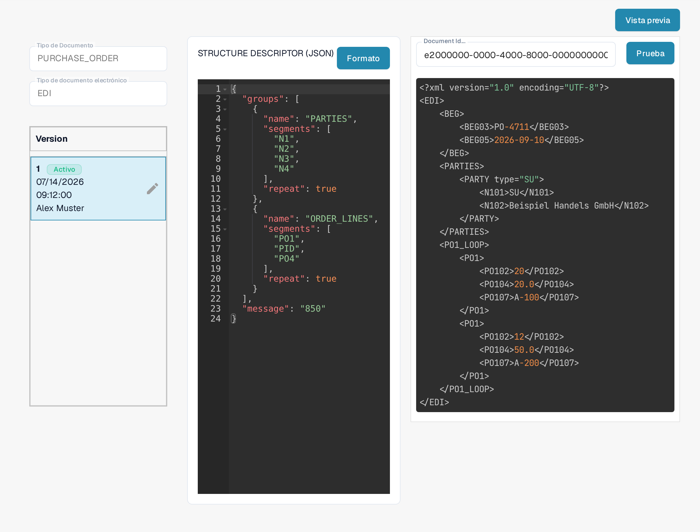

# Guía del archivo Structure Descriptor de EDI

## 1. Descripción general

El **archivo Structure Descriptor** es un archivo **JSON** que define cómo se agrupan los segmentos EDI repetidos (por ejemplo `N1`–`N4`) en una salida estructurada. Es el primer paso del procesamiento EDI:

* **Análisis preciso** de los segmentos relacionados como unidades individuales.
* **Salida consistente** para la [Transformation](../edi-transformation-file-guide.md) y los sistemas posteriores.

_Encontrará un ejemplo completo con el detalle de los segmentos en_ [_Structure Descriptor Example_](edi-structure-descriptor.md)_._

## 2. Acceso y edición básica

#### **Acceso al archivo**

1. Vaya a **Ajustes** → **Tipos de Documento** y abra **E-Doc** para el tipo de documento que desea configurar (en la captura, **PURCHASE_ORDER**). Necesita acceso de administrador en su organización para editar estos archivos.

    <figure><figcaption>Abra E-Doc para su tipo de documento; el formato EDI enumera sus archivos de configuración.</figcaption></figure>

2. Despliegue el formato **EDI**. Sus archivos de configuración aparecen juntos: **STRUCTURE DESCRIPTOR**, **TRANSFORMATION**, **PREVIEW** y **EXTRACTION PATHS**. La columna **Estado** muestra **Defecto** en los archivos que DocBits utiliza mientras no active una versión propia.
3. Haga clic en la fila **STRUCTURE DESCRIPTOR**, marcada como **JSON**, para abrirla.

Si necesita otro archivo de configuración para el mismo formato EDI, use **Nuevo** encima de la lista e indique el nombre del atributo.

#### **Gestión de borradores**

La columna izquierda muestra la lista **Version** del archivo. La versión marcada como **Activo** es la que utiliza DocBits.

* **Crear un borrador**: haga clic en el icono de lápiz ✏️ que está junto a la versión activa para empezar a editar. El archivo activo no se puede editar directamente.
* **Eliminar borradores**: utilice el icono de papelera 🗑️ para quitar los borradores que no utilice.
* **Activar cambios**: haga clic en el icono de marca de verificación ✅ de un borrador para aprobar y publicar los cambios.
  * <mark style="color:red;">**Nota**</mark>: al activar una versión nueva, la anterior se **desactiva automáticamente**.

<figure><figcaption>El archivo Structure Descriptor con su lista de versiones; el lápiz crea un borrador que puede editar.</figcaption></figure>

Con **Formato** se vuelve a ordenar y sangrar el código del editor para leerlo mejor; los datos del archivo no cambian.

## 3. Función Vista previa (salida analizada)

La **función Vista previa** le permite comprobar cómo se analiza un archivo EDI cargado con el Structure Descriptor que se muestra en ese momento, antes de activar cualquier cambio.

#### Uso

* Cargue un archivo EDI mediante el proceso de carga habitual.
* Copie el identificador del documento del archivo cargado.
* Abra el archivo **Structure Descriptor** tal como se describe más arriba.
* Haga clic en **Vista previa**, en la esquina superior derecha, para abrir el panel de prueba.

    
<figure><figcaption>El panel de prueba: el identificador que aparece es un dato de ejemplo inventado; pulse Prueba para ver la salida analizada.</figcaption></figure>

* Escriba el identificador en el campo **Document Id...** y pulse **Prueba**.
* La **salida estructurada** resultante aparece junto al editor.

Esto resulta especialmente útil para depurar los mappings y validar las agrupaciones estructurales en tiempo real. Se requiere un documento EDI representativo de su propio formato; el resultado mostrado depende del archivo cargado.

## 4. Recorrido en vídeo

En la [página de vídeos](../edi-videos.md) encontrará una guía en vídeo para este tipo de archivo.\
Úsela para seguir la configuración, la edición y la previsualización.

Las imágenes muestran una configuración y una versión ya existentes. Los ajustes varían según el tipo de documento y el formato. Valide los cambios en un borrador antes de activarlos.

Algunos textos de la interfaz siguen apareciendo en inglés en la versión española: los nombres de archivo (**STRUCTURE DESCRIPTOR**, **TRANSFORMATION**, **PREVIEW**, **EXTRACTION PATHS**), la cabecera de versiones **Version** y el campo **Document Id...**. El resto de la interfaz está traducida.
