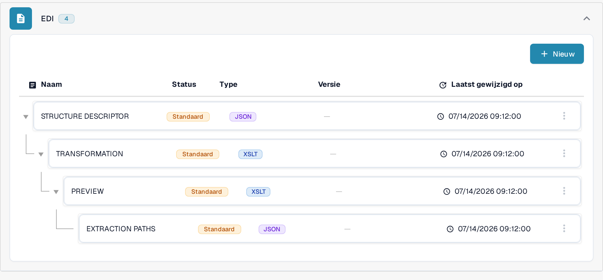

# Gids voor het EDI Structure Descriptor-bestand

## 1. Overzicht

Het **Structure Descriptor**-bestand is een **JSON**-bestand dat bepaalt hoe terugkerende EDI-segmenten (bijvoorbeeld `N1`–`N4`) worden gegroepeerd tot gestructureerde uitvoer. Het is de eerste stap in de EDI-verwerking:

* **Nauwkeurig parsen** van samenhangende segmenten als afzonderlijke eenheden.
* **Consistente uitvoer** voor de [Transformation](../edi-transformation-file-guide.md) en stroomafwaartse systemen.

_Voor een volledig voorbeeld met segmendetails, zie_ [_Structure Descriptor Example_](edi-structure-descriptor.md)_._

## 2. Toegang en basisbewerking

#### **Het bestand openen**

1. Ga naar **Instellingen** → **Documenttypen** en open **E-Doc** voor het documenttype dat u wilt configureren (in de afbeelding **PURCHASE_ORDER**). U hebt beheerdersrechten nodig binnen uw organisatie om deze bestanden te bewerken.

    <figure><figcaption>Open E-Doc voor uw documenttype; het EDI-formaat vermeldt de bijbehorende configuratiebestanden.</figcaption></figure>

2. Klap het formaat **EDI** uit. De configuratiebestanden worden samen vermeld: **STRUCTURE DESCRIPTOR**, **TRANSFORMATION**, **PREVIEW** en **EXTRACTION PATHS**. De kolom **Status** toont **Standaard** bij de bestanden die DocBits gebruikt zolang u geen eigen versie activeert.
3. Klik op de rij **STRUCTURE DESCRIPTOR**, herkenbaar aan **JSON**, om het bestand te openen.

Hebt u nog een ander configuratiebestand voor hetzelfde EDI-formaat nodig, gebruik dan **Nieuw** boven de lijst en geef de naam van het attribuut op.

#### **Concepten beheren**

De linkerkolom toont de lijst **Version** van het bestand. De versie met het label **Actief** is de versie die DocBits gebruikt.

* **Een concept aanmaken**: klik op het ✏️ potloodpictogram naast de actieve versie om te beginnen met bewerken. Het actieve bestand zelf kan niet rechtstreeks worden bewerkt.
* **Concepten verwijderen**: gebruik het 🗑️ prullenbakpictogram om ongebruikte concepten te verwijderen.
* **Wijzigingen activeren**: klik op het ✅ vinkje-pictogram bij een concept om uw wijzigingen goed te keuren en te publiceren.
  * <mark style="color:red;">**Let op**</mark>: het activeren van een nieuwe versie **deactiveert automatisch** de vorige versie.

<figure><figcaption>Het Structure Descriptor-bestand met de versielijst; met het potlood maakt u een concept aan dat u kunt bewerken.</figcaption></figure>

Met **Formaat** laat u de code in de editor opnieuw inspringen, zodat u hem beter kunt lezen; de gegevens in het bestand veranderen daardoor niet.

## 3. Functie Voorvertoning (geparseerde uitvoer bekijken)

Met de **functie Voorvertoning** test u hoe een geüpload EDI-bestand wordt geparseerd met de Structure Descriptor die op dat moment wordt getoond, nog voordat u een wijziging activeert.

#### Gebruik

* Upload een EDI-bestand via de gebruikelijke uploadprocedure.
* Kopieer het **Document ID** van het geüploade bestand.
* Open het bestand **Structure Descriptor** zoals hierboven beschreven.
* Klik rechtsboven op **Voorvertoning** om het testpaneel te openen.

    
<figure><figcaption>Het testpaneel: de getoonde ID is verzonnen voorbeelddata; klik op Test om de geparseerde uitvoer te zien.</figcaption></figure>

* Voer het **Document ID** in het veld **Document Id...** in en klik op **Test**.
* De resulterende **gestructureerde uitvoer** wordt naast de editor weergegeven.

Dit is vooral handig om mappings te debuggen en structuurgroeperingen in realtime te valideren. U hebt een representatief EDI-document van uw eigen formaat nodig; het getoonde resultaat is afhankelijk van het geüploade bestand.

## 4. Videowalkthrough

Een videohandleiding voor dit bestandstype vindt u op de [pagina Video's.](../edi-videos.md)\
Gebruik deze om de installatie, het bewerken en het bekijken van de Voorvertoning stap voor stap te volgen.

De beelden tonen een bestaande configuratie en versie. Instellingen verschillen per documenttype en formaat. Valideer wijzigingen in een concept voordat u ze activeert.

Sommige interfaceteksten blijven in de Nederlandse versie Engels: de bestandsnamen (**STRUCTURE DESCRIPTOR**, **TRANSFORMATION**, **PREVIEW**, **EXTRACTION PATHS**), de versiekop **Version**, het veld **Document Id...** en de knop **Test**. De rest van de interface is vertaald.
