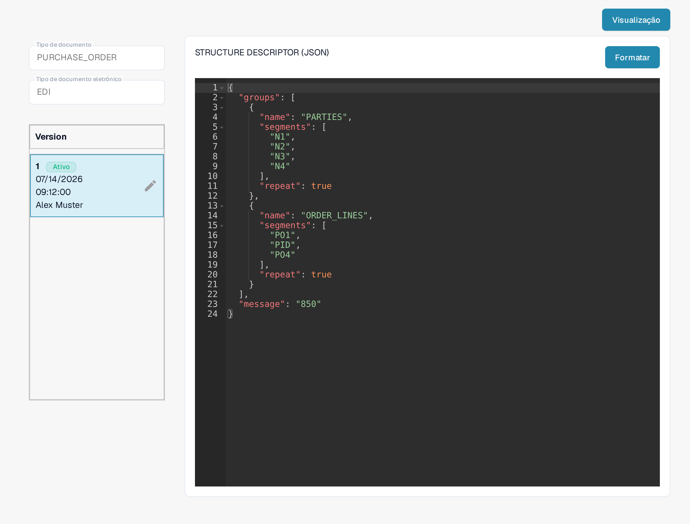
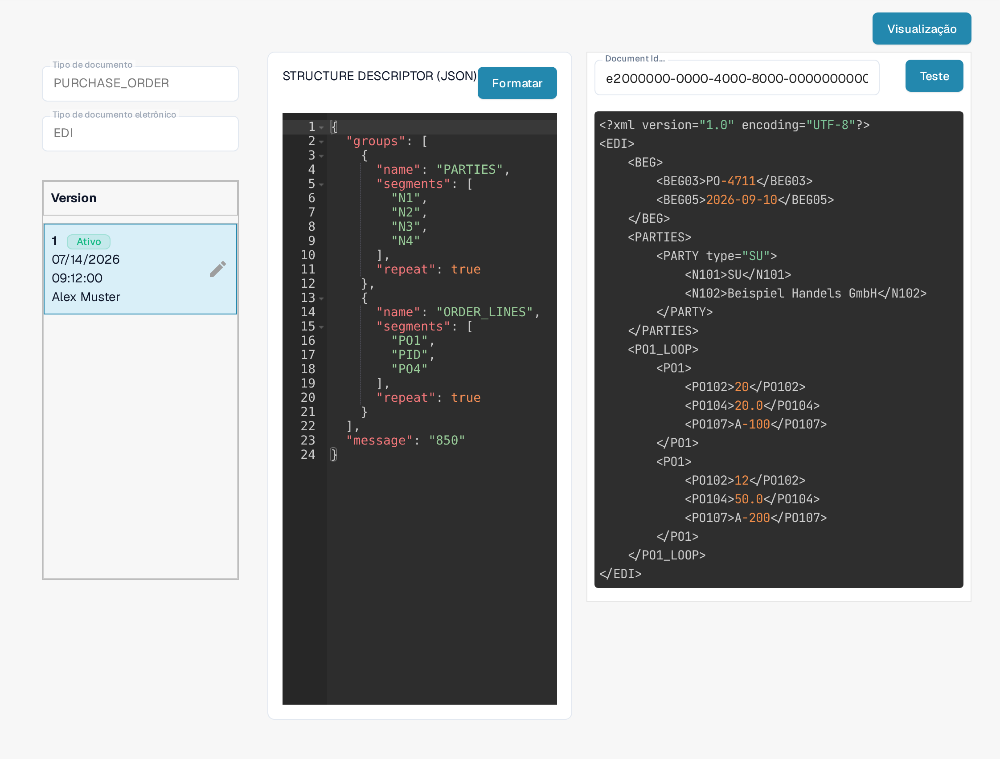

# Guia do arquivo Structure Descriptor de EDI

## 1. Visão geral

O **Structure Descriptor File** é um arquivo **JSON** que define como segmentos EDI repetidos (por exemplo, `N1`–`N4`) são agrupados em uma saída estruturada. Ele é a primeira etapa do processamento de EDI:

* **Interpretação precisa** de segmentos relacionados como unidades únicas.
* **Saída consistente** para a [Transformation](../edi-transformation-file-guide.md) e os sistemas downstream.

_Para um exemplo completo com os detalhes dos segmentos, consulte_ [_Structure Descriptor Example_](edi-structure-descriptor.md)_._

## 2. Acesso e edição básica

#### **Acessando o arquivo**

1. Acesse **Configurações** → **Tipos de documentos** e abra **E-Doc** para o tipo de documento que você deseja configurar (por exemplo, _Purchase Order_). Você precisa de acesso de administrador na sua organização para editar esses arquivos.

    <figure><figcaption>Abra o E-Doc do seu tipo de documento; o formato EDI lista seus arquivos de configuração. A captura usa dados de exemplo inventados.</figcaption></figure>

2. Expanda o formato **EDI**. Seus arquivos de configuração são listados juntos: **STRUCTURE DESCRIPTOR**, **TRANSFORMATION**, **PREVIEW** e **EXTRACTION PATHS**.
3. Clique na linha **STRUCTURE DESCRIPTOR**, marcada como **JSON**, para abri-la.

#### **Gerenciamento de rascunhos**

A coluna da esquerda mostra a lista de **Version** do arquivo. A versão marcada como **Ativo** é a que o DocBits utiliza.

* **Criar um rascunho**: clique no ícone de lápis ✏️ ao lado da versão ativa para começar a editar. O arquivo ativo não pode ser editado diretamente.
* **Excluir rascunhos**: use o ícone de lixeira 🗑️ para remover os rascunhos que não estão em uso.
* **Ativar alterações**: clique no ícone de confirmação ✅ em um rascunho para aprovar e publicar suas alterações.
  * <mark style="color:red;">**Nota**</mark>: ao ativar uma nova versão, a anterior é **desativada automaticamente**.

<figure><figcaption>O arquivo Structure Descriptor com sua lista de versões; o ícone de lápis cria um rascunho que você pode editar. A captura usa dados de exemplo inventados.</figcaption></figure>

## 3. Função de visualização (Preview)

A função de visualização (**Preview**) permite testar como um arquivo EDI enviado é interpretado com o Structure Descriptor exibido no momento, antes de ativar qualquer alteração.

#### Uso

* Envie um arquivo EDI pelo fluxo de upload padrão.
* Copie o **ID do documento** do arquivo enviado.
* Abra o arquivo **Structure Descriptor** conforme descrito acima.
* Clique em **Visualização** no canto superior direito para abrir o painel de teste.

    
<figure><figcaption>O painel de teste: informe um ID de documento e pressione Teste. O identificador e a saída XML são dados de exemplo inventados.</figcaption></figure>

* Informe o **ID do documento** no campo **Document Id…** e pressione **Teste**.
* A **saída estruturada** resultante é exibida ao lado do editor.

Isso é especialmente útil para depurar mapeamentos e validar agrupamentos estruturais em tempo real. É necessário um documento EDI representativo do seu próprio formato; o resultado exibido depende do arquivo enviado.

## 4. Passo a passo em vídeo

Um guia em vídeo para este tipo de arquivo está disponível na [página de vídeos.](../edi-videos.md)\
Use-o para acompanhar a configuração, a edição e a visualização.

As telas mostram uma configuração e uma versão existentes. As configurações variam conforme o tipo de documento e o formato. Valide as alterações em um rascunho antes de ativá-las.
