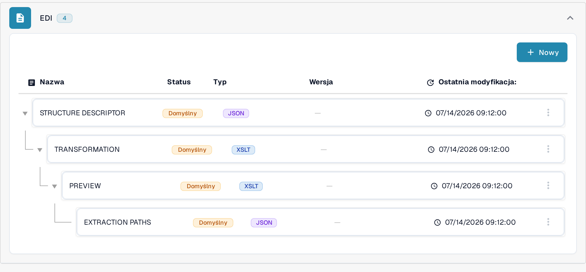
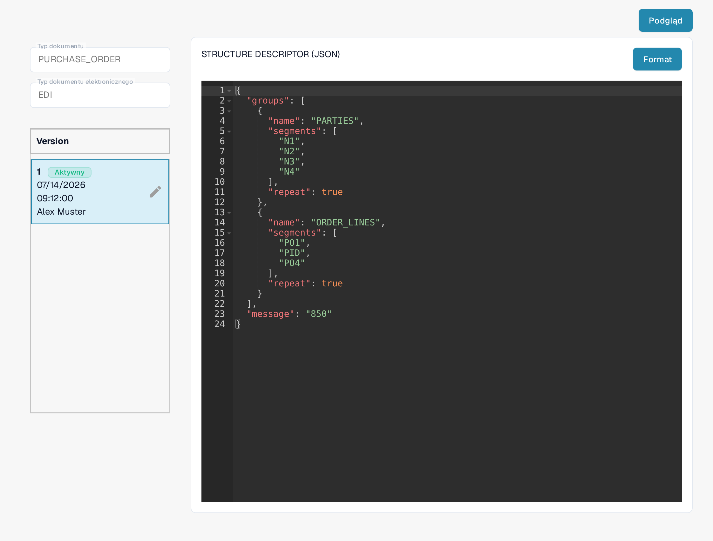

# Przewodnik po pliku EDI Structure Descriptor

## 1. Przegląd

**Plik Structure Descriptor** to plik **JSON**, który określa, w jaki sposób powtarzające się segmenty EDI (na przykład `N1`–`N4`) są grupowane w ustrukturyzowane dane wyjściowe. To pierwszy etap przetwarzania EDI:

* **Dokładne parsowanie** powiązanych segmentów jako pojedynczych jednostek.
* **Spójne dane wyjściowe** dla [Transformation](../edi-transformation-file-guide.md) i systemów docelowych.

_Pełny przykład ze szczegółami segmentów znajdziesz w_ [_Przykład Structure Descriptor_](edi-structure-descriptor.md)_._

## 2. Dostęp i podstawowa edycja

#### **Otwieranie pliku**

1. Przejdź do **Ustawienia** → **Typy dokumentów** i otwórz **E-Doc** dla typu dokumentu, który chcesz skonfigurować (na przykład _Purchase Order_). Do edycji tych plików wymagane są uprawnienia administratora w organizacji.

    <figure><figcaption>Otwórz E-Doc dla swojego typu dokumentu; format EDI zawiera listę plików konfiguracyjnych.</figcaption></figure>

2. Rozwiń format **EDI**. Jego pliki konfiguracyjne są wymienione razem: **STRUCTURE DESCRIPTOR**, **TRANSFORMATION**, **PREVIEW** i **EXTRACTION PATHS**. W kolumnie **Status** pliki domyślne mają znacznik **Domyślny**.
3. Kliknij wiersz **STRUCTURE DESCRIPTOR**, oznaczony jako **JSON**, aby go otworzyć.
4. Kolejny plik konfiguracyjny dla tego samego formatu dodasz przyciskiem **Nowy** nad listą.

#### **Zarządzanie wersjami roboczymi**

W lewej kolumnie widoczna jest lista **Version** dla pliku. Wersja oznaczona jako **Aktywny** to ta, której używa DocBits.

* **Utworzenie wersji roboczej**: kliknij ikonę ołówka ✏️ obok aktywnej wersji, aby rozpocząć edycję. Samego aktywnego pliku nie można edytować bezpośrednio.
* **Usuwanie wersji roboczych**: użyj ikony kosza 🗑️, aby usunąć nieużywane wersje robocze.
* **Aktywowanie zmian**: kliknij ikonę znacznika wyboru ✅ na wersji roboczej, aby zatwierdzić i opublikować zmiany.
  * <mark style="color:red;">**Uwaga**</mark>: aktywacja nowej wersji **automatycznie dezaktywuje** poprzednią.

<figure><figcaption>Plik Structure Descriptor z listą wersji; ikona ołówka tworzy wersję roboczą, którą można edytować.</figcaption></figure>

Przycisk **Format** nad edytorem ponownie formatuje i wcina kod, aby był czytelniejszy; zmienia się tylko układ kodu, nie jego treść.

## 3. Funkcja Podgląd (podgląd wyników parsowania)

**Funkcja Podgląd** pozwala sprawdzić, jak przesłany plik EDI jest parsowany przy użyciu aktualnie wyświetlanego pliku Structure Descriptor, przed aktywacją jakichkolwiek zmian.

#### Jak używać

* Prześlij plik EDI w standardowym procesie przesyłania.
* Skopiuj identyfikator przesłanego pliku (pole **Document Id...**).
* Otwórz plik **Structure Descriptor** w sposób opisany powyżej.
* Kliknij **Podgląd** w prawym górnym rogu, aby otworzyć panel testowy.

    
<figure><figcaption>Panel testowy: wpisz wymyślony przykładowy identyfikator dokumentu i kliknij Test.</figcaption></figure>

* Wprowadź identyfikator w polu formularza i kliknij **Test**.
* Wynikowe **ustrukturyzowane dane wyjściowe** są wyświetlane obok edytora.

Jest to szczególnie przydatne do debugowania mapowań i weryfikowania grupowania struktur w czasie rzeczywistym. Wymagany jest reprezentatywny dokument EDI w danym formacie; wyświetlany wynik zależy od przesłanego pliku.

Niektóre teksty interfejsu pozostają po angielsku również w polskiej wersji aplikacji: nazwy plików (**STRUCTURE DESCRIPTOR**, **TRANSFORMATION**, **PREVIEW**, **EXTRACTION PATHS**), nagłówek listy **Version** oraz pole **Document Id...**. Opisujemy je dokładnie tak, jak widać je na ekranie.

## 4. Omówienie wideo

Przewodnik wideo dla tego typu pliku jest dostępny na [stronie Wideo.](../edi-videos.md)\
Skorzystaj z niego, aby prześledzić konfigurację, edycję i podgląd.

Pokazane widoki przedstawiają istniejącą konfigurację i wersję. Ustawienia różnią się w zależności od typu dokumentu i formatu. Zmiany należy zweryfikować w wersji roboczej przed aktywacją.
