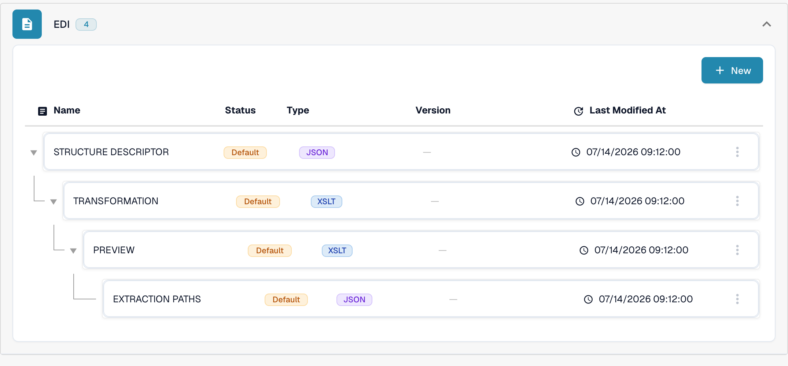
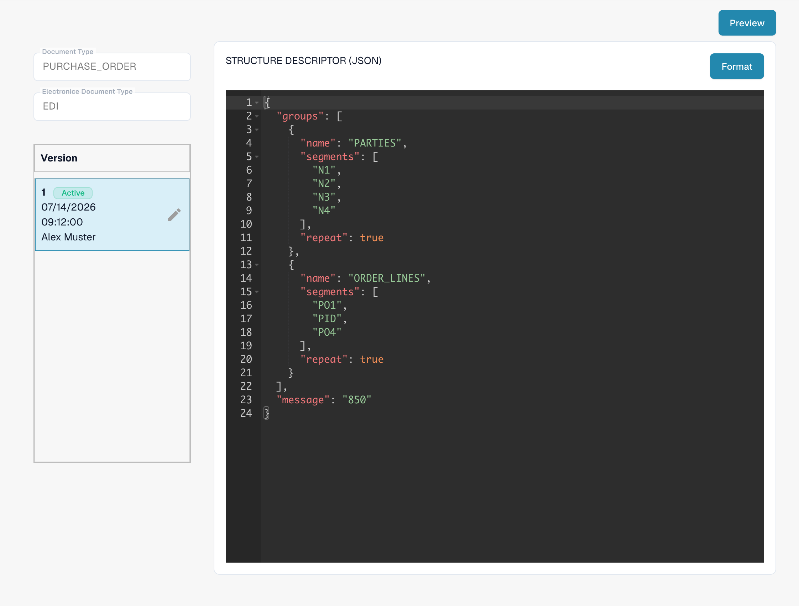
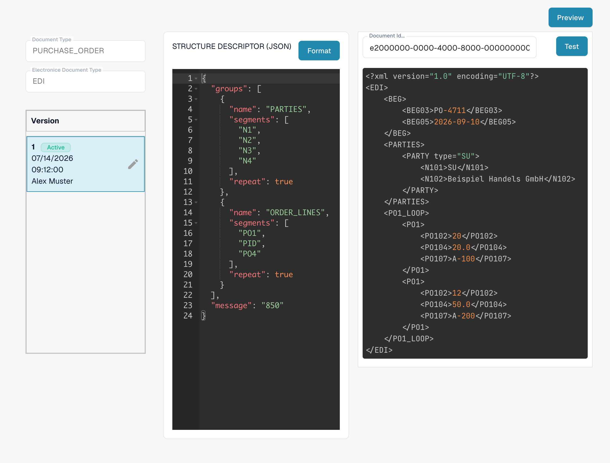

# Leitfaden zur EDI Structure Descriptor Datei

## 1. Overview

Die **Structure Descriptor File** ist eine **JSON**-Datei, die festlegt, wie sich wiederholende EDI-Segmente (zum Beispiel `N1`–`N4`) zu einer strukturierten Ausgabe zusammengefasst werden. Sie ist der erste Schritt der EDI-Verarbeitung:

* **Präzises Parsen** zusammengehöriger Segmente als einzelne Einheiten.
* **Konsistente Ausgabe** für die [Transformation](../edi-transformation-file-guide.md) und nachgelagerte Systeme.

_Ein vollständiges Beispiel mit Details zu den Segmenten finden Sie unter_ [_Structure Descriptor Example_](edi-structure-descriptor.md)_._

## 2. Access & Basic Editing

#### **Zugriff auf die Datei**

1. Gehen Sie zu **Settings** → **Document Types** und öffnen Sie **E-Doc** für den Dokumenttyp, den Sie konfigurieren möchten (zum Beispiel _Purchase Order_). Um diese Dateien zu bearbeiten, benötigen Sie Administratorzugriff in Ihrer Organisation.

    <!-- dbdc-139-edi-sd-list-en.png --><figure><figcaption>Öffnen Sie E-Doc für Ihren Dokumenttyp; das EDI-Format listet seine Konfigurationsdateien auf.</figcaption></figure>

2. Klappen Sie das Format **EDI** auf. Seine Konfigurationsdateien werden gemeinsam aufgelistet: **STRUCTURE DESCRIPTOR**, **TRANSFORMATION**, **PREVIEW** und **EXTRACTION PATHS**.
3. Klicken Sie auf die Zeile **STRUCTURE DESCRIPTOR**, die mit **JSON** gekennzeichnet ist, um sie zu öffnen.

#### **Umgang mit Entwürfen**

Die linke Spalte zeigt die **Version**-Liste der Datei. Die Version, die mit **Active** gekennzeichnet ist, wird von DocBits verwendet.

* **Einen Entwurf erstellen**: Klicken Sie auf das Stiftsymbol ✏️ neben der aktiven Version, um die Bearbeitung zu beginnen. Die aktive Datei selbst kann nicht direkt bearbeitet werden.
* **Entwürfe löschen**: Über das Papierkorbsymbol 🗑️ entfernen Sie nicht benötigte Entwürfe.
* **Änderungen aktivieren**: Klicken Sie auf das Häkchen-Symbol ✅ eines Entwurfs, um Ihre Änderungen zu bestätigen und zu veröffentlichen.
  * <mark style="color:red;">**Hinweis**</mark>: Beim Aktivieren einer neuen Version wird die vorherige **automatisch deaktiviert**.

<!-- dbdc-139-edi-sd-detail-en.png --><figure><figcaption>Die Structure Descriptor Datei mit ihrer Versionsliste; über den Stift erstellen Sie einen bearbeitbaren Entwurf.</figcaption></figure>

## 3. Preview Function (Preview Parsed Output)

Die **Preview Function** ermöglicht Ihnen zu testen, wie eine hochgeladene EDI-Datei mit dem aktuell angezeigten Structure Descriptor geparst wird – und zwar bevor Sie eine Änderung aktivieren.

#### Verwendung

* Laden Sie eine EDI-Datei über den üblichen Upload-Ablauf hoch.
* Kopieren Sie die **Document ID** der hochgeladenen Datei.
* Öffnen Sie die Datei **Structure Descriptor** wie oben beschrieben.
* Klicken Sie rechts oben auf **Preview**, um das Testfenster zu öffnen.

    
<!-- dbdc-139-edi-sd-preview-en.png --><figure><figcaption>Das Testfenster: Document ID eingeben und Test drücken.</figcaption></figure>

* Geben Sie die **Document ID** in das Feld ein und klicken Sie auf **Test**.
* Die resultierende **strukturierte Ausgabe** wird neben dem Editor angezeigt.

Das ist besonders hilfreich, um Zuordnungen zu debuggen und strukturelle Gruppierungen in Echtzeit zu prüfen. Dazu ist ein repräsentatives EDI-Dokument Ihres eigenen Formats erforderlich; das angezeigte Ergebnis hängt von der hochgeladenen Datei ab.

## 4. Video Walkthrough

Eine Videohilfe zu diesem Dateityp finden Sie auf der [Seite „Videos“.](../edi-videos.md)\
Nutzen Sie sie, um Einrichtung, Bearbeitung und Preview Schritt für Schritt mitzuverfolgen.

Die Ansichten zeigen eine bestehende Konfiguration und Version. Die Einstellungen unterscheiden sich je nach Dokumenttyp und Format. Prüfen Sie Änderungen in einem Entwurf, bevor Sie sie aktivieren.
