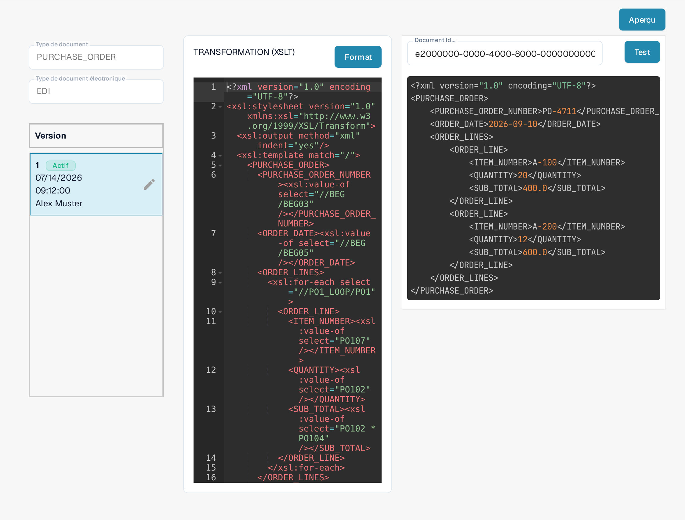

# Guide de fichier de transformation EDI

La configuration **TRANSFORMATION** convertit l'entrée EDI en XML structuré utilisé par DocBits. C'est une feuille de style **XSLT**. Ce guide s'adresse aux personnes qui gèrent un format de document électronique ; pour vérifier une modification, il vous faut un document EDI représentatif.

## Ouvrir la transformation

1. Allez dans **Paramètres → Types De Documents** et ouvrez **E-Doc** pour le type de document que vous voulez configurer.
2. Dépliez **EDI** et sélectionnez **TRANSFORMATION**, marqué **XSLT**. Les captures montrent le type de document `PURCHASE_ORDER` (commande d'achat) dans une organisation de démonstration pour la documentation.

<figure><figcaption>
Choisissez TRANSFORMATION (XSLT) dans la liste des formats EDI.
</figcaption></figure>

Pour les administrateurs, **Nouveau** ouvre un formulaire pour créer un nouvel attribut EDI. Le menu à trois points d'une ligne propose **Personnaliser**, qui crée votre propre copie modifiable de l'attribut par défaut, ainsi que **Supprimer** pour les administrateurs. Le statut, le type, la version et la date de dernière modification de chaque fichier sont expliqués dans [Configurer les attributs EDI](setting-up-edi-templates.md).

## Lire la feuille de style et la version

À gauche, la page affiche le type de document sélectionné, le format EDI et les versions. **Actif** marque la version actuellement utilisée. La feuille de style apparaît dans l'éditeur, à droite. L'exemple de la commande d'achat utilise `xsl:value-of` pour copier le numéro de commande (`//BEG/BEG03`), la date de commande (`//BEG/BEG05`) et les positions (`//PO1_LOOP/PO1` avec `PO107`, `PO102` et `PO102 * PO104`) de l'entrée EDI dans une structure XML `PURCHASE_ORDER`. Votre document peut utiliser d'autres chemins EDI. **Format** réindente le source pour la lecture ; aucune version n'est activée par cette action.

<figure><figcaption>
La transformation EDI active de la commande d'achat dans l'organisation de démonstration.
</figcaption></figure>

Tant que la version active est affichée, l'éditeur est en lecture seule. L'icône crayon, à côté de la version active, crée un **brouillon** dans lequel vous pouvez modifier le source ; cette action enregistre aussi vos modifications. Vérifiez et testez le brouillon, puis activez-le avec sa coche. Une version activée remplace la version active précédente. L'icône corbeille supprime un brouillon inutile ; elle apparaît seulement lorsque plusieurs versions existent. Les captures montrent la version active, c'est pourquoi les icônes d'un brouillon n'y figurent pas.

## Tester avant activation

Cliquez sur **Aperçu** en haut à droite pour ouvrir le panneau de test. Saisissez l'ID d'un document EDI importé dans le champ **Document Id...**, dont le libellé reste en anglais dans cette version de l'interface, puis cliquez sur **Test**. Le test porte sur le contenu actuel de l'éditeur et inclut donc un brouillon non encore activé. Comparez la sortie obtenue avec le document d'origine et les champs XML attendus. La capture montre un test dans une organisation de démonstration avec l'ID d'exemple inventé `e2000000-0000-4000-8000-000000000004` ; la sortie affichée est elle aussi constituée de données d'exemple inventées.

<figure><figcaption>
Testez la transformation choisie avec l'ID d'un document EDI d'exemple ; l'ID et la sortie affichés sont des données d'exemple inventées.
</figcaption></figure>

Après la transformation, DocBits utilise les [chemins d'extraction](edi-extraction-paths-file-guide.md) pour affecter les valeurs XML aux champs. Le [fichier d'aperçu](edi-preview-file-guide.md) contrôle l'affichage lisible. Un [guide vidéo EDI](edi-videos.md) montre le déroulement.

## Règles effectives et activation

Les règles propres à l'organisation ont priorité sur les règles par défaut pour le format eDoc détecté. Vérifiez la TRANSFORMATION active et le nœud qui fournit `invoice_type` dans le XML transformé ; le chemin dépend du format. Créez un brouillon pour enregistrer vos modifications, puis activez-le avec la coche après les tests. Un aperçu affiché ne prouve pas le type de document enregistré. Le [guide de diagnostic de la classification](../credit-note-recognized-as-invoice.md) explique les codes 381/261, les scripts exécutés ensuite et les précautions à prendre avant un nouveau traitement.

Les noms techniques des attributs dans la liste, par exemple TRANSFORMATION, PREVIEW ou EXTRACTION PATHS, ne changent pas d'une langue à l'autre. Les vues montrent une configuration et une version existantes. Les paramètres varient selon le type de document et le format. Validez les modifications dans un brouillon avant leur activation.
