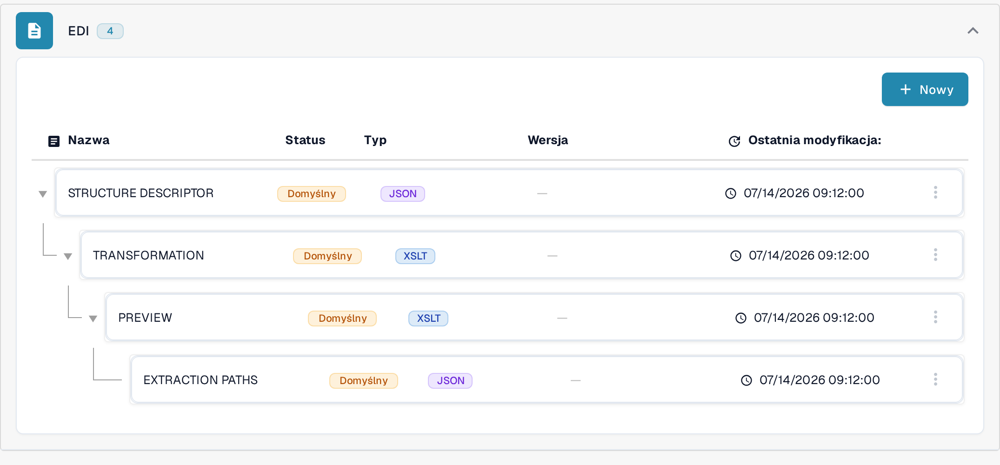

# Przewodnik po pliku transformacji EDI

Konfiguracja **TRANSFORMATION** zamienia wejście EDI na ustrukturyzowany XML używany przez DocBits. Jest to arkusz stylów **XSLT**. Ten przewodnik jest przeznaczony dla osób, które utrzymują elektroniczny format dokumentów; do sprawdzenia zmiany potrzebujesz reprezentatywnego dokumentu EDI.

## Otwórz transformację

1. Przejdź do **Ustawienia → Typy Dokumentów** i otwórz **E-Doc** dla typu dokumentu, który chcesz skonfigurować.
2. Rozwiń **EDI** i wybierz **TRANSFORMATION** z oznaczeniem **XSLT**. Zrzuty ekranu pokazują typ dokumentu `PURCHASE_ORDER` (zamówienie zakupu) w organizacji demonstracyjnej na potrzeby dokumentacji.

<figure><figcaption>
Wybierz TRANSFORMATION (XSLT) na liście formatów EDI.
</figcaption></figure>

Gdy potrzebujesz własnego wariantu, a nie pliku domyślnego, otwórz menu z trzema kropkami w wierszu i wybierz **Dostosuj**: DocBits tworzy wtedy własną, edytowalną kopię atrybutu i od razu otwiera ją do zmian. Administrator widzi w tym menu także **Usuwać**, które usuwa atrybut. Przycisk **Nowy** powyżej listy otwiera formularz nowego atrybutu EDI, więc dodasz kolejny plik obok istniejących. Status, typ, wersję i datę ostatniej zmiany każdego pliku opisuje strona [Konfiguracja Szablonów EDI](setting-up-edi-templates.md).

## Odczytaj arkusz stylów i wersję

Po lewej stronie widzisz wybrany typ dokumentu, format EDI i listę wersji; etykieta **Version** nad listą wersji pozostała w tej wersji interfejsu po angielsku. **Aktywny** oznacza wersję używaną obecnie. Arkusz stylów pojawia się w edytorze po prawej. Przykład zamówienia zakupu używa `xsl:value-of`, aby skopiować numer zamówienia (`//BEG/BEG03`), datę zamówienia (`//BEG/BEG05`) oraz pozycje (`//PO1_LOOP/PO1` z `PO107`, `PO102` i `PO102 * PO104`) z wejścia EDI do struktury XML `PURCHASE_ORDER`. Twój dokument może używać innych ścieżek EDI. **Format** porządkuje kod źródłowy, aby ułatwić czytanie; ta czynność nie aktywuje żadnej wersji.

<figure><figcaption>
Aktywna transformacja EDI zamówienia zakupu w organizacji demonstracyjnej.
</figcaption></figure>

Dopóki wyświetlana jest wersja aktywna, edytora nie można zmieniać. Ikona ołówka obok aktywnej wersji tworzy **wersję roboczą**, w której możesz zmieniać kod źródłowy. Wersję roboczą sprawdź i przetestuj, a następnie aktywuj znacznikiem wyboru; aktywowana wersja zastępuje poprzednią wersję aktywną. Ikona kosza usuwa niepotrzebną wersję roboczą i pojawia się tylko wtedy, gdy istnieje więcej niż jedna wersja. Zrzuty ekranu pokazują wersję aktywną, dlatego nie widać na nich ikon wersji roboczej.

## Przetestuj przed aktywacją

Kliknij **Podgląd** w prawym górnym rogu, aby otworzyć panel testowy. Wpisz ID dokumentu EDI wczytanego do DocBits w pole **Document Id...**, którego etykieta pozostała w tej wersji interfejsu po angielsku, a następnie kliknij **Test**. Test obejmuje bieżącą treść edytora, więc uwzględnia również jeszcze nieaktywną wersję roboczą. Porównaj wynik z dokumentem źródłowym i oczekiwanymi polami XML. Zrzut ekranu pokazuje test w organizacji demonstracyjnej z wymyślonym przykładowym ID `e2000000-0000-4000-8000-000000000004`; wyświetlony wynik XML to również wymyślone dane przykładowe.

<figure><figcaption>
Przetestuj wybraną transformację na przykładowym ID dokumentu EDI; widoczne ID i wynik XML to wymyślone dane przykładowe.
</figcaption></figure>

Po transformacji DocBits używa [ścieżek ekstrakcji](edi-extraction-paths-file-guide.md), aby przypisać wartości XML do pól. [Plik podglądu](edi-preview-file-guide.md) steruje czytelnym wyświetlaniem dokumentu. [Filmy EDI](edi-videos.md) pokazują cały przebieg.

## Obowiązujące reguły i aktywacja

Reguły właściwe dla organizacji mają pierwszeństwo przed regułami domyślnymi dla wykrytego formatu eDoc. Sprawdź aktywną konfigurację TRANSFORMATION i sprawdź, który węzeł dostarcza `invoice_type` w przekształconym XML; ścieżka zależy od formatu. Zapisanie odkłada zmiany w wersji roboczej, a po testach aktywujesz ją znacznikiem wyboru. Wyświetlony podgląd nie potwierdza zapisanego typu dokumentu. [Elektroniczna nota kredytowa jest rozpoznawana jako faktura](../credit-note-recognized-as-invoice.md) opisuje kody 381/261, później uruchamiane skrypty i środki ostrożności przed ponownym przetwarzaniem.

Techniczne nazwy atrybutów na liście, na przykład TRANSFORMATION, PREVIEW czy EXTRACTION PATHS, nie zmieniają się w zależności od języka. Widoki pokazują istniejącą konfigurację i wersję. Ustawienia różnią się w zależności od typu dokumentu i formatu. Zmiany sprawdź w wersji roboczej przed aktywacją.
