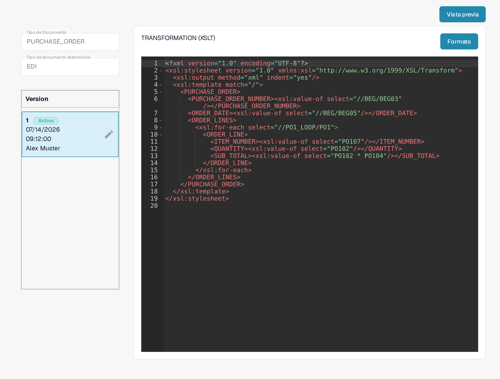

# Guía de Archivo de Transformación EDI

La configuración **TRANSFORMATION** convierte la entrada EDI en el XML estructurado que utiliza DocBits. Es una hoja de estilo **XSLT**. Esta guía está pensada para las personas que mantienen un formato de documento electrónico; para comprobar un cambio necesita un documento EDI representativo.

## Abrir la transformación

1. Vaya a **Ajustes → Tipos de Documento** y abra **E-Doc** para el tipo de documento que desea configurar.
2. Expanda **EDI** y seleccione **TRANSFORMATION**, marcado como **XSLT**. Las capturas muestran el tipo de documento **PURCHASE_ORDER** (orden de compra) con el formato **EDI** en una organización de pruebas de documentación.

La lista muestra las cuatro configuraciones del formato: **STRUCTURE DESCRIPTOR**, **TRANSFORMATION**, **PREVIEW** y **EXTRACTION PATHS**. **Defecto** indica que DocBits las entrega preconfiguradas. Con **Nuevo** añade una configuración propia al formato seleccionado. El menú de tres puntos de una fila ofrece **Personalizar**, que crea su propia copia editable de una configuración predeterminada, y **Borrar**, que elimina la configuración seleccionada (solo para administradores).

<figure><figcaption>Elija TRANSFORMATION (XSLT) en la configuración EDI del tipo de documento.</figcaption></figure>

## Leer la hoja de estilo y la versión

La parte izquierda muestra el tipo de documento seleccionado, el formato de documento electrónico y las versiones. **Activo** marca la versión que se utiliza actualmente. La hoja de estilo aparece en el editor de la derecha. En el ejemplo actual, `xsl:value-of` copia valores como el número de pedido y la fecha del pedido de la entrada EDI a una estructura XML `PURCHASE_ORDER`. Su documento puede usar rutas EDI distintas. **Formato** ordena el código fuente para facilitar la lectura; no activa ninguna versión.

<figure><figcaption>La transformación EDI activa del ejemplo en la organización de pruebas.</figcaption></figure>

El lápiz situado junto a la versión activa crea un **borrador** para los cambios. Revise y pruebe el borrador antes de activarlo con su marca de verificación. Una versión activada sustituye a la versión activa anterior. El icono de papelera elimina un borrador que ya no necesita.

## Probar antes de activar

Haga clic en **Vista previa** en la esquina superior derecha para abrir el panel de prueba. Introduzca el **ID del documento** de un documento EDI cargado y haga clic en **Prueba**. Compare la salida devuelta con el documento original y con los campos XML que espera. La captura muestra un resultado con datos de ejemplo inventados; no demuestra que su documento se transforme correctamente.

<figure><figcaption>Prueba de la transformación seleccionada con un ID de documento de ejemplo inventado (e2000000-0000-4000-8000-000000000004).</figcaption></figure>

Después de la transformación, DocBits utiliza las [Rutas de extracción](edi-extraction-paths-file-guide.md) para asignar los valores XML a los campos. El [Archivo de vista previa](edi-preview-file-guide.md) controla la visualización legible. Consulte la [guía de vídeos EDI](edi-videos.md) para ver el proceso paso a paso.

## Reglas efectivas y activación

Las reglas específicas de la organización tienen prioridad sobre las predeterminadas para el formato eDoc detectado. Compruebe la TRANSFORMATION activa y qué nodo proporciona `invoice_type` en el XML transformado; la ruta depende del formato. Guardar conserva un borrador; utilice la marca de verificación para activarlo después de las pruebas. Una vista previa renderizada no demuestra el tipo de documento almacenado. Consulte la [guía de resolución de problemas de clasificación](../credit-note-recognized-as-invoice.md) para conocer los códigos 381/261, los scripts posteriores y las precauciones para volver a procesar documentos.

Las vistas muestran una configuración y una versión existentes. Los ajustes varían según el tipo de documento y el formato. Valide los cambios en un borrador antes de activarlos.

## Etiquetas que siguen en inglés

En la interfaz actual, la cabecera de la columna de versiones se muestra como **Version**, el campo de prueba usa el marcador de posición **Document Id...** y los nombres de las configuraciones (**STRUCTURE DESCRIPTOR**, **TRANSFORMATION**, **PREVIEW**, **EXTRACTION PATHS**) se mantienen en inglés. El resto de la lista (**Nombre**, **Estado**, **Tipo**, **Fecha de última modificación**, **Defecto**, **Nuevo**) aparece en español.
