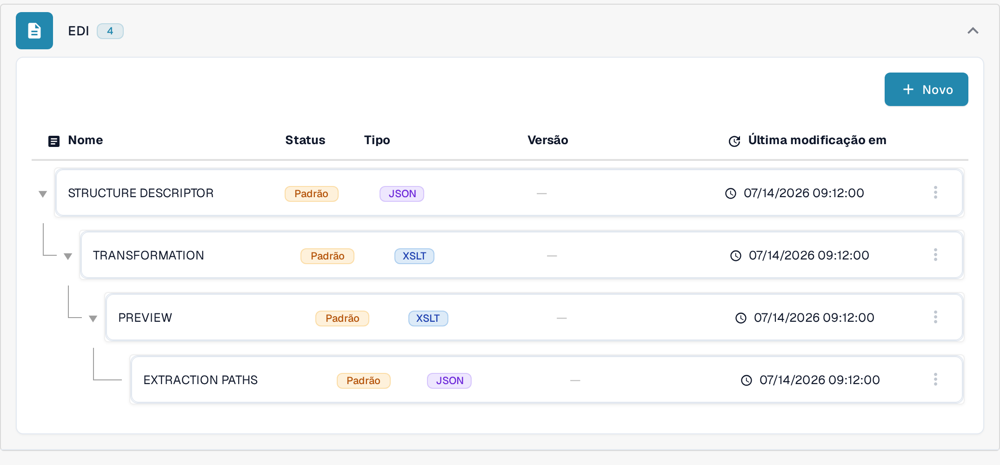
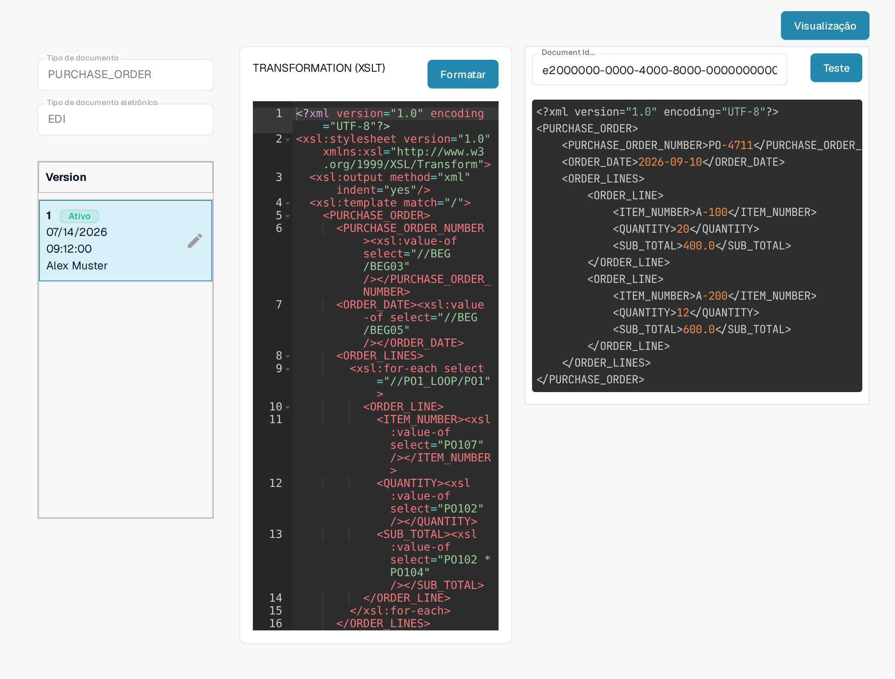

# Guia do Arquivo de Transformação EDI

A configuração **TRANSFORMATION** converte a entrada EDI no XML estruturado que o DocBits utiliza. Trata-se de um stylesheet **XSLT**. Este guia destina-se a quem mantém um formato de documento eletrónico; para validar uma alteração é necessário um documento EDI representativo.

## Abrir a transformação

1. Aceda a **Configurações → Tipos De Documentos** e abra **E-Doc** no tipo de documento que pretende configurar.
2. Expanda **EDI** e selecione **TRANSFORMATION**, identificado como **XSLT**. As imagens mostram o formato EDI de uma encomenda (**PURCHASE_ORDER**) numa organização de teste para documentação.

<figure><figcaption>Escolha TRANSFORMATION (XSLT) na lista de formatos EDI.</figcaption></figure>

Com **Novo** cria um atributo EDI adicional para este tipo de documento e formato; esta página descreve a edição de uma TRANSFORMATION existente.

## Ler o stylesheet e a versão

O lado esquerdo mostra o tipo de documento selecionado, o tipo de documento eletrónico e as versões. **Ativo** identifica a versão atualmente em uso; o painel de versões tem o título **Version**, que a interface mantém em inglês. O código-fonte XSLT aparece no editor à direita. O exemplo da encomenda copia o número (`//BEG/BEG03`) e a data (`//BEG/BEG05`) da encomenda e percorre as linhas com `xsl:for-each` sobre `//P01_LOOP/P01`, a partir das quais preenche o número do artigo (`P0107`), a quantidade (`P0102`) e o total da linha (`P0102 * P0104`) numa estrutura XML `PURCHASE_ORDER`. O seu documento pode usar outros caminhos EDI. **Formatar** apenas organiza o código-fonte para leitura; não ativa qualquer versão.

<figure><figcaption>A transformação EDI ativa da encomenda na organização de teste.</figcaption></figure>

O ícone de lápis junto à versão ativa cria um **rascunho** para alterações. Reveja e teste o rascunho antes de o ativar com a marca de verificação. Uma versão ativada substitui a versão anteriormente ativa. O ícone de caixote do lixo elimina um rascunho indesejado; só aparece quando existe mais do que uma versão. As imagens mostram a versão ativa, por isso as ações de um rascunho não estão representadas.

## Testar antes de ativar

Clique em **Visualização** no canto superior direito para abrir o painel de teste. Introduza o ID do documento de um EDI carregado no campo **Document Id...** e clique em **Teste**. É testado o conteúdo atual do editor, incluindo um rascunho ainda não guardado. Compare a saída devolvida com o documento original e com os campos XML esperados. A imagem mostra um teste numa organização de teste: o ID introduzido é o exemplo inventado `e2000000-0000-4000-8000-000000000004`, cortado na margem direita do campo, e a saída apresentada também são dados de exemplo inventados.

<figure><figcaption>Teste a transformação selecionada com o ID de exemplo inventado e2000000-0000-4000-8000-000000000004; o ID cortado à direita e a saída são dados inventados.</figcaption></figure>

Após a transformação, o DocBits utiliza os [Caminhos de Extração](edi-extraction-paths-file-guide.md) para associar os valores XML aos campos. O [Arquivo de Pré-visualização](edi-preview-file-guide.md) controla a apresentação legível. Consulte os [Vídeos EDI](edi-videos.md) para acompanhar o processo.

## Regras efetivas e ativação

As regras específicas da organização têm prioridade sobre as predefinições do formato eDoc detetado. Verifique a TRANSFORMATION ativa e verifique qual o nó que fornece o valor pretendido no XML transformado; o caminho depende do formato. Guardar cria um rascunho; ative-o com a marca de verificação depois de testar. Uma pré-visualização renderizada não comprova o tipo de documento guardado. Consulte o [guia de resolução de problemas de classificação](../credit-note-recognized-as-invoice.md) para obter informações sobre os códigos 381/261, os scripts posteriores e as precauções de reprocessamento.

Os nomes técnicos dos atributos na lista, como TRANSFORMATION, PREVIEW ou EXTRACTION PATHS, permanecem iguais em todas as línguas. As vistas mostram uma configuração e uma versão existentes. As definições variam consoante o tipo de documento e o formato. Valide as alterações num rascunho antes da ativação.
