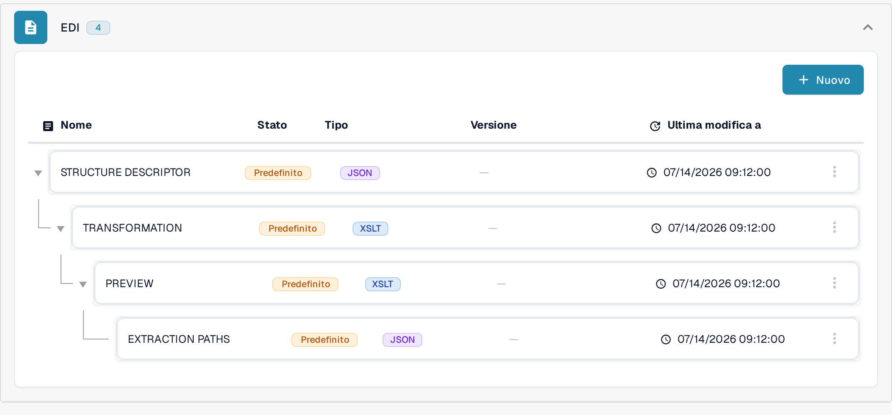
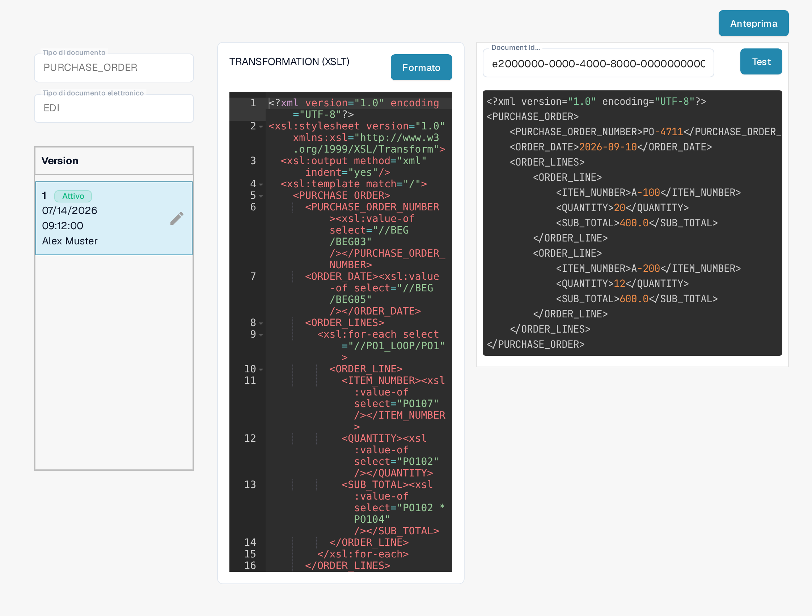

# Guida al File di Trasformazione EDI

La configurazione **TRANSFORMATION** converte l'input EDI nell'XML strutturato che DocBits utilizza. È un foglio di stile **XSLT**. Questa guida è rivolta a chi mantiene un formato di documento elettronico; per verificare una modifica serve un documento EDI rappresentativo.

## Aprire la trasformazione

1. Vai su **Impostazioni → Tipi di Documento** e apri **Documenti elettronici** (nel percorso compare come **E-Doc**) per il tipo di documento che vuoi configurare.
2. Espandi **EDI** e seleziona **TRANSFORMATION**, contrassegnato come **XSLT**. Gli screenshot mostrano il tipo di documento **PURCHASE_ORDER** con il formato **EDI** in un'organizzazione di test della documentazione.

<figure><figcaption>Scegli TRANSFORMATION (XSLT) nella configurazione EDI del tipo di documento.</figcaption></figure>

L'elenco mostra per ogni configurazione il nome, lo stato, il tipo, la versione e la data dell'ultima modifica. Lo stato **Predefinito** indica un valore predefinito: la colonna della versione è ancora vuota. Il pulsante a tre punti sulla riga apre **Personalizzazione**, che crea una tua copia della configurazione e apre la pagina di modifica lasciando invariato il valore predefinito, e **Cancellare**, che elimina la configurazione dopo una richiesta di conferma. **Nuovo** crea una configurazione aggiuntiva.

## Leggere il foglio di stile e la versione

A sinistra vedi il tipo di documento selezionato, il tipo di documento elettronico e le versioni. Il contrassegno **Attivo** indica la versione in uso. Il foglio di stile compare nell'editor a destra. L'esempio per gli ordini d'acquisto usa `xsl:value-of` per copiare valori come il numero d'ordine e la data dall'input EDI in una struttura XML `PURCHASE_ORDER`. Il tuo documento può usare percorsi EDI diversi. **Formato** dispone il sorgente per la lettura; non attiva nessuna versione.

<figure><figcaption>La trasformazione EDI attiva dell'esempio nell'organizzazione di test.</figcaption></figure>

La matita accanto alla versione attiva crea una **bozza** con le modifiche. Controlla e prova la bozza prima di attivarla con il segno di spunta: una versione attivata sostituisce quella attiva in precedenza. Il cestino elimina una bozza e compare solo quando la configurazione ha più di una versione. Sulla versione attiva è visibile solo **Formato**; il pulsante per salvare compare quando una bozza è aperta in modifica.

## Provare prima dell'attivazione

Fai clic su **Anteprima** in alto a destra per aprire il pannello di prova. Inserisci l'ID di un documento EDI caricato nel campo **Document Id...** e fai clic su **Test**. Confronta l'output restituito con il documento originale e con i campi XML che ti aspetti. Lo screenshot mostra una prova con un ID di esempio inventato (e2000000-0000-4000-8000-000000000004); l'XML restituito contiene dati di esempio inventati, con numero d'ordine PO-4711, data 2026-09-10 e le righe A-100 e A-200. Questo output non dimostra la trasformazione di un documento reale.

<figure><figcaption>Prova della trasformazione selezionata con un ID di documento di esempio inventato (e2000000-0000-4000-8000-000000000004).</figcaption></figure>

Dopo la trasformazione DocBits usa i [Percorsi di estrazione](edi-extraction-paths-file-guide.md) per mappare i valori XML sui campi. Il [File di anteprima](edi-preview-file-guide.md) controlla la visualizzazione leggibile. Guarda la [guida video EDI](edi-videos.md) per seguire la configurazione in un video.

## Regole effettive e attivazione

Le regole specifiche dell'organizzazione hanno la precedenza sui valori predefiniti per il formato eDoc rilevato. Controlla la TRANSFORMATION attiva e verifica quale nodo fornisce `invoice_type` nell'XML trasformato; il percorso dipende dal formato. Le modifiche restano una bozza finché non le attivi con il segno di spunta dopo le prove. Un'anteprima renderizzata non dimostra il tipo di documento memorizzato. Consulta la [guida alla diagnosi della classificazione](../credit-note-recognized-as-invoice.md) per i codici 381/261, gli script successivi e le precauzioni prima della rielaborazione.

Le viste mostrano una configurazione e una versione esistenti. Le impostazioni variano in base al tipo di documento e al formato. Verifica le modifiche in una bozza prima dell'attivazione.

## Etichette che restano in inglese

Nella versione dell'interfaccia illustrata alcune etichette non sono tradotte in italiano e compaiono in inglese: l'intestazione **Version** del pannello delle versioni, il campo **Document Id...** e il pulsante **Test**. Restano invariati anche gli identificatori tecnici come **TRANSFORMATION**, **PREVIEW**, **EXTRACTION PATHS**, **STRUCTURE DESCRIPTOR** e **PURCHASE_ORDER**.
