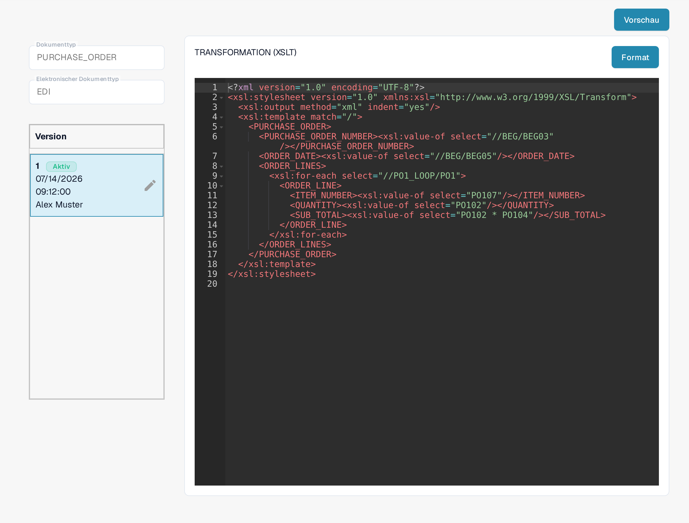
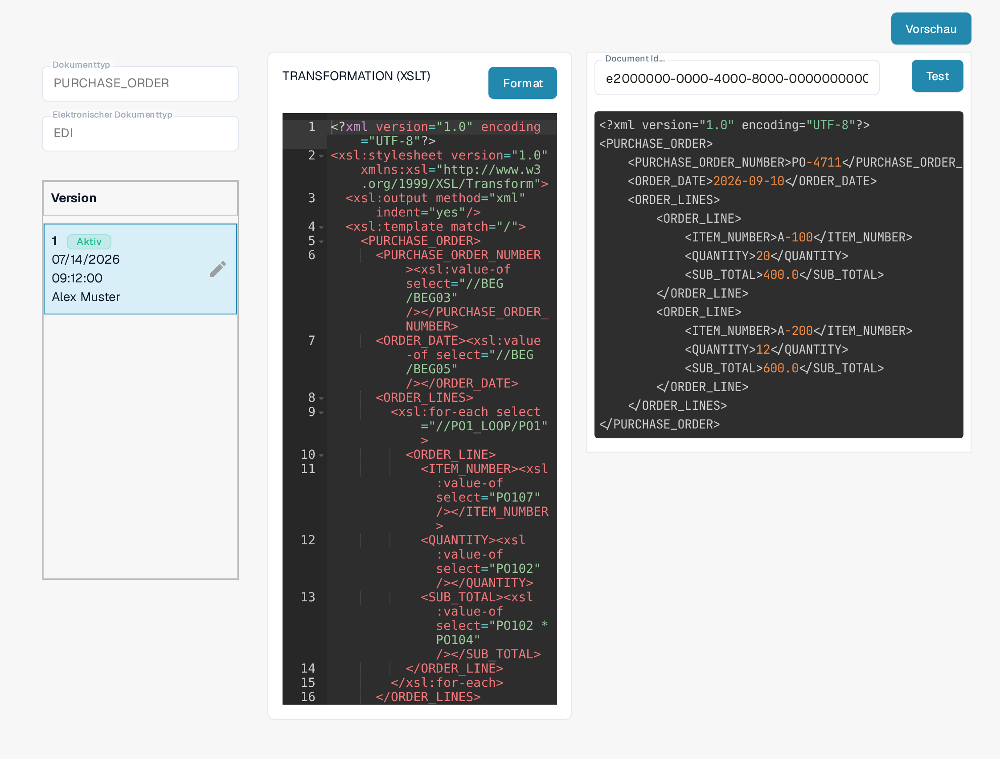

# EDI-Transformationsdatei-Anleitung

Die Konfiguration **TRANSFORMATION** wandelt die EDI-Eingabe in das strukturierte XML um, das DocBits verwendet. Sie ist ein **XSLT**-Stylesheet. Diese Anleitung richtet sich an Personen, die ein elektronisches Dokumentformat pflegen; für die Prüfung einer Änderung brauchst du ein aussagekräftiges EDI-Dokument.

## Transformation öffnen

1. Gehe zu **Einstellungen → Dokumenttypen** und öffne **E-Doc** für den Dokumenttyp, den du konfigurieren möchtest.
2. Klappe **EDI** auf und wähle **TRANSFORMATION** mit der Kennzeichnung **XSLT**. Die Bilder zeigen das EDI-Format einer Bestellung (**PURCHASE_ORDER**) in einer Testorganisation für die Dokumentation.

<figure><figcaption>Wähle TRANSFORMATION (XSLT) in der EDI-Formatliste.</figcaption></figure>

## Stylesheet und Version lesen

Links siehst du den gewählten Dokumenttyp, das EDI-Format und die Versionen. **Aktiv** kennzeichnet die Version, die derzeit verwendet wird. Der XSLT-Quelltext steht rechts im Editor. Das Beispiel der Bestellung nutzt `xsl:value-of`, um Werte wie die Bestellnummer (`//BEG/BEG03`), das Bestelldatum (`//BEG/BEG05`) und die Positionen aus der EDI-Eingabe in eine `PURCHASE_ORDER`-XML-Struktur zu kopieren. Dein Dokument kann andere EDI-Pfade verwenden. **Format** ordnet den Quelltext nur zum Lesen; dabei wird keine Version aktiviert.

<figure><figcaption>Die aktive EDI-Transformation der Bestellung in der Testorganisation.</figcaption></figure>

Das Stiftsymbol neben der aktiven Version legt einen **Entwurf** für Änderungen an. Prüfe und teste den Entwurf, bevor du ihn mit seinem Häkchen aktivierst. Eine aktivierte Version ersetzt die bisher aktive Version. Das Papierkorb-Symbol löscht einen unerwünschten Entwurf; es erscheint nur, wenn mehr als eine Version vorhanden ist. Die Bilder zeigen die aktive Version, deshalb sind die Schaltflächen eines Entwurfs darin nicht abgebildet.

## Vor der Aktivierung testen

Klicke oben rechts auf **Vorschau**, um das Testfeld zu öffnen. Trage die Dokument-ID eines hochgeladenen EDI-Dokuments in das Feld neben **Test** ein und klicke auf **Test**. Geprüft wird der aktuelle Inhalt des Editors, also auch ein noch nicht gespeicherter Entwurf. Vergleiche die zurückgegebene Ausgabe mit dem Ausgangsdokument und den erwarteten XML-Feldern. Das Bild zeigt einen Test in einer Testorganisation mit der erfundenen Beispiel-ID `e2000000-0000-4000-8000-000000000004` (im Eingabefeld am rechten Rand abgeschnitten); auch die angezeigte Ausgabe sind erfundene Beispieldaten.

<figure><figcaption>Teste die gewählte Transformation mit der Dokument-ID eines Beispiel-EDIs; die gezeigte ID und die Ausgabe sind erfundene Beispieldaten.</figcaption></figure>

Nach der Transformation ordnet DocBits die XML-Werte über [Extraktionspfade](edi-extraction-paths-file-guide.md) den Feldern zu. Die [Vorschau-Datei](edi-preview-file-guide.md) steuert die lesbare Darstellung. Eine [Videoanleitung zu EDI](edi-videos.md) zeigt den Ablauf.

## Geltende Regeln und Aktivierung

Organisationsspezifische Regeln haben Vorrang vor den Standardregeln für das erkannte eDoc-Format. Prüfe die aktive TRANSFORMATION und prüfe, welcher Knoten den gesuchten Wert im transformierten XML liefert; der Pfad hängt vom Format ab. Speichern sichert einen Entwurf; aktivierst du ihn nach dem Testen über das Häkchen. Eine gerenderte Vorschau belegt nicht den gespeicherten Dokumenttyp. Die [Anleitung zur Fehlerbehebung bei der Klassifizierung](../credit-note-recognized-as-invoice.md) erläutert die Codes 381/261, spätere Skripte und Vorsichtsmaßnahmen bei der erneuten Verarbeitung.

Die technischen Attributnamen in der Liste, etwa TRANSFORMATION, PREVIEW oder EXTRACTION PATHS, bleiben in jeder Sprache unverändert. Die Ansichten zeigen eine vorhandene Konfiguration und Version. Die Einstellungen unterscheiden sich je nach Dokumenttyp und Format. Prüfe Änderungen in einem Entwurf vor der Aktivierung.
