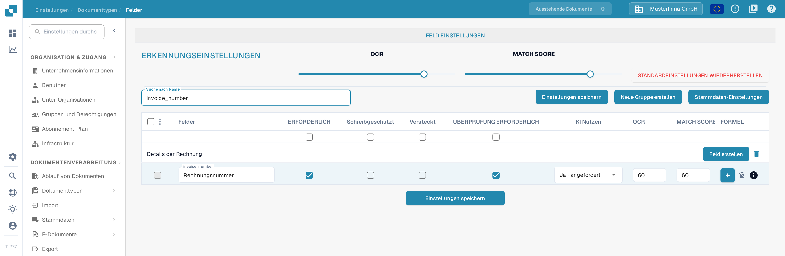
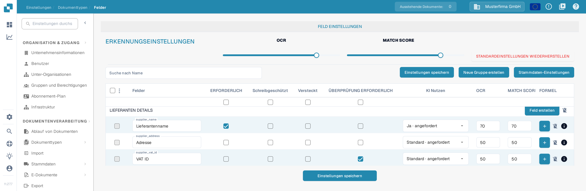

# Festlegen von Validierung und Match Score

In **Felder** können Sie Validierung und Erkennungsschwellenwerte für einen Dokumenttyp festlegen. Diese Seite verwendet **Rechnung** in einer Dokumentationstestorganisation. Sie erläutert das aktuelle Kontrollkästchen **ÜBERPRÜFUNG ERFORDERLICH** und die **Match Score**-Steuerung.

## Felder-Einstellungen öffnen

1. Gehen Sie zu **Einstellungen → Dokumenttypen → Rechnung → Felder**.
2. Verwenden Sie **Suche nach Name**, um ein Feld zu finden, zum Beispiel `invoice_number` (angezeigt als **Rechnungsnummer**).
3. Prüfen Sie die Feldzeile, bevor Sie eine Einstellung ändern. **ERFORDERLICH**, **Schreibgeschützt**, **Versteckt** und **ÜBERPRÜFUNG ERFORDERLICH** sind getrennte Kontrollkästchen.

<figure><figcaption>
Feldeinstellungen mit getrennten Spalten für Überprüfung erforderlich, OCR und Match Score.
</figcaption></figure>

## ÜBERPRÜFUNG ERFORDERLICH (Force Validation)

Aktivieren Sie **ÜBERPRÜFUNG ERFORDERLICH** in der Feldzeile, um für dieses Feld eine strengere Validierung anzuwenden. Das Kontrollkästchen ist von **ERFORDERLICH** getrennt: Ein Feld als erforderlich zu markieren wählt ÜBERPRÜFUNG ERFORDERLICH nicht automatisch mit aus. Das Kontrollkästchen kann nicht verfügbar sein, wenn ein Feld ausgeblendet oder schreibgeschützt ist. Klicken Sie nach dem Ändern der Feldkonfiguration auf **Einstellungen speichern**.

Die alten Anweisungen schlugen vor, hier numerische Grenzwerte oder reguläre Ausdrücke einzugeben. Die aktuelle Felder-Tabelle zeigt in der Zelle ÜBERPRÜFUNG ERFORDERLICH keinen Regeleditor. Für feldspezifische Regeln siehe [Konfigurieren von Feldeigenschaften](configuring-field-properties-1.md).

## Match Score

**Match Score** ist ein numerischer Schwellenwert, kein fester Referenzwert. Der Regler **MATCH SCORE** unter **ERKENNUNGSEINSTELLUNGEN** wendet seinen Wert auf die Feldzeilen des Dokumenttyps an; für einen einzelnen Wert verwenden Sie das **MATCH SCORE**-Eingabefeld einer Feldzeile. In der Dokumentationstestorganisation zeigen die Regler **OCR** und **MATCH SCORE** **80**, die Zeile `invoice_number` zeigt **60**. Prüfen Sie die betroffenen Felder und klicken Sie dann auf **Einstellungen speichern**.

<figure><figcaption>
Gefilterte Zeile Rechnungsnummer mit aktivierter Überprüfung erforderlich und eigenem Match-Score-Wert.
</figcaption></figure>

**OCR** ist ein separater Erkennungsschwellenwert neben dem Match Score. **STANDARDEINSTELLUNGEN WIEDERHERSTELLEN** setzt die Einstellungen zurück; verwenden Sie es nur, wenn Sie Ihre eigenen Schwellenwerte verwerfen möchten. Weitere Feldoptionen finden Sie in der [Felder-Übersicht](README.md).

## Feldübersicht

<figure><figcaption>
Weitere Feldzeilen mit eigenen Werten für Überprüfung erforderlich, OCR und Match Score.
</figcaption></figure>

ÜBERPRÜFUNG ERFORDERLICH, OCR und Match Score sind getrennte Einstellungen. Match Score ist ein numerischer Schwellenwert; er ist kein fester Referenztext und keine Auswahl eines Match-Value.
