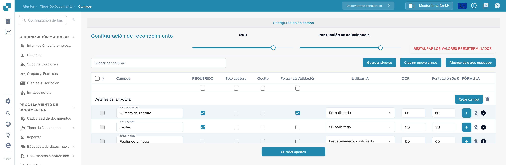
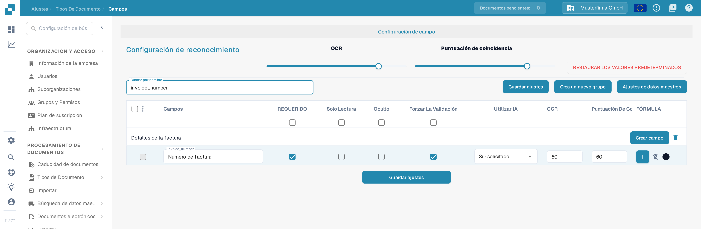

# Validación y puntuación de coincidencia

En **Campos**, puede establecer los umbrales de validación y reconocimiento de un tipo de documento. Esta página utiliza **Factura** en una organización de prueba de la documentación. Explica la casilla **Forzar La Validación** y los controles de **Puntuación de coincidencia** actuales.

## Abrir la configuración de campos

1. Vaya a **Ajustes → Tipos De Documento → Factura → Campos**.
2. Use **Buscar por nombre** para encontrar un campo, por ejemplo `invoice_number` (que se muestra como **Número de factura**).
3. Revise la fila del campo antes de cambiar una configuración. **REQUERIDO**, **Solo Lectura**, **Oculto** y **Forzar La Validación** son casillas independientes.

<figure><figcaption>
La configuración de reconocimiento aparece encima de la tabla de campos; cada fila tiene su propia casilla Forzar La Validación y sus propios umbrales de OCR y Puntuación De Coincidencia.
</figcaption></figure>

## Forzar La Validación

Marque **Forzar La Validación** en la fila del campo para aplicar una validación más estricta a ese campo. La casilla es independiente de **REQUERIDO**: marcar un campo como requerido no selecciona Forzar La Validación automáticamente. La casilla puede no estar disponible cuando un campo está oculto o es de solo lectura. Haga clic en **Guardar ajustes** después de cambiar la configuración del campo.

Las instrucciones antiguas sugerían introducir aquí límites numéricos o expresiones regulares. La tabla de Campos actual no muestra un editor de reglas en la celda de Forzar La Validación. Para reglas específicas de cada campo, consulte [Configuración de propiedades de campo](configuring-field-properties-1.md).

## Puntuación de coincidencia

**Puntuación de coincidencia** es un umbral numérico, no un valor de referencia fijo. El control deslizante **Puntuación de coincidencia** de **Configuración de reconocimiento** aplica su valor a las filas de campos del tipo de documento; utilice el campo **Puntuación De Coincidencia** de una fila para dar un valor individual a ese campo. En la organización de prueba, la fila `invoice_number` muestra **60** tanto en **OCR** como en **Puntuación De Coincidencia**. Revise los campos afectados y haga clic en **Guardar ajustes**.

<figure><figcaption>
La búsqueda de <strong>invoice_number</strong> deja una sola fila; ahí se ven la casilla Forzar La Validación y los dos umbrales de ese campo.
</figcaption></figure>

**OCR** es un umbral de reconocimiento independiente situado junto a la Puntuación de coincidencia. **Restaurar los valores predeterminados** restablece la configuración; utilícelo solo cuando desee descartar sus umbrales personalizados. Para otras opciones de campos, consulte la [Descripción general de Campos](README.md).

## Descripción general por campo

<figure><figcaption>
Los grupos de campos inferiores muestran el mismo par de umbrales en cada fila: el nombre del proveedor coincide a partir de 70, los demás campos a partir de 50.
</figcaption></figure>

Forzar La Validación, OCR y Puntuación de coincidencia son ajustes independientes. La puntuación de coincidencia es un umbral numérico; no es un texto de referencia fijo ni un selector de valor de coincidencia.
