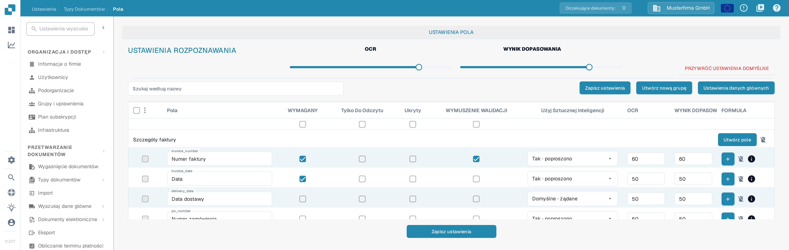
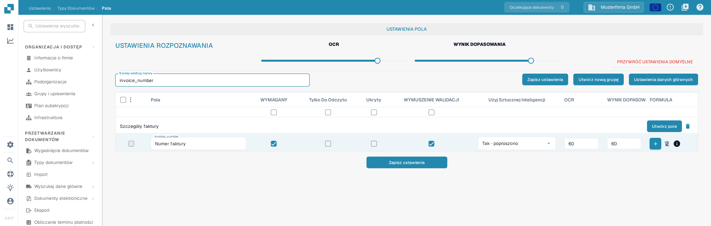

# Ustawianie walidacji i wyniku dopasowania

W sekcji **Pola** możesz ustawić progi walidacji i rozpoznawania dla typu dokumentu. Ta strona używa typu **Faktura** w testowej organizacji dokumentacji. Opisuje aktualne pole wyboru **WYMUSZENIE WALIDACJI** oraz elementy sterujące **WYNIK DOPASOWANIA**.

## Otwieranie ustawień pól

1. Przejdź do **Ustawienia → Typy Dokumentów → Faktura → Pola**.
2. Użyj pola **Szukaj według nazwy**, aby znaleźć pole, na przykład `invoice_number` (wyświetlane jako **Numer faktury**).
3. Sprawdź wiersz pola przed zmianą ustawienia. **WYMAGANY**, **Tylko Do Odczytu**, **Ukryty** i **WYMUSZENIE WALIDACJI** to oddzielne pola wyboru.

<figure><figcaption>
Ustawienia rozpoznawania i kolumny pól znajdują się nad listą pól.
</figcaption></figure>

## WYMUSZENIE WALIDACJI

Zaznacz **WYMUSZENIE WALIDACJI** w wierszu pola, aby zastosować dla tego pola surowszą walidację. Pole wyboru jest niezależne od opcji **WYMAGANY**: oznaczenie pola jako wymagane nie zaznacza automatycznie opcji WYMUSZENIE WALIDACJI. Pole wyboru może być niedostępne, gdy pole jest ukryte lub tylko do odczytu. Po zmianie konfiguracji pól kliknij **Zapisz ustawienia**.

Stare instrukcje sugerowały wpisywanie w tym miejscu limitów liczbowych lub wyrażeń regularnych. Aktualna tabela pól nie wyświetla edytora reguł w komórce WYMUSZENIE WALIDACJI. Reguły dotyczące poszczególnych pól opisuje strona [Konfigurowanie właściwości pola](configuring-field-properties-1.md).

## WYNIK DOPASOWANIA

**WYNIK DOPASOWANIA** to próg liczbowy, a nie stała wartość referencyjna. Suwak **WYNIK DOPASOWANIA** w sekcji **USTAWIENIA ROZPOZNAWANIA** stosuje swoją wartość do wierszy pól typu dokumentu; wartość dla pojedynczego pola ustawiasz w polu **WYNIK DOPASOWANIA** w tym wierszu. Obok suwaka nie ma liczby — rzeczywiste wartości odczytasz w polach wierszy. W przykładzie wiersz `invoice_number` pokazuje **60** w kolumnach **OCR** i **WYNIK DOPASOWANIA**. Przejrzyj objęte pola, a następnie kliknij **Zapisz ustawienia**.

<figure><figcaption>
Wyszukaj pole, aby sprawdzić jego pole wyboru WYMUSZENIE WALIDACJI i wartość WYNIK DOPASOWANIA.
</figcaption></figure>

**OCR** to oddzielny próg rozpoznawania obok wyniku dopasowania. **PRZYWRÓĆ USTAWIENIA DOMYŚLNE** resetuje ustawienia; użyj tej opcji tylko wtedy, gdy chcesz odrzucić własne progi. Inne działania na polach, w tym **Utwórz pole**, **Utwórz nową grupę**, **Ustawienia danych głównych** i **Przypisz ponownie grupę pól**, opisuje [Konfigurowanie właściwości pola](configuring-field-properties-1.md); przegląd typów pól znajdziesz w [Przegląd pól](README.md).

## Przegląd na poziomie pól

<figure><figcaption>
Każdy wiersz pola ma własne wartości OCR i WYNIK DOPASOWANIA.
</figcaption></figure>

**WYMUSZENIE WALIDACJI**, **OCR** i **WYNIK DOPASOWANIA** to oddzielne ustawienia. WYNIK DOPASOWANIA jest progiem liczbowym: to nie jest stały tekst referencyjny ani selektor wartości dopasowania.
