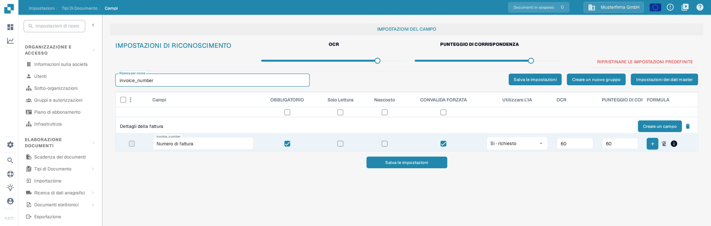

# Impostazioni di convalida e punteggio di corrispondenza

In **Campi** puoi impostare le soglie di convalida e di riconoscimento di un tipo di documento. Questa pagina usa **Fattura** in un'organizzazione di prova della documentazione. Spiega l'attuale casella **CONVALIDA FORZATA** e i controlli **PUNTEGGIO DI CORRISPONDENZA**.

## Aprire le impostazioni dei campi

1. Vai a **Impostazioni → Tipi di Documento → Fattura → Campi**.
2. Usa **Ricerca per nome** per trovare un campo, ad esempio `invoice_number` (mostrato come **Numero di fattura**).
3. Controlla la riga del campo prima di modificare un'impostazione. **OBBLIGATORIO**, **Solo Lettura**, **Nascosto** e **CONVALIDA FORZATA** sono caselle di controllo separate.

<figure><figcaption>
I controlli di riconoscimento compaiono sopra l'elenco dei campi.
</figcaption></figure>

## CONVALIDA FORZATA

Seleziona **CONVALIDA FORZATA** nella riga del campo per applicare a quel campo una convalida più rigorosa. La casella è separata da **OBBLIGATORIO**: contrassegnare un campo come obbligatorio non seleziona automaticamente CONVALIDA FORZATA. La casella può non essere disponibile quando un campo è nascosto o di sola lettura. Dopo aver modificato la configurazione del campo, fai clic su **Salva le impostazioni**.

Le istruzioni precedenti suggerivano di inserire qui limiti numerici o espressioni regolari. L'attuale tabella Campi non mostra un editor di regole nella cella CONVALIDA FORZATA. Per le regole specifiche di un campo, consulta [Configurazione delle proprietà dei campi](configuring-field-properties-1.md).

## PUNTEGGIO DI CORRISPONDENZA

**PUNTEGGIO DI CORRISPONDENZA** è una soglia numerica, non un valore di riferimento fisso. Il cursore **PUNTEGGIO DI CORRISPONDENZA** in **IMPOSTAZIONI DI RICONOSCIMENTO** applica il proprio valore alle righe dei campi del tipo di documento; per un valore individuale usa l'input **PUNTEGGIO DI CORRISPONDENZA** della singola riga di campo. Nell'esempio illustrato il cursore mostra **80**, mentre la riga `invoice_number` mostra **60** sia in **OCR** sia in **PUNTEGGIO DI CORRISPONDENZA**. Verifica i campi interessati, poi fai clic su **Salva le impostazioni**.

<figure><figcaption>
Cerca un campo per verificarne la casella CONVALIDA FORZATA e il valore PUNTEGGIO DI CORRISPONDENZA.
</figcaption></figure>

**OCR** è una soglia di riconoscimento separata, accanto a PUNTEGGIO DI CORRISPONDENZA. **RIPRISTINARE LE IMPOSTAZIONI PREDEFINITE** reimposta le configurazioni; usalo solo se intendi scartare le tue soglie personalizzate. Per gli altri controlli di questa vista, tra cui **Creare un nuovo gruppo**, **Impostazioni dei dati master** e **FORMULA**, consulta [Configurazione delle proprietà dei campi](configuring-field-properties-1.md); una panoramica dei tipi di campo è in [Campi](README.md).

## Panoramica a livello di campo

<figure><figcaption>
Ogni riga di campo porta le proprie impostazioni di convalida e di riconoscimento.
</figcaption></figure>

CONVALIDA FORZATA, OCR e PUNTEGGIO DI CORRISPONDENZA sono impostazioni separate. PUNTEGGIO DI CORRISPONDENZA è una soglia numerica: non è un testo di riferimento fisso né un selettore del valore di corrispondenza.
