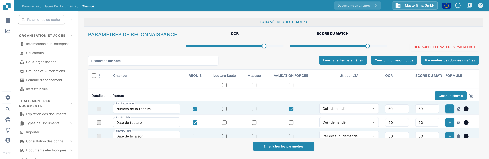
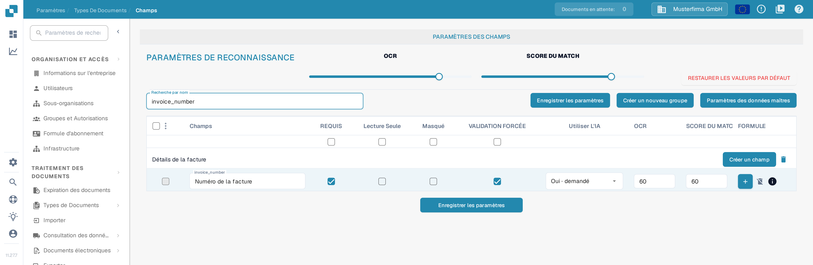
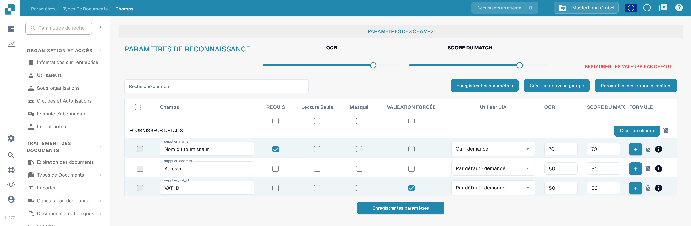

# Paramétrage de la validation et du score de correspondance

Dans **Champs**, vous pouvez définir les seuils de validation et de reconnaissance d'un type de document. Cette page utilise **Facture** dans une organisation de test de la documentation. Elle explique la case à cocher **VALIDATION FORCÉE** et les contrôles **SCORE DU MATCH** actuels.

## Ouvrir les paramètres des champs

1. Allez dans **Paramètres → Types De Documents → Facture → Champs**.
2. Utilisez **Recherche par nom** pour trouver un champ, par exemple `invoice_number` (affiché comme **Numéro de la facture**).
3. Vérifiez la ligne du champ avant de modifier un paramètre. **REQUIS**, **Lecture Seule**, **Masqué** et **VALIDATION FORCÉE** sont des cases à cocher indépendantes.

<figure><figcaption>
Les paramètres de reconnaissance se trouvent au-dessus du tableau des champs ; chaque ligne possède sa propre case VALIDATION FORCÉE et ses propres seuils OCR et SCORE DU MATCH.
</figcaption></figure>

## Validation forcée

Cochez **VALIDATION FORCÉE** dans la ligne du champ pour appliquer une validation plus stricte à ce champ. La case à cocher est indépendante de **REQUIS** : marquer un champ comme requis ne coche pas VALIDATION FORCÉE automatiquement. La case à cocher peut être indisponible lorsqu'un champ est masqué ou en lecture seule. Cliquez sur **Enregistrer les paramètres** après avoir modifié la configuration du champ.

Les anciennes instructions suggéraient de saisir ici des limites numériques ou des expressions régulières. Le tableau des Champs actuel n'affiche pas d'éditeur de règles dans la cellule VALIDATION FORCÉE. Pour les règles propres à un champ, consultez [Configuration des propriétés de champ](configuring-field-properties-1.md).

## Score du match

**SCORE DU MATCH** est un seuil numérique, pas une valeur de référence fixe. Le curseur **SCORE DU MATCH** dans **PARAMÈTRES DE RECONNAISSANCE** applique sa valeur aux lignes de champs du type de document ; utilisez le champ **SCORE DU MATCH** d'une ligne pour donner une valeur individuelle à ce champ. Dans l'organisation de test, la ligne `invoice_number` affiche **60** aussi bien en **OCR** qu'en **SCORE DU MATCH**. Vérifiez les champs concernés, puis cliquez sur **Enregistrer les paramètres**.

<figure><figcaption>
La recherche de <strong>invoice_number</strong> ne laisse qu'une ligne ; vous y voyez la case VALIDATION FORCÉE et les deux seuils de ce champ.
</figcaption></figure>

**OCR** est un seuil de reconnaissance distinct, situé à côté du SCORE DU MATCH. **RESTAURER LES VALEURS PAR DÉFAUT** réinitialise les paramètres ; utilisez-le uniquement lorsque vous souhaitez abandonner vos seuils personnalisés. Pour les autres options de champs, consultez la [présentation des Champs](README.md).

## Vue d'ensemble au niveau du champ

<figure><figcaption>
Les groupes de champs situés plus bas affichent la même paire de seuils sur chaque ligne : 70 pour le nom du fournisseur, 50 pour les autres champs.
</figcaption></figure>

VALIDATION FORCÉE, OCR et SCORE DU MATCH sont des réglages indépendants. Le score du match est un seuil numérique ; ce n'est ni un texte de référence fixe ni un sélecteur de valeur de correspondance.
