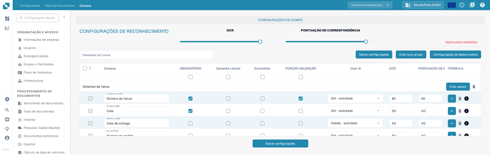
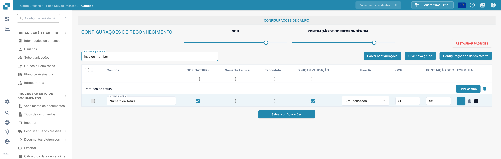

# Definição de Validação e Pontuação de Correspondência

Em **Campos**, você pode definir os limites de validação e de reconhecimento de um tipo de documento. Esta página usa **Fatura** em uma organização de teste da documentação. Ela explica a caixa de seleção **FORÇAR VALIDAÇÃO** e os controles **PONTUAÇÃO DE CORRESPONDÊNCIA** atuais.

## Abrir as configurações dos campos

1. Vá para **Configurações → Tipos de Documentos → Fatura → Campos**.
2. Use **Pesquisar por nome** para localizar um campo, por exemplo `invoice_number` (exibido como **Número da fatura**).
3. Verifique a linha do campo antes de alterar uma configuração. **OBRIGATÓRIO**, **Somente Leitura**, **Escondido** e **FORÇAR VALIDAÇÃO** são caixas de seleção separadas.

<figure><figcaption>
As configurações de reconhecimento ficam acima da lista de campos.
</figcaption></figure>

## FORÇAR VALIDAÇÃO

Selecione **FORÇAR VALIDAÇÃO** na linha do campo para aplicar uma validação mais rigorosa a esse campo. A caixa de seleção é separada de **OBRIGATÓRIO**: marcar um campo como obrigatório não seleciona FORÇAR VALIDAÇÃO automaticamente. A caixa de seleção pode ficar indisponível quando um campo está escondido ou é somente leitura. Depois de alterar a configuração do campo, clique em **Salvar configurações**.

As instruções antigas sugeriam inserir aqui limites numéricos ou expressões regulares. A tabela Campos atual não mostra um editor de regras na célula FORÇAR VALIDAÇÃO. Para regras específicas de um campo, consulte [Configurando Propriedades de Campo](configuring-field-properties-1.md).

## PONTUAÇÃO DE CORRESPONDÊNCIA

**PONTUAÇÃO DE CORRESPONDÊNCIA** é um limite numérico, não um valor de referência fixo. Os controles deslizantes **OCR** e **PONTUAÇÃO DE CORRESPONDÊNCIA** em **CONFIGURAÇÕES DE RECONHECIMENTO** aplicam seu valor às linhas de campos do tipo de documento; use as entradas **OCR** e **PONTUAÇÃO DE CORRESPONDÊNCIA** de uma linha de campo para um valor individual. No exemplo ilustrado, a linha `invoice_number` mostra **60** nas duas entradas. Revise os campos afetados e, em seguida, clique em **Salvar configurações**.

<figure><figcaption>
Pesquise um campo para verificar sua caixa FORÇAR VALIDAÇÃO e seu valor de PONTUAÇÃO DE CORRESPONDÊNCIA.
</figcaption></figure>

**OCR** é um limite de reconhecimento separado, ao lado de PONTUAÇÃO DE CORRESPONDÊNCIA. **RESTAURAR PADRÕES** redefine as configurações; use-o apenas quando pretende descartar seus limites personalizados. Para outras opções de campos, consulte a visão geral de [Campos](README.md).

## Visão geral no nível do campo

<figure><figcaption>
Cada campo tem sua própria configuração de validação e de reconhecimento.
</figcaption></figure>

FORÇAR VALIDAÇÃO, OCR e PONTUAÇÃO DE CORRESPONDÊNCIA são configurações separadas. A pontuação de correspondência é um limite numérico; não é um texto de referência fixo nem um seletor de Match Value.
