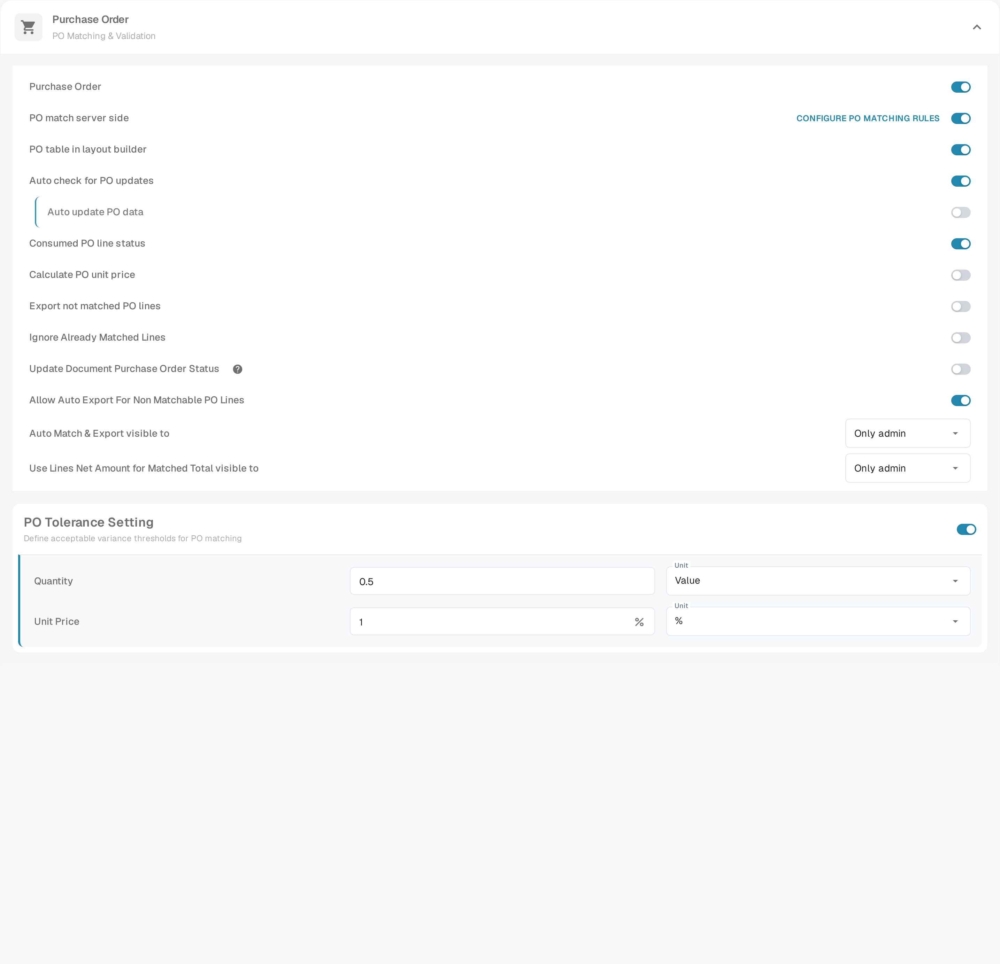

# Reguły wyboru układu

## Przegląd

**Układ** decyduje, które pola i grupy użytkownik widzi — i w jakiej kolejności — na ekranach **Field Validation**, **Approval**, **Reject** i **Review** dokumentu. Układy projektujesz w [Layout Manager](./).

Klasycznie DocBits wybierał układ na podstawie **pochodzenia** dokumentu: kraju lub regionu pobranego z ustawień językowych dokumentu, takiego jak `DE` czy `US`. Każde pochodzenie miało własną kopię układu i nic innego nie mogło wpłynąć na wybór.

Dzięki **regułom wyboru układu** układy stają się wielokrotnie używanymi elementami składowymi, niezależnymi od pochodzenia, a to **reguły** decydują, jaki układ otrzyma dokument:

> *Gdy* dokument spełnia warunek, *wtedy* otrzymuje ten układ. Reguły są sprawdzane od góry do dołu; **wygrywa pierwsza pasująca reguła**. Jeśli żadna reguła nie pasuje, używany jest **układ domyślny**.

Pochodzenie nadal jest dostępne — jako jeden z wielu warunków. Reguła może równie dobrze uwzględniać dostawcę, kwotę, status dokumentu, metodę ekstrakcji lub dowolne pole nagłówka.

### Problemy, które rozwiązują

| Wymaganie                                                           | Klasyczne układy oparte na pochodzeniu      | Z regułami wyboru                                                                     |
| ------------------------------------------------------------------- | ------------------------------------------- | ------------------------------------------------------------------------------------- |
| Faktury jednego dostawcy wymagają dodatkowych pól (projekt, numer celny) | niemożliwe bez nowego pochodzenia       | reguła *Supplier ID is 20723* → układ „Faktura z polami projektu”                     |
| Dokumenty DE, AT i CH powinny wyglądać tak samo                     | trzy kopie tego samego układu do utrzymania | jeden układ, jedna reguła na pochodzenie (lub grupa ANY) wskazująca na niego          |
| E-faktury wymagają prostszego ekranu niż skanowane pliki PDF         | niemożliwe                                  | reguła *Extraction Method is ELECTRONIC\_DOCUMENT* → układ „E-faktura”                |
| Faktury o wysokiej wartości wymagają więcej pól na ekranie Approval  | niemożliwe                                  | reguła Approval *Total Amount greater than 10000* → układ „Akceptacja wysokich kwot”  |
| Drugi akceptujący powinien widzieć inny ekran niż pierwszy           | osobny typ układu „druga akceptacja”        | reguła Approval *Document Status is Pending second approval* → układ „Druga akceptacja” |

## Włączanie układów opartych na regułach

Układy oparte na regułach włącza się **dla każdego typu dokumentu** osobno, jako **administrator organizacji**.

1. Przejdź do **Settings → Document Processing → Document Types**.
2. Kliknij ikonę **ustawień** (koło zębate) na karcie typu dokumentu.
3. Otwórz **Manage Layouts** i włącz przełącznik.

<figure><figcaption>
Przełącznik Manage Layouts w dodatkowych ustawieniach typu dokumentu
</figcaption></figure>
<!-- English source image: lsr-manage-layouts-toggle-en-20261102.png -->

Link **Layouts** na karcie typu dokumentu otwiera teraz **Layouts & Selection Rules**.

### Co się dzieje po włączeniu

DocBits przekształca istniejące układy oparte na pochodzeniu w reguły — jednorazowo, dla danego typu dokumentu i dla każdego ekranu:

* Układ o pochodzeniu **DEFAULT** staje się **układem domyślnym** (rozwiązaniem awaryjnym).
* Każdy układ konkretnego pochodzenia staje się regułą **„Layout for XX”** z warunkiem *Document Origin is XX*, wskazującą na ten układ. Reguły te otrzymują priorytety w krokach po 10 (na przykład 2000, 2010, 2020 …), dzięki czemu własne reguły możesz umieścić przed nimi, między nimi lub po nich.

<figure><figcaption>
Reguły pochodzenia utworzone przy aktywacji, a po nich układ domyślny (FALLBACK)
</figcaption></figure>
<!-- English source image: lsr-default-layout-row-en-20261102.png -->

Nic nie jest usuwane ani zmieniane w samych układach. Zaraz po aktywacji każdy dokument otrzymuje więc dokładnie ten układ, który otrzymywał wcześniej. Zachowanie zmienia się dopiero wtedy, gdy dodasz lub zmienisz reguły.

**Wyłączenie** funkcji natychmiast przywraca dla typu dokumentu wybór oparty na pochodzeniu. Reguły są zachowane, ale nieużywane, i zaczynają działać ponownie po ponownym włączeniu przełącznika.

## Ekran Layouts & Selection Rules

<figure><figcaption>
Zakładka Layouts: każdy układ typu dokumentu jako karta
</figcaption></figure>
<!-- English source image: lsr-layouts-overview-en-20261102.png -->

* **Layouts / Selection rules** (w nagłówku strony) przełączają między listą układów a listą reguł. Liczby pokazują, ile ich jest.
* **Field Validation / Approval / Reject / Review** przełączają **ekran**. Każdy ekran ma własne układy, własne reguły i własny układ domyślny — reguła Approval nigdy nie zmienia ekranu Field Validation.
* Na zakładce **Layouts** możesz tworzyć, edytować, klonować i usuwać układy. Każda karta pokazuje, czy jakaś reguła używa układu („Not targeted by rules”, gdy żadna go nie używa). Filtruj za pomocą **All / My layouts / System**; układy systemowe są dostarczane z DocBits i można je przeglądać oraz klonować, ale nie zmieniać.


Pierwsza i druga akceptacja współdzielą układy i reguły **Approval**. Aby nadać drugiemu etapowi akceptacji własny ekran, dodaj regułę Approval z warunkiem *Document Status is Pending second approval* — zobacz [przykład](layout-selection-rules.md#different-screens-for-first-and-second-approval).


## Jak wybierany jest układ

Za każdym razem, gdy dokument jest otwierany, oraz ponownie po jego zapisaniu, DocBits ustala jego układ dla bieżącego ekranu:

1. **Aktywne reguły** ekranu są sprawdzane w kolejności **priorytetu** (od najniższego numeru). **Wygrywa pierwsza reguła, której warunek jest prawdziwy**, i używany jest jej układ.
2. Jeśli żadna reguła nie pasuje, używany jest **układ domyślny**.
3. Jeśli nie ma też układu domyślnego, DocBits wraca do klasycznego wyboru opartego na pochodzeniu.

Reguły, których układ został usunięty lub jest pusty, są pomijane.

### Przykład krok po kroku

Reguły ekranu **Field Validation**:

| Priorytet | Reguła                | Warunek                                     | Układ                          |
| -------- | --------------------- | ------------------------------------------- | ------------------------------ |
| 5        | Faktury Behaelterbau  | *Supplier ID is HP0000278*                  | Faktura z polami projektu      |
| 10       | E-faktury             | *Extraction Method is ELECTRONIC\_DOCUMENT* | E-faktura                      |
| 2020     | Layout for DE         | *Document Origin is DE*                     | Field Validation Layout (DE)   |
| —        | Układ domyślny        | —                                           | Field Validation Layout (Base) |

Jaki układ otrzymuje każdy dokument:

| Dokument | Dostawca  | Ekstrakcja  | Pochodzenie | Układ                          | Dlaczego                                              |
| -------- | --------- | ----------- | ----------- | ------------------------------ | ----------------------------------------------------- |
| 1        | HP0000278 | e-faktura   | DE          | Faktura z polami projektu      | najpierw pasuje priorytet 5; kolejne reguły nie są sprawdzane |
| 2        | 10040     | e-faktura   | DE          | E-faktura                      | priorytet 5 nie pasuje, 10 pasuje                      |
| 3        | 10040     | skanowany PDF | DE        | Field Validation Layout (DE)   | pasuje tylko reguła pochodzenia                       |
| 4        | 10040     | skanowany PDF | US        | Field Validation Layout (Base) | żadna reguła nie pasuje → układ domyślny              |

**Kolejność ma znaczenie**: reguły szczegółowe (jeden dostawca) umieszczaj nad regułami ogólnymi (jeden kraj).

### Gdy użytkownik zmieni pole, które reguły uwzględniają

Układ jest zawsze wybierany na podstawie **bieżących** wartości dokumentu. Jeśli użytkownik poprawi na przykład dostawcę na ekranie Field Validation, DocBits po zapisaniu wybierze układ ponownie, a ekran może przełączyć się na inny układ. Żadne dane nie są tracone: pole, które nie należy do nowego układu, zachowuje swoją wartość; po prostu nie jest wyświetlane, dopóki nie zacznie obowiązywać układ, który je zawiera.

## Zarządzanie regułami wyboru

<figure><figcaption>
Zakładka Selection rules ekranu Field Validation
</figcaption></figure>
<!-- English source image: lsr-rules-list-en-20261102.png -->

Każdy wiersz pokazuje **priorytet** (pierwszy wiersz jest oznaczony **FIRST**), **nazwę i klucz reguły** wraz z jej **warunkami**, **układ docelowy**, plakietkę **źródła** oraz przełącznik **Active**.

| Zadanie                | Jak                                                                                |
| ------------------- | ---------------------------------------------------------------------------------- |
| Utworzenie reguły   | **New rule**                                                                       |
| Edycja reguły       | Kliknij wiersz                                                                      |
| Zmiana kolejności    | Przeciągnij uchwyt po lewej stronie wiersza w górę lub w dół. Nowa kolejność jest zapisywana natychmiast. |
| Wyłączenie reguły   | Przełącznik **Active**. Nieaktywne reguły są ignorowane.                                     |
| Duplikowanie lub usuwanie | Menu **⋮** wiersza                                                              |
| Wyszukiwanie reguły | **Search rules…**                                                                  |

Plakietka **źródła** informuje, skąd pochodzi reguła: reguły **System** są dostarczane z DocBits. Edycja takiej reguły tworzy kopię dla Twojej organizacji, oznaczoną jako **Customized**; oryginał pozostaje nienaruszony i można go przywrócić. Reguły, które tworzysz, mają źródło **Custom**.

### Układ domyślny

Ostatni wiersz, oznaczony **FALLBACK** i **is\_default**, to układ domyślny: jest używany zawsze, gdy żadna z reguł powyżej nie pasuje, i nie ma warunku. Powstaje po włączeniu funkcji (z układu o pochodzeniu DEFAULT).


Aby użyć innego układu awaryjnego, utwórz regułę **bez żadnego warunku** i nadaj jej najwyższy numer priorytetu, tak aby była sprawdzana jako ostatnia. Pasuje do każdego dokumentu, którego nie dopasowała żadna wcześniejsza reguła, jeszcze zanim zostanie użyty układ domyślny.


## Tworzenie reguły

Kliknij **New rule** na zakładce Selection rules ekranu, który chcesz zmienić.

<figure><figcaption>
Edytor reguły: zakres i priorytet, warunki, układ docelowy oraz podgląd na żywo tego, co reguła by zrobiła.
</figcaption></figure>
<!-- English source image: lsr-rule-editor-en-20261104.png -->

Zdanie u góry podsumowuje regułę w trakcie jej budowania — „When doc.doc_origin = AR, an INVOICE document gets the origin-ar layout for Field validation. Checked at priority 0 — the first matching rule wins.”

### Krok 1 — Zakres i priorytet

| Ustawienie                          | Co robi                                                                                                           |
| ----------------------------------- | ----------------------------------------------------------------------------------------------------------------- |
| **Rule Name**                       | Wyświetlana na liście reguł. Opisz przypadek biznesowy: „Behaelterbau invoices”, „E-invoices”, „High value approval”. |
| **Rule key**                        | Generowany z nazwy; pozostaje taki sam po zmianie nazwy reguły.                                                   |
| **Document Type** / **Layout type** | Typ dokumentu i ekran, dla którego jest reguła. Przejmowane z miejsca, w którym kliknięto **New rule**.            |
| **Priority**                        | Niższe numery są sprawdzane jako pierwsze. Zostawiaj odstępy (5, 10, 20 …), aby móc później wstawiać reguły.       |
| **Log execution**                   | Zapisuje każde obliczenie reguły, abyś później mógł prześledzić, dlaczego dokument pasował lub nie. Pozostaw wyłączone, dopóki nie potrzebujesz tego śladu. |

### Krok 2 — Dotyczy, gdy

Warunek, który musi spełniać dokument. Możesz użyć:

* **atrybutów dokumentu**: Document Origin, Extraction Method, Document Status, Sub Document Type,
* **pól nagłówka**: Supplier ID, Total Amount, Currency, Purchase Order i każde inne pole typu dokumentu,
* **własnej ścieżki JSON** (Advanced).

Kolumny tabeli nie są dostępne: układ jest wybierany jednorazowo dla całego dokumentu.

Pozostaw krok pusty, aby dopasować każdy dokument przy tym priorytecie. Sposób działania warunków — ALL / ANY, zagnieżdżone grupy, wszystkie operatory, puste wartości, wielkość liter — wyjaśniono na stronie [Rule Conditions (Applies when)](../rule-conditions-applies-when.md).

### Krok 3 — Układ docelowy

Kliknij układ, który ma otrzymać dokument. Lista pokazuje Twoje własne układy oraz układy systemowe wybranego ekranu. Układu nie można usunąć, dopóki jakaś reguła nadal na niego wskazuje.

### Podgląd na żywo · /resolve

Panel po prawej stronie pokazuje, co reguła robi dla przykładowego dokumentu o wartościach z Twoich warunków:

| Wiersz              | Znaczenie                                                                                             |
| ------------------- | ----------------------------------------------------------------------------------------------------- |
| **Sample document** | Wartości użyte w podglądzie, pobrane z Twoich warunków                                                |
| **matched\_by**     | `rule`, jeśli dopasowała się reguła, w przeciwnym razie układ domyślny                                |
| **Resolved layout** | Układ, który otrzymałby przykładowy dokument                                                          |
| **Priority hit**    | Priorytet reguły, która się dopasowała                                                                |
| **watched\_fields** | Pola, od których zależy wybór układu. Gdy użytkownik zmieni któreś z nich, układ jest wybierany ponownie. |

Kliknij **Create Rule** (lub **Save rule** podczas edycji), aby zapisać. **Cancel** wraca do listy reguł.

## Przykłady

### Dodatkowe pola dla jednego dostawcy

Ekran **Field Validation** · priorytet **5** · *Supplier ID is HP0000278* · cel *Faktura z polami projektu* (klon standardowego układu z dodatkowymi polami projektu i miejsca powstawania kosztów).

### Jeden układ dla kilku krajów

Ekran **Field Validation** · priorytet **100** · **ANY of**: *Document Origin is Deutsch*, *Document Origin is Austria*, *Document Origin is Switzerland* · cel *Faktura DACH*. Dezaktywuj zmigrowane reguły „Layout for AT” i „Layout for CH”, jeśli wskazują na starsze kopie.

### Prostszy ekran dla e-faktur

Ekran **Field Validation** · priorytet **10** · *Extraction Method is ELECTRONIC\_DOCUMENT* · cel *E-faktura* (bez pól związanych z OCR).

### Bardziej rygorystyczny ekran Approval dla wysokich kwot

Ekran **Approval** · priorytet **10** · *Total Amount greater than 10000* · cel *Akceptacja wysokich kwot* (pokazujący miejsce powstawania kosztów, właściciela budżetu i numer umowy).

### Różne ekrany dla pierwszej i drugiej akceptacji

Ekran **Approval** · priorytet **5** · *Document Status is Pending second approval* · cel *Second Approval Layout*. Dokumenty na etapie pierwszej akceptacji nie pasują i otrzymują domyślny układ Approval.

<figure><figcaption>
Reguła Approval dla drugiego etapu akceptacji — podgląd na żywo po prawej pokazuje już, że ta reguła wygrywa przy priorytecie 2000.
</figcaption></figure>
<!-- English source image: lsr-rule-editor-approval-en-20261104.png -->

### Specjalny ekran Reject dla wybranych dostawców

Ekran **Reject** · priorytet **10** · *Supplier ID is one of* `10040, 10041` · cel *Reject with reason codes*.

## Dobre praktyki

* **Najpierw szczegółowe, potem ogólne.** Reguły dostawców nad regułami krajów, reguły krajów nad układem domyślnym.
* **Zostawiaj odstępy w priorytetach** (5, 10, 20 …), aby nowe reguły można było wstawić bez zmiany numeracji.
* **Opieraj warunki na wiarygodnych polach.** Dostawca i pochodzenie są ustalane wcześnie i rzadko się zmieniają. Warunki oparte na polach, które użytkownicy często edytują, powodują przełączanie układów w trakcie pracy.
* **Klonuj, zamiast zaczynać od zera.** Sklonuj standardowy układ i dostosuj go, aby wszystkie układy zachowały tę samą podstawową strukturę.
* **Sprawdzaj podgląd na żywo** i po zmianie reguł otwórz rzeczywisty dokument każdego rodzaju.
* **Zachowaj sensowny układ domyślny** dla każdego ekranu, aby żaden dokument nie został bez układu.

## Rozwiązywanie problemów

| Objaw                                            | Co sprawdzić                                                                                                                         |
| ------------------------------------------------ | ------------------------------------------------------------------------------------------------------------------------------------ |
| Dokument otrzymuje zły układ                     | Wcześniejsza reguła pasuje jako pierwsza. Sprawdź reguły powyżej lub **Priority hit** w podglądzie.                                  |
| Używany jest układ domyślny, choć reguła powinna pasować | Czy reguła jest **Active**? Czy warunek pasuje do dokładnej wartości (wielkość liter, spacje)? Czy reguła jest na właściwej zakładce **ekranu**? |
| Układ zmienia się w trakcie pracy użytkownika     | Zmieniono pole z **watched\_fields**. Oprzyj regułę na bardziej stabilnym polu.                                                      |
| Nie można usunąć układu                          | Nadal wskazuje na niego jakaś reguła. Najpierw zmień cel tej reguły lub ją usuń.                                                      |
| Nie jest wyświetlany żaden układ                 | Żadna reguła nie pasowała, nie ma układu domyślnego i dla tego ekranu nie istnieje układ oparty na pochodzeniu. Dodaj regułę bez warunku jako rozwiązanie zbiorcze. |
| Po aktywacji nic się nie zmieniło                | Tak ma być: aktywacja odtwarza poprzedni wybór oparty na pochodzeniu. Dodaj własne reguły.                                            |
| Druga akceptacja pokazuje układ pierwszej akceptacji | Dodaj regułę Approval z warunkiem *Document Status is Pending second approval* nad pozostałymi regułami Approval.                  |

## Powiązane

* [Rule Conditions (Applies when)](../rule-conditions-applies-when.md)
* [Niestandardowe reguły walidacji](../custom-validation-rules.md)
* [Reguły transformacji](../transformation-rules/)
* [Nawigacja w Layout Manager](navigating-the-layout-manager.md)
