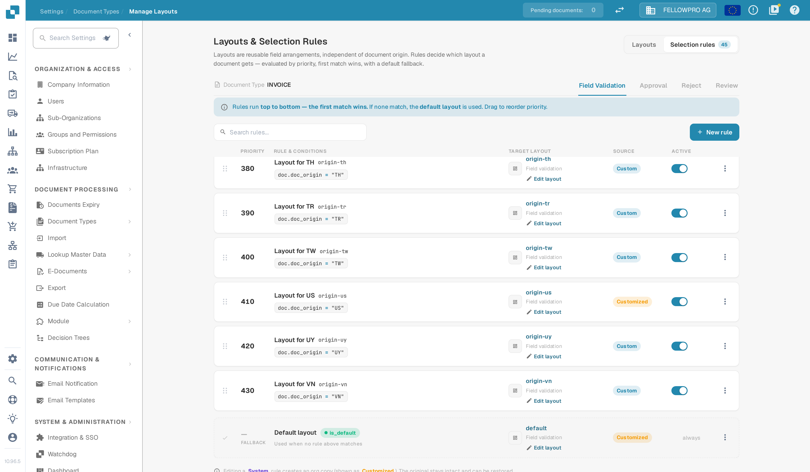
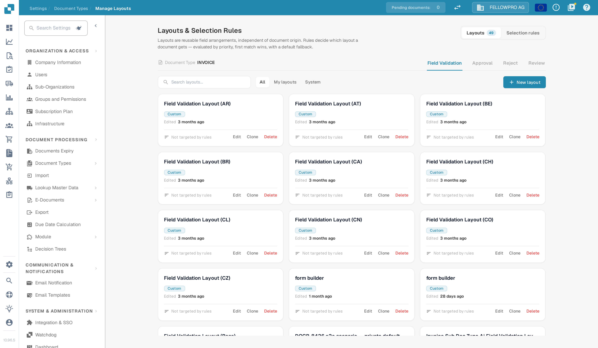
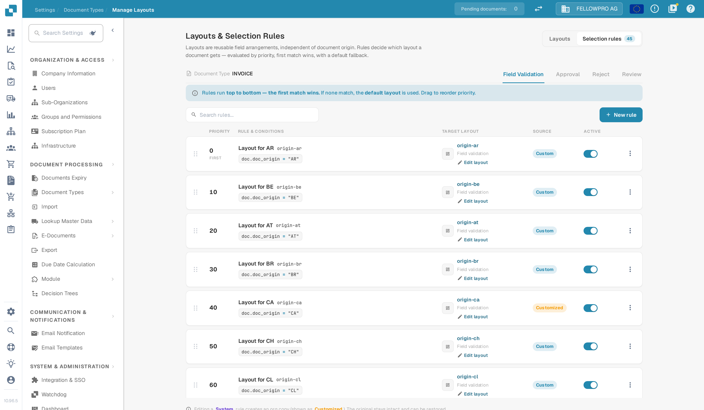
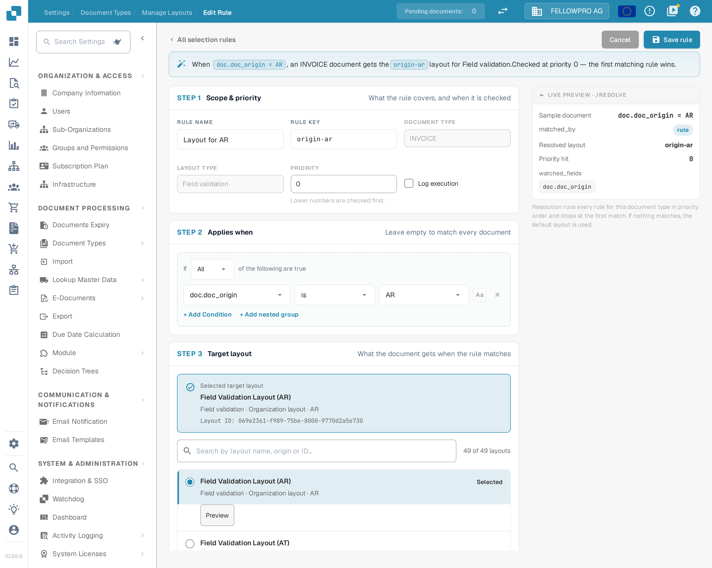
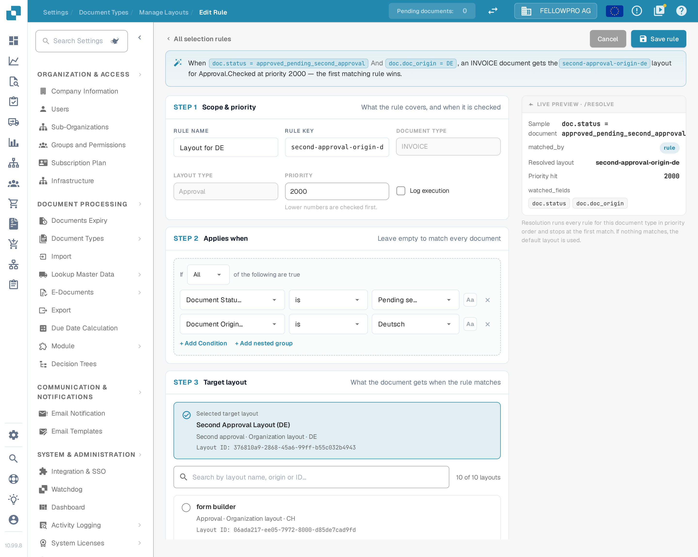

# 布局选择规则

## 概述

**布局**决定用户在文档的 **validation**、**approval**、**reject** 和 **review** 界面上看到哪些字段和分组，以及它们的显示顺序。您在[布局管理器](README.md)中设计布局。

传统上，DocBits 根据文档的**来源地**选择布局：来源地取自文档语言设置中的国家或地区，例如 `DE` 或 `US`。每个来源地都有自己的布局副本，其他因素都无法影响这一选择。

使用**布局选择规则**后，布局成为与来源地无关、可重复使用的构建模块，由**规则**决定文档获得哪个布局：

> *当*文档满足某个条件时，*则*使用指定的布局。规则按从上到下的顺序检查；**第一个匹配的规则生效**。如果没有规则匹配，则使用**默认布局**。

来源地仍然可用，只是它现在是众多条件之一。规则同样可以依据供应商、金额、文档状态、提取方法或任何标题字段来判断。

### 解决的问题

| 需求 | 传统的基于来源地的布局 | 使用选择规则后 |
| --- | --- | --- |
| 某个供应商的发票需要额外字段（项目、海关编号） | 无法实现，除非新增一个来源地 | 规则 *Supplier ID is 20723* → 布局“Invoice with project fields” |
| DE、AT 和 CH 文档应使用相同的外观 | 需要维护三个相同的布局副本 | 使用一个布局，每个来源地对应一条指向该布局的规则（或使用一个 ANY 分组） |
| 电子发票需要比扫描 PDF 更简单的界面 | 无法实现 | 规则 *Extraction Method is ELECTRONIC\_DOCUMENT* → 布局“E-invoice” |
| 高金额发票在审批界面上需要更多字段 | 无法实现 | 审批规则 *Total Amount greater than 10000* → 布局“High value approval” |
| 第二位审批人应看到与第一位审批人不同的界面 | 需要单独的“第二次审批”布局类型 | 审批规则 *Document Status is Pending second approval* → 布局“Second approval” |

## 启用基于规则的布局

基于规则的布局由**组织管理员**按**文档类型**启用。

1. 前往 **Settings → Document Processing → Document Types**。
2. 点击文档类型卡片上的 **settings**（齿轮）图标。
3. 打开 **Manage Layouts** 并启用开关。

<figure><figcaption>
文档类型其他设置中的 Manage Layouts 开关
</figcaption></figure>
<!-- English source image: lsr-manage-layouts-toggle-en-20261102.png -->

现在，文档类型卡片上的 **Layouts** 链接会打开 **Layouts & Selection Rules**。

### 启用后会发生什么

DocBits 会把现有的基于来源地的布局转换为规则——每个文档类型、每个界面仅执行一次：

* 来源地为 **DEFAULT** 的布局成为**默认布局**（回退布局）。
* 每个特定来源地的布局都会转换为一条名为 **“Layout for XX”** 的规则，条件为 _Document Origin is XX_，并指向该布局。这些规则的优先级按 10 递增（例如 2000、2010、2020……），因此您可以在它们之前、之间或之后放置自己的规则。

<figure><figcaption>
启用时创建的来源地规则，随后是默认布局（FALLBACK）
</figcaption></figure>
<!-- English source image: lsr-default-layout-row-en-20261102.png -->

布局本身不会被删除或更改。因此启用后，每份文档获得的布局与启用前完全相同。只有当您添加或更改规则时，行为才会改变。

**关闭此功能**会立即使文档类型恢复为基于来源地的选择方式。规则会保留，但不会使用；重新启用开关后，规则会再次生效。

## “Layouts & Selection Rules”界面

<figure><figcaption>
Layouts 选项卡：该文档类型的每个布局以卡片形式显示
</figcaption></figure>
<!-- English source image: lsr-layouts-overview-en-20261102.png -->

* 页面标题中的 **Layouts / Selection rules** 用于在布局列表和规则列表之间切换。数字表示相应项目的数量。
* **Field Validation / Approval / Reject / Review** 用于切换**界面**。每个界面都有自己的布局、规则和默认布局——审批规则绝不会更改验证界面。
* 在 **Layouts** 选项卡中，您可以创建、编辑、克隆和删除布局。每张卡片都会显示是否有规则使用该布局（如果没有规则使用，则显示“Not targeted by rules”）。可使用 **All / My layouts / System** 进行筛选；系统布局随 DocBits 提供，可以查看和克隆，但不能更改。


首次审批和第二次审批共用 **Approval** 布局和规则。如需让第二个审批阶段使用自己的界面，请添加一条条件为 _Document Status is Pending second approval_ 的审批规则，参见[示例](#different-screens-for-first-and-second-approval)。


## 如何选择布局

每次打开文档以及保存文档后，DocBits 都会为当前界面确定布局：

1. 按**优先级**从低到高检查该界面的**启用规则**。**第一个条件为真的规则生效**，并使用其布局。
2. 如果没有规则匹配，则使用**默认布局**。
3. 如果也没有默认布局，DocBits 会回退到传统的基于来源地的选择方式。

如果规则指向的布局已被删除或为空，则跳过该规则。

### 示例

**Field Validation** 界面的规则：

| 优先级 | 规则 | 条件 | 布局 |
| --- | --- | --- | --- |
| 5 | Behaelterbau invoices | *Supplier ID is HP0000278* | Invoice with project fields |
| 10 | E-invoices | *Extraction Method is ELECTRONIC\_DOCUMENT* | E-invoice |
| 2020 | Layout for DE | *Document Origin is DE* | Field Validation Layout (DE) |
| — | Default layout | — | Field Validation Layout (Base) |

各文档获得的布局：

| 文档 | 供应商 | 提取方式 | 来源地 | 布局 | 原因 |
| --- | --- | --- | --- | --- | --- |
| 1 | HP0000278 | e-invoice | DE | Invoice with project fields | 优先级 5 首先匹配；不再检查后续规则 |
| 2 | 10040 | e-invoice | DE | E-invoice | 优先级 5 不匹配，优先级 10 匹配 |
| 3 | 10040 | 扫描 PDF | DE | Field Validation Layout (DE) | 只有来源地规则匹配 |
| 4 | 10040 | 扫描 PDF | US | Field Validation Layout (Base) | 没有规则匹配 → 使用默认布局 |

**顺序很重要**：把特定规则（单个供应商）放在通用规则（单个国家）之前。

### 用户更改规则所依据的字段时

布局始终根据文档的**当前**值选择。例如，如果用户在验证界面上更正了供应商，DocBits 会在保存后重新选择布局，界面可能会切换到另一个布局。不会丢失数据：不属于新布局的字段会保留其值，只是在再次适用包含该字段的布局之前不会显示。

## 管理选择规则

<figure><figcaption>
Field Validation 界面的 Selection rules 选项卡
</figcaption></figure>
<!-- English source image: lsr-rules-list-en-20261102.png -->

每行都会显示**优先级**（第一行标有 **FIRST**）、包含条件的**规则名称和键**、**目标布局**、**来源**徽标以及 **Active** 开关。

| 任务 | 操作方法 |
| --- | --- |
| 创建规则 | **New rule** |
| 编辑规则 | 点击该行 |
| 更改顺序 | 拖动行左侧的手柄向上或向下移动。新顺序会立即保存。 |
| 停用规则 | **Active** 开关。已停用的规则会被忽略。 |
| 复制或删除 | 该行的 **⋮** 菜单 |
| 查找规则 | **Search rules…** |

**来源**徽标说明规则的出处：**System** 规则随 DocBits 提供。编辑系统规则会为您的组织创建一个副本，并显示为 **Customized**；原始规则保持不变，可以恢复。您自己创建的规则为 **Custom**。

### 默认布局

最后一行标有 **FALLBACK** 和 **is\_default**，它就是默认布局：当上方没有规则匹配时使用，且本身没有条件。启用此功能时（基于来源地 DEFAULT 的布局）会创建该布局。


如需使用另一个回退布局，请创建一条**不带任何条件**的规则，并为其设置最高的优先级数字，使其最后被检查。它会匹配所有未被前面规则匹配的文档，并在默认布局之前生效。


## 创建规则

在要更改的界面的 Selection rules 选项卡中点击 **New rule**。

<figure><figcaption>
规则编辑器：作用范围与优先级、条件、目标布局，以及该规则实际效果的实时预览。
</figcaption></figure>
<!-- English source image: lsr-rule-editor-en-20261104.png -->

顶部的语句会在您构建规则时概括规则内容——“When doc.doc_origin = AR, an INVOICE document gets the origin-ar layout for Field validation. Checked at priority 0 — the first matching rule wins.”

### 步骤 1 — 范围与优先级

| 设置 | 作用 |
| --- | --- |
| **Rule Name** | 显示在规则列表中。请描述业务场景，例如“Behaelterbau invoices”“E-invoices”“High value approval”。 |
| **Rule key** | 根据名称生成；重命名规则后保持不变。 |
| **Document Type** / **Layout type** | 规则适用的文档类型和界面。取决于您点击 **New rule** 的位置。 |
| **Priority** | 数字越小，越早检查。请保留间隔（5、10、20……），以便稍后插入规则。 |
| **Log execution** | 记录该规则的每次评估，便于日后追查文档为何匹配或未匹配。在需要该追踪前请保持关闭。 |

### 步骤 2 — 适用条件

文档必须满足的条件。您可以使用：

* **文档属性**：Document Origin、Extraction Method、Document Status、Sub Document Type，
* **标题字段**：Supplier ID、Total Amount、Currency、Purchase Order 以及该文档类型的其他所有字段，
* 一个**自定义 JSON 路径**（高级）。

表格列不可用：布局对整个文档只选择一次。

将此步骤留空可在此优先级下匹配所有文档。条件的工作方式——ALL / ANY、嵌套分组、所有运算符、空值、大小写——请参阅[规则条件（适用条件）](../rule-conditions-applies-when.md)。

### 步骤 3 — 目标布局

点击文档应获得的布局。列表会显示您自己的布局，以及所选界面的系统布局。只要仍有规则指向某个布局，就不能删除该布局。

### 实时预览 · /resolve

右侧面板会显示该规则对一份具有您条件取值的示例文档的效果：

| 行 | 含义 |
| --- | --- |
| **Sample document** | 用于预览的取值，来自您的条件 |
| **matched\_by** | 如果规则匹配则为 `rule`，否则为默认布局 |
| **Resolved layout** | 示例文档将获得的布局 |
| **Priority hit** | 匹配规则的优先级 |
| **watched\_fields** | 布局选择所依赖的字段。用户更改其中一个字段后，会重新选择布局。 |

点击 **Create Rule**（编辑时点击 **Save rule**）保存。**Cancel** 返回规则列表。

## 示例

### 为一个供应商添加额外字段

界面 **Field Validation** · 优先级 **5** · _Supplier ID is HP0000278_ · 目标布局 _Invoice with project fields_（标准布局的克隆版本，额外包含项目和成本中心字段）。

### 多个国家共用一个布局

界面 **Field Validation** · 优先级 **100** · **ANY of**：_Document Origin is Deutsch_、_Document Origin is Austria_、_Document Origin is Switzerland_ · 目标布局 _DACH invoice_。如果迁移的“Layout for AT”和“Layout for CH”规则指向旧副本，请停用这些规则。

### 电子发票使用更简单的界面

界面 **Field Validation** · 优先级 **10** · _Extraction Method is ELECTRONIC\_DOCUMENT_ · 目标布局 _E-invoice_（不含与 OCR 相关的字段）。

### 高金额使用更严格的审批界面

界面 **Approval** · 优先级 **10** · _Total Amount greater than 10000_ · 目标布局 _High value approval_（显示成本中心、预算负责人和合同编号）。

### 首次审批和第二次审批使用不同界面 

界面 **Approval** · 优先级 **5** · _Document Status is Pending second approval_ · 目标布局 _Second Approval Layout_。处于首次审批阶段的文档不匹配此规则，会获得 Approval 的默认布局。

<figure><figcaption>
用于第二个审批步骤的 Approval 规则——右侧的实时预览已显示该规则在优先级 2000 时胜出。
</figcaption></figure>
<!-- English source image: lsr-rule-editor-approval-en-20261104.png -->

### 为部分供应商设置专用驳回界面

界面 **Reject** · 优先级 **10** · _Supplier ID is one of_ `10040, 10041` · 目标布局 _Reject with reason codes_。

## 最佳实践

* **先特定，后通用。** 供应商规则放在国家规则之前，国家规则放在默认布局之前。
* **保留优先级间隔**（5、10、20……），使新规则无需重新编号即可插入。
* **条件基于可靠的字段。** 供应商和来源地会较早确定，且很少变化。若条件依据用户经常编辑的字段，用户操作时界面会在布局之间切换。
* **克隆，而不是从零开始。** 克隆标准布局并进行调整，使所有布局保持相同的基本结构。
* **检查实时预览**，并在更改规则后打开各类真实文档。
* **为每个界面保留一个有意义的默认布局**，避免文档最终没有布局。

## 故障排除

| 问题 | 检查内容 |
| --- | --- |
| 文档获得了错误的布局 | 更早的规则首先匹配。检查其上方的规则，或查看预览中的 **Priority hit**。 |
| 尽管应有规则匹配，却使用了默认布局 | 规则是否 **Active**？条件是否与准确值匹配（大小写、空格）？规则是否位于正确的**界面**选项卡？ |
| 用户操作时布局发生变化 | **watched\_fields** 中的某个字段被更改。请让规则依据更稳定的字段。 |
| 无法删除布局 | 仍有规则指向该布局。请先更改该规则的目标或删除该规则。 |
| 完全没有显示布局 | 没有规则匹配，没有默认布局，该界面也不存在基于来源地的布局。请添加一条不带条件的兜底规则。 |
| 启用后没有任何变化 | 符合预期：启用会复现之前基于来源地的选择结果。请添加自己的规则。 |
| 第二次审批显示首次审批的布局 | 在其他 Approval 规则之上，针对 _Document Status is Pending second approval_ 添加一条 Approval 规则。 |

## 相关内容

* [规则条件（适用条件）](../rule-conditions-applies-when.md)
* [自定义验证规则](../custom-validation-rules.md)
* [转换规则](../transformation-rules/)
* [浏览布局管理器](navigating-the-layout-manager.md)
