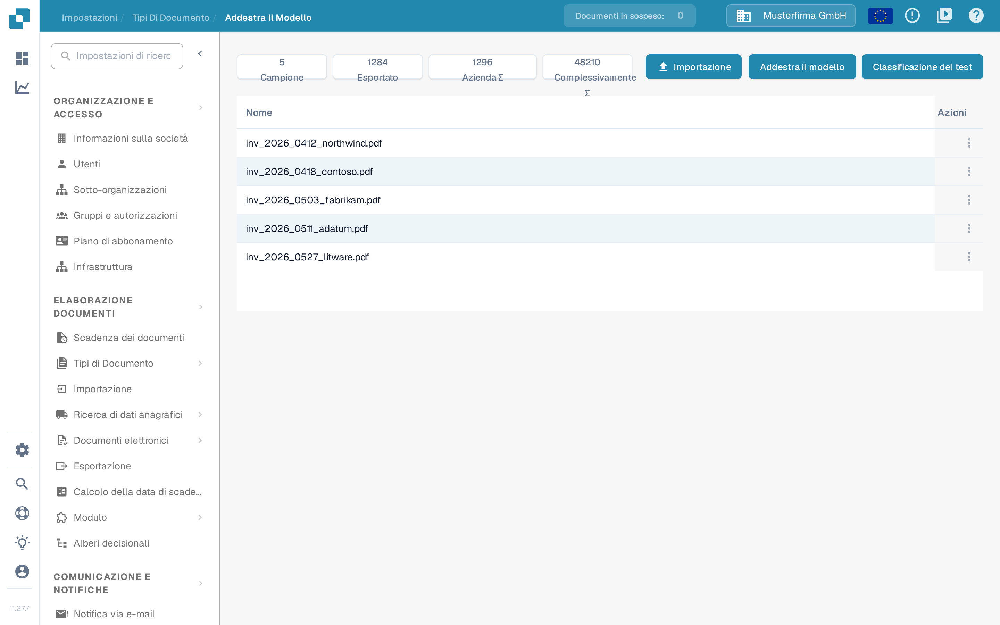

# Addestramento del modello

<figure><figcaption>
La pagina Addestra il modello mostra i contatori dei campioni, i comandi Importazione, Addestra il modello e Classificazione del test e l'elenco dei documenti di addestramento.
</figcaption></figure>

## Panoramica

L'addestramento del modello consente agli amministratori di seguire e gestire l'addestramento dei modelli di machine learning specifici di ogni tipo di documento. Offrendo un'interfaccia strutturata per importare dati di esempio, addestrare i modelli e testarne le prestazioni, DocBits garantisce che le capacità di estrazione dei dati migliorino continuamente nel tempo.

## Funzioni e opzioni principali

1. **Riepilogo dei contatori**:
   * **Campione**: numero di documenti di esempio usati per l'addestramento.
   * **Esportato**: numero di documenti esportati correttamente dopo l'elaborazione.
   * **Azienda Σ**: numero totale di documenti elaborati per l'azienda.
   * **Complessivamente Σ**: numero totale di documenti elaborati in tutte le categorie.
2. **Opzioni di addestramento e di test**:
   * **Importazione**: consente agli amministratori di importare nuovi set di dati di addestramento, in genere campioni strutturati di documenti che il sistema deve riconoscere. Per il flusso di lavoro passo per passo, vedere [Importazione dei dati: addestramento del modello](import-data-model-training.md).
   * **Addestra il modello**: avvia l'addestramento con i dati importati per migliorare le capacità di riconoscimento ed estrazione del sistema.
   * **Classificazione del test**: consente di testare il modello per valutarne le prestazioni nella classificazione e nell'estrazione dei dati da documenti nuovi o non ancora visti.
3. **Elenco dei documenti di addestramento**:
   * **Nome**: mostra il nome del file di ogni documento di addestramento importato.
   * **Azioni** (il menu a tre punti in ogni riga): offre **Cancellare** per rimuovere quel documento di addestramento dall'elenco. Per la gestione dei campioni importati, vedere [Gestione dei dati di addestramento](manage-training-data.md).
