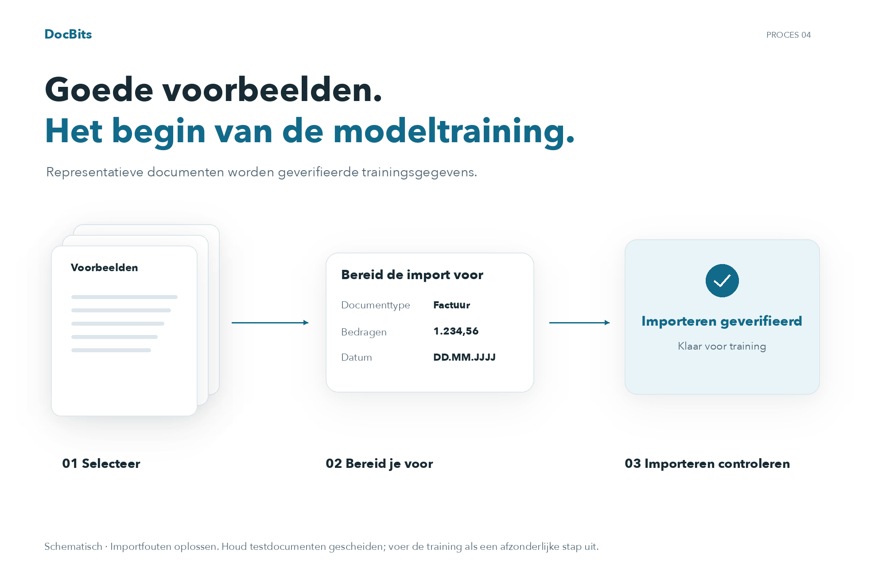
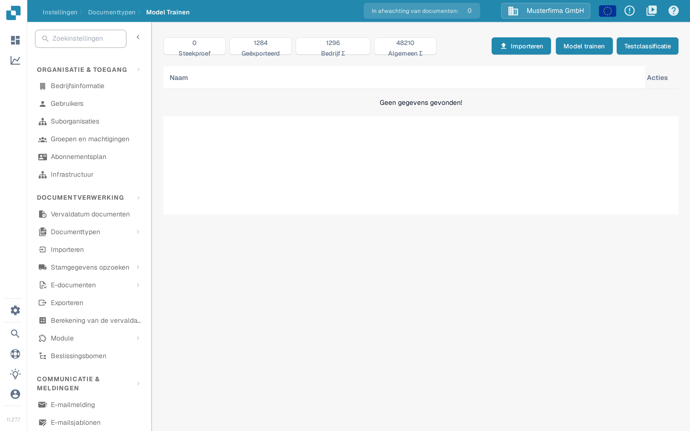
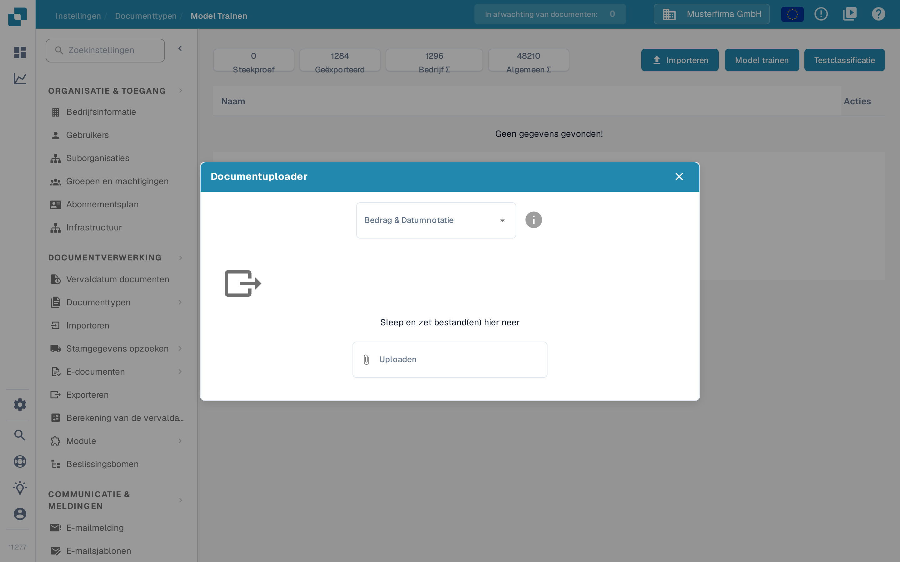

# Gegevens importeren voor modeltraining

## Opstellen, importeren en controleren van voorbeelddocumenten

<figure><picture><source srcset="../../../../../.gitbook/assets/intro-process-04-trainingsimport-nl-dark-20261029.png" media="(prefers-color-scheme: dark)"></picture><figcaption>
Opstellen, importeren en controleren van voorbeelddocumenten
</figcaption></figure>

Kies representatieve voorbeelddocumenten, bereid de beschikbare importopties voor en controleer de importstatus. Alleen succesvol geïmporteerde voorbeelden zijn klaar voor verdere training. Los importfouten op vóór de volgende stap en houd onafhankelijke testdocumenten gescheiden van de trainingsdataset.

Bereid documenten voor die representatief zijn voor de formaten, talen en documenttypen van de organisatie. Gebruik alleen bestandsformaten die je installatie accepteert. Vermijd duplicaten en houd trainingsdocumenten gescheiden van de documenten voor de evaluatie.

## Import openen

Open de modeltraining in de instellingen van het gewenste documenttype en kies de importfunctie.

<figure><figcaption>
Overzicht van modeltraining: beschikbare gegevens en acties; er is geen training of import gestart.
</figcaption></figure>

## Formaat en bestanden kiezen

Kies het getal- en datumformaat dat bij de bestanden past en selecteer vervolgens de documenten om te importeren. `1.234,56` en `1,234.56` gebruiken bijvoorbeeld verschillende scheidingstekens. Ook een datum zoals `05/06/2026` moet volgens het gekozen formaat worden geïnterpreteerd.

<figure><figcaption>
Het dialoogvenster <strong>Documentuploader</strong>: kies eerst de optie <strong>Bedrag &amp; Datumnotatie</strong> en selecteer daarna de bestanden.
</figcaption></figure>

Controleer de selectie voordat je de import start. Wacht tot de verwerking klaar is en controleer fouten en het toegewezen documenttype. Corrigeer onjuiste classificaties en extracties voordat je de voorbeelden voor training gebruikt.

## Trainen en evalueren

Train het model met de functies en rechten die je versie biedt. Evalueer het resultaat vervolgens met een afzonderlijke steekproef. Meer trainingsdocumenten garanderen op zichzelf geen betere nauwkeurigheid. Zie [Het model testen](testing-the-model.md).
