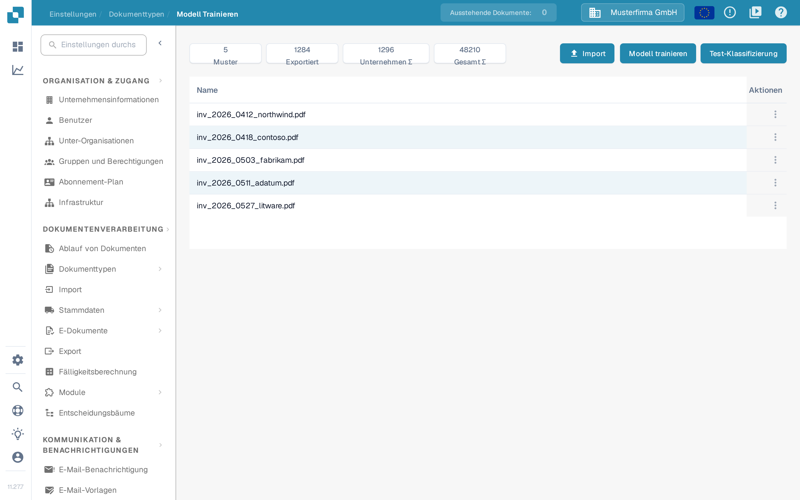
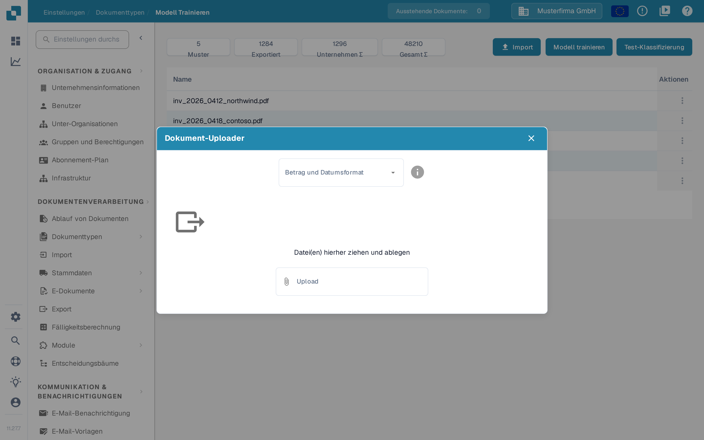

# Beispieldokumente für das Modelltraining importieren

## Beispiele vorbereiten, importieren und prüfen

<figure><picture><source srcset="../../../../../.gitbook/assets/intro-process-04-trainingsimport-de-dark-20261029.png" media="(prefers-color-scheme: dark)"></picture><figcaption>
Beispiele vorbereiten, importieren und prüfen
</figcaption></figure>

Wählen Sie repräsentative Beispielbelege, bereiten Sie die verfügbaren Importoptionen vor und kontrollieren Sie den Importstatus. Erst erfolgreich importierte Beispiele stehen für das weitere Training bereit. Klären Sie Importfehler vor dem nächsten Schritt und halten Sie unabhängige Testbelege vom Trainingsdatensatz getrennt.

Wählen Sie Dokumente aus, die die Formate, Sprachen und Dokumenttypen Ihrer Organisation abbilden. Verwenden Sie nur Dateiformate, die Ihre Installation akzeptiert. Entfernen Sie Duplikate und halten Sie Trainingsdokumente von den Dokumenten getrennt, die Sie zur Bewertung aufbewahren.

## Den Import öffnen

Öffnen Sie das Modelltraining in den Einstellungen des betreffenden Dokumenttyps und wählen Sie die Importfunktion.

<figure><figcaption>
Überblick über das Modelltraining: Beispielanzahl, Trainingsstand und die verfügbaren Aktionen.
</figcaption></figure>

## Formate und Dateien auswählen

Wählen Sie das Zahlen- und Datumsformat passend zu den Dateien und danach die zu importierenden Dokumente aus. `1.234,56` und `1,234.56` verwenden zum Beispiel unterschiedliche Trennzeichen. Auch ein Datum wie `05/06/2026` muss passend zum gewählten Format gelesen werden.

<figure><figcaption>
Der Dialog <strong>Dokument-Uploader</strong>: Wählen Sie zuerst das Betrag- und Datumsformat, dann die Dateien.
</figcaption></figure>

Prüfen Sie die Auswahl, bevor Sie den Import starten. Warten Sie die Verarbeitung ab und kontrollieren Sie Fehler sowie zugeordnete Dokumenttypen. Korrigieren Sie Klassifizierungs- und Extraktionsfehler, bevor Sie die Beispiele zum Training verwenden. Was Sie mit bereits importierten Beispielen tun können, lesen Sie unter [Trainingsdaten verwalten](manage-training-data.md).

## Modell trainieren und bewerten

Wählen Sie **Modell trainieren**, um das Modell mit den Funktionen und Berechtigungen zu trainieren, die in Ihrer Version verfügbar sind. Bewerten Sie es anschließend an einem separaten Beispiel. Das Hinzufügen von Dokumenten allein sorgt nicht für höhere Genauigkeit. Siehe [Testen des Modells](testing-the-model.md).
