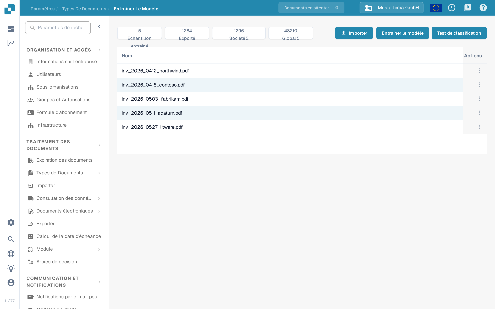
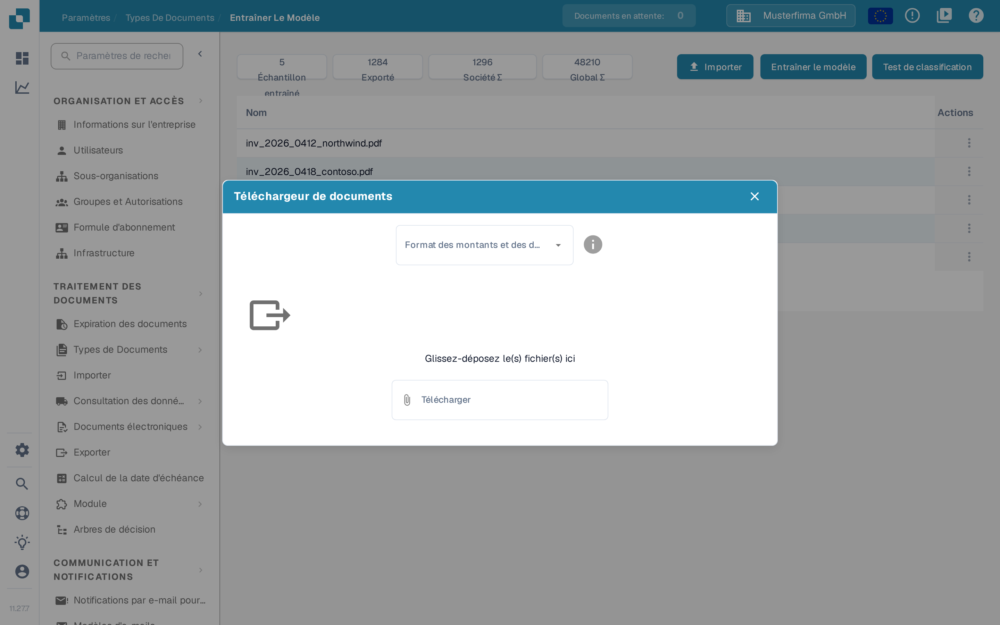

# Importer des documents d'exemple pour l'entraînement du modèle

## Préparer, importer et vérifier des exemples de documents

<figure><picture><source srcset="../../../../../.gitbook/assets/intro-process-04-trainingsimport-fr-dark-20261029.png" media="(prefers-color-scheme: dark)"></picture><figcaption>
Préparer, importer et vérifier des exemples de documents
</figcaption></figure>

Choisissez des exemples de documents représentatifs, préparez les options d’importation disponibles et vérifiez le statut de l’importation. Seuls les échantillons importés avec succès sont prêts pour un entraînement ultérieur. Résolvez les erreurs d’importation avant l’étape suivante et conservez les documents de test indépendants séparés de l’ensemble de données d’entraînement.

Préparez des documents qui représentent les formats, les langues et les types de documents traités par votre organisation. Utilisez uniquement les formats de fichiers acceptés par votre installation. Supprimez les doublons et séparez les documents d’entraînement des documents réservés à l’évaluation.

## Ouvrir l'importation

Ouvrez l’entraînement du modèle dans les paramètres du type de document concerné et sélectionnez la fonction d’importation.

<figure><figcaption>
Vue générale de l’entraînement du modèle : données disponibles et actions ; aucun entraînement ni importation n’a été lancé.
</figcaption></figure>

## Choisir les formats et les fichiers

Choisissez les formats de nombres et de dates qui correspondent aux fichiers, puis sélectionnez les documents à importer. Par exemple, `1.234,56` et `1,234.56` utilisent des séparateurs différents. Une date comme `05/06/2026` doit également être interprétée selon le format sélectionné.

<figure><figcaption>
Le dialogue <strong>Téléchargeur de documents</strong> : choisissez d’abord le format des montants et des dates, puis les fichiers.
</figcaption></figure>

Vérifiez la sélection avant de lancer l’importation. Attendez la fin du traitement et contrôlez les erreurs ainsi que les types de documents attribués. Corrigez les erreurs de classification et d’extraction avant d’utiliser les exemples pour l’entraînement. Pour les actions disponibles sur les échantillons déjà importés, consultez [Gérer les données d’entraînement](manage-training-data.md).

## Entraîner et évaluer le modèle

Sélectionnez **Entraîner le modèle** pour entraîner le modèle avec les fonctions et les autorisations disponibles dans votre version. Évaluez-le ensuite sur un exemple distinct avec **Test de classification**. L’ajout de documents ne garantit pas à lui seul une meilleure précision. Voir [Tester le modèle](testing-the-model.md).
