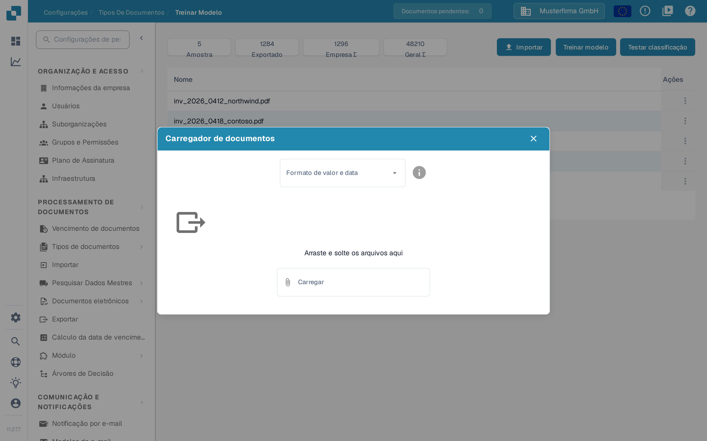

# Importar documentos de exemplo para o treinamento do modelo

## Preparar, importar e verificar documentos de amostra

<figure><picture><source srcset="../../../../../.gitbook/assets/intro-process-04-trainingsimport-pt-dark-20261029.png" media="(prefers-color-scheme: dark)"></picture><figcaption>
Preparar, importar e verificar documentos de amostra
</figcaption></figure>

Escolha documentos de amostra representativos, prepare as opções de importação disponíveis e verifique o status da importação. Somente amostras importadas com sucesso estão prontas para treinamento subsequente. Resolva erros de importação antes da próxima etapa e mantenha os documentos de teste independentes separados do conjunto de dados de treinamento.

Prepare documentos que representem os formatos, os idiomas e os tipos de documento que sua organização processa. Use apenas formatos de arquivo aceitos pela sua instalação. Remova duplicatas e mantenha os documentos de treinamento separados dos documentos que você reserva para avaliação.

## Abrir a importação

Abra o treinamento do modelo nas configurações do tipo de documento relevante e selecione a função de importação.

<figure><figcaption>
Visão geral do treinamento do modelo: número de amostras, situação do treinamento e ações disponíveis.
</figcaption></figure>

## Selecionar formatos e arquivos

Escolha os formatos de número e data que correspondem aos arquivos e, em seguida, selecione os documentos a importar. Por exemplo, `1.234,56` e `1,234.56` usam separadores diferentes. Uma data como `05/06/2026` também precisa ser interpretada de acordo com o formato escolhido.

<figure><figcaption>
A caixa de diálogo <strong>Carregador de documentos</strong>: escolha o formato de valor e data e depois os arquivos.
</figcaption></figure>

Verifique a seleção antes de iniciar a importação. Aguarde o processamento terminar e revise os erros e os tipos de documento atribuídos. Corrija erros de classificação e extração antes de usar os exemplos para treinamento. O menu **Ações** (⋮) de cada linha contém a ação **Excluir**; o trabalho com exemplos já importados está descrito em [Gerenciar dados de treinamento](manage-training-data.md).

## Treinar e avaliar

Selecione **Treinar modelo** para treinar o modelo com as funções e permissões disponíveis na sua versão. Depois, avalie-o com uma amostra separada: selecione **Testar classificação** e consulte [Testando o modelo](testing-the-model.md). Adicionar documentos não garante, por si só, maior precisão.
