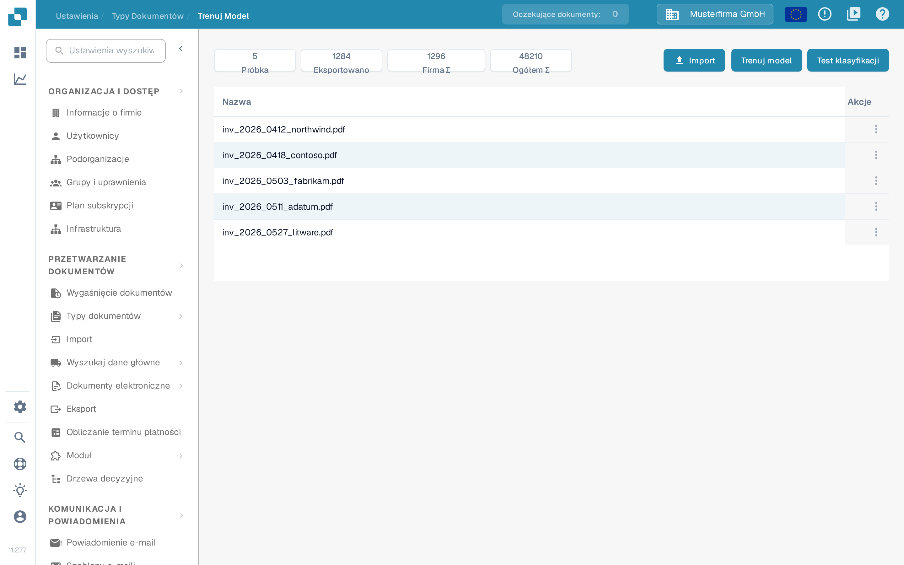
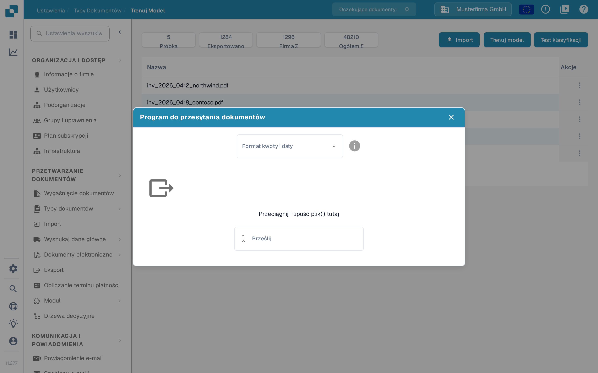

# Importuj przykładowe dokumenty do trenowania modelu

## Przygotuj, importuj i sprawdź przykładowe dokumenty

<figure><picture><source srcset="../../../../../.gitbook/assets/intro-process-04-trainingsimport-pl-dark-20261029.png" media="(prefers-color-scheme: dark)"></picture><figcaption>
Przygotuj, importuj i sprawdź przykładowe dokumenty
</figcaption></figure>

Wybierz reprezentatywne przykładowe dokumenty, przygotuj dostępne opcje importu i sprawdź status importu. Tylko pomyślnie zaimportowane przykłady są gotowe do dalszego treningu. Rozwiąż błędy importu przed następnym krokiem i przechowuj niezależne dokumenty testowe oddzielnie od zbioru danych treningowych.

Przygotuj dokumenty, które odzwierciedlają formaty, języki i typy dokumentów przetwarzane w Twojej organizacji. Używaj tylko formatów plików akceptowanych przez Twoją instalację. Usuń duplikaty i przechowuj dokumenty treningowe oddzielnie od dokumentów zarezerwowanych do oceny.

## Otwórz import

Otwórz trenowanie modelu w ustawieniach odpowiedniego typu dokumentu i wybierz funkcję importu.

<figure><figcaption>
Przegląd trenowania modelu: dostępne dane i działania; trening ani import nie zostały uruchomione.
</figcaption></figure>

## Wybierz formaty i pliki

Wybierz format kwoty i daty pasujący do plików, a następnie wskaż dokumenty do importu. Na przykład `1.234,56` i `1,234.56` używają różnych separatorów. Datę taką jak `05/06/2026` również trzeba odczytać zgodnie z wybranym formatem.

<figure><figcaption>
Okno <strong>Program do przesyłania dokumentów</strong>: najpierw wybierz format kwoty i daty, potem pliki.
</figcaption></figure>

Sprawdź wybór, zanim uruchomisz import. Poczekaj na zakończenie przetwarzania i przejrzyj błędy oraz przypisane typy dokumentów. Popraw błędy klasyfikacji i ekstrakcji, zanim użyjesz przykładów do treningu. Menu **Akcje** (⋮) w wierszu listy zawiera pozycję **Usuwać**. Pracę z zaimportowanymi przykładami opisuje sekcja [Zarządzanie danymi treningowymi](manage-training-data.md).

## Trenuj i oceń model

Wybierz **Trenuj model**, aby uruchomić trening z użyciem funkcji i uprawnień dostępnych w Twojej wersji. Następnie oceń go na osobnym przykładzie. Samo dodanie dokumentów nie gwarantuje wyższej dokładności. Zobacz [Testowanie modelu](testing-the-model.md).
