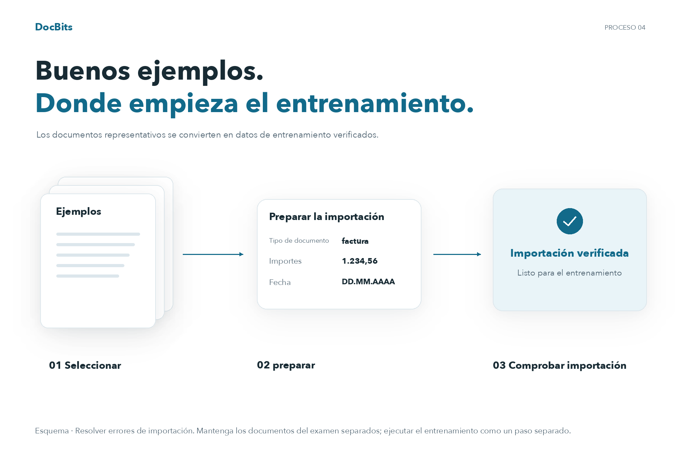
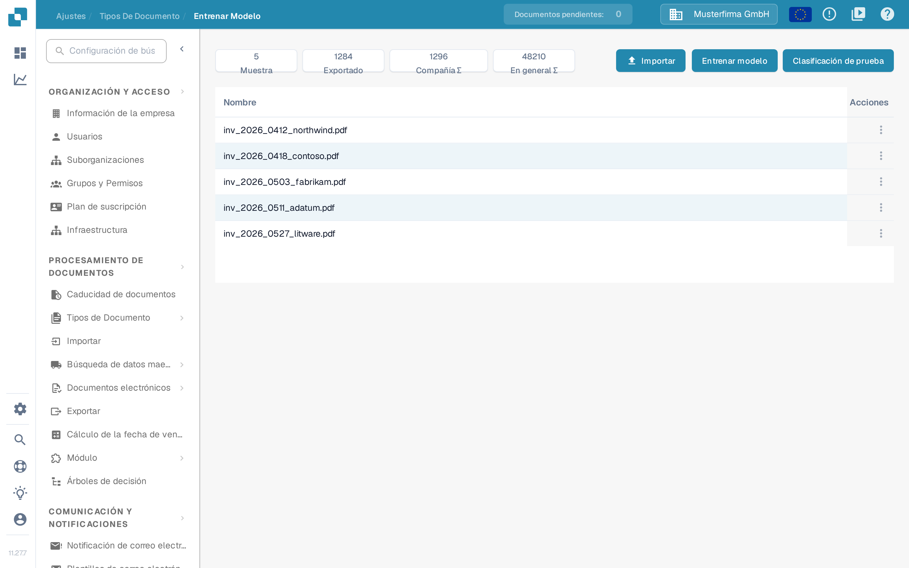
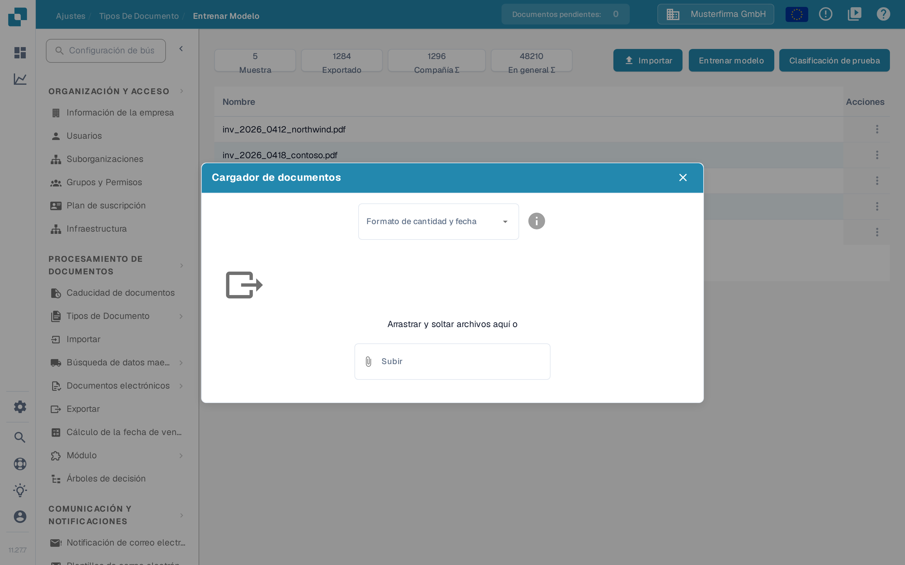

# Importar documentos de muestra para el entrenamiento del modelo

## Preparar, importar y comprobar documentos de muestra

<figure><picture><source srcset="../../../../../.gitbook/assets/intro-process-04-trainingsimport-es-dark-20261029.png" media="(prefers-color-scheme: dark)"></picture><figcaption>
Preparar, importar y comprobar documentos de muestra
</figcaption></figure>

Elija documentos de muestra representativos, prepare las opciones de importación disponibles y compruebe el estado de la importación. Sólo los documentos importados correctamente están listos para el entrenamiento posterior. Resuelva los errores de importación antes del siguiente paso y mantenga los documentos de prueba independientes separados del conjunto de datos de entrenamiento.

Prepare documentos que representen los formatos, los idiomas y los tipos de documento que procesa su organización. Utilice únicamente los formatos de archivo que admita su instalación. Elimine los duplicados y mantenga los documentos de entrenamiento separados de los documentos reservados para la evaluación.

## Abrir la importación

Abra el entrenamiento del modelo en los ajustes del tipo de documento correspondiente y seleccione la función de importación.

<figure><figcaption>
Vista general del entrenamiento del modelo: datos y acciones disponibles; no se inició ningún entrenamiento ni ninguna importación.
</figcaption></figure>

## Seleccionar formatos y archivos

Elija los formatos de número y fecha que coincidan con los archivos y, a continuación, seleccione los documentos que desea importar. Por ejemplo, `1.234,56` y `1,234.56` utilizan separadores distintos. Una fecha como `05/06/2026` también debe interpretarse según el formato seleccionado.

<figure><figcaption>
El diálogo <strong>Cargador de documentos</strong>: elija el formato de cantidad y fecha y, a continuación, seleccione los archivos.
</figcaption></figure>

Compruebe la selección antes de iniciar la importación. Espere a que finalice el procesamiento y revise los errores y los tipos de documento asignados. Corrija los errores de clasificación y extracción antes de utilizar los ejemplos para el entrenamiento.

Para las acciones sobre las muestras ya importadas, consulte [Gestionar datos de entrenamiento](manage-training-data.md).

## Entrenar y evaluar

Entrene el modelo con las funciones y los permisos disponibles en su versión. A continuación, evalúelo con una muestra independiente. Añadir documentos no garantiza por sí mismo una mayor precisión. Consulte [Probando el modelo](testing-the-model.md).
