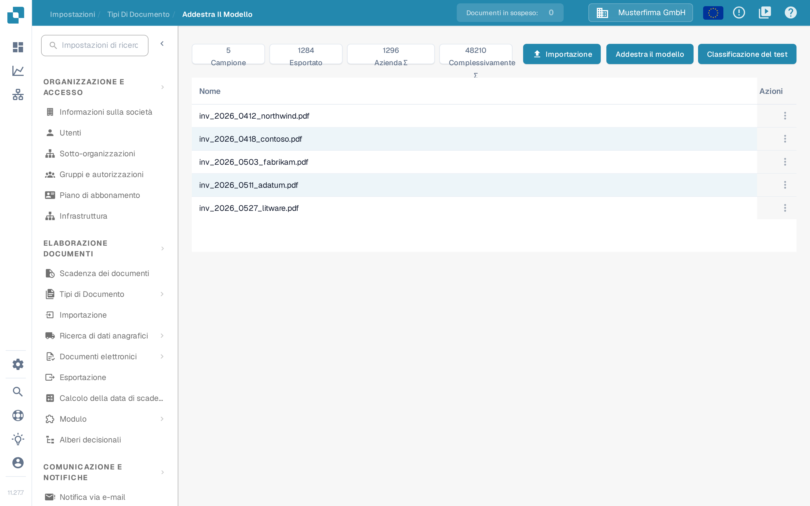

# Test del modello

## Valutare con documenti di test indipendenti

<figure><picture><source srcset="../../../../../.gitbook/assets/intro-process-05-modelltest-it-dark-20261029.png" media="(prefers-color-scheme: dark)"></picture><figcaption>
Valutare con documenti di test indipendenti
</figcaption></figure>

I dati di addestramento e i documenti di test hanno scopi diversi. Per i documenti di test indipendenti, definire i tipi di documenti e i valori dei campi previsti, quindi confrontarli con le previsioni. Registrare la versione del modello, il campione, le discrepanze e i guasti tecnici. Apporta miglioramenti mirati e ripeti il test con lo stesso protocollo di valutazione. I valori mostrati sono un esempio, non una misurazione di precisione.

Il test deve misurare i risultati su documenti rappresentativi non usati per l’addestramento. Prepara le risposte attese per ciascuno: tipo di documento e, per valutare l’estrazione, valori dei campi.

## Eseguire il test

1. Apri l’addestramento del tipo di documento da valutare.
2. Scegli **Classificazione del test**, se la tua versione offre questa funzione.
3. Seleziona il campione e avvia la valutazione con le opzioni offerte.
4. Attendi il completamento e registra risultati ed errori. Un errore tecnico o un test incompleto non equivale a una classificazione corretta.

<figure><figcaption>
Vista di Addestra Il Modello con dati di esempio: le cifre Campione, Esportato, Azienda ∑ e Complessivamente ∑, i pulsanti Importazione, Addestra il modello e Classificazione del test e l’elenco dei documenti di addestramento. Non è stato avviato alcun addestramento né alcun test.
</figcaption></figure>

Le voci seguenti spiegano cosa fa ciascun comando e dove trovare la procedura completa:

* **Importazione**: apre la selezione di nuovi dati di addestramento; la procedura è in [Importazione dei dati: addestramento del modello](import-data-model-training.md).
* **Addestra il modello**: avvia l’addestramento per il tipo di documento; l’uso è in [Scopo e utilizzo: addestramento del modello](purpose-and-use-model-training.md).
* **Classificazione del test**: avvia la verifica descritta qui sopra nella sezione «Eseguire il test»; i risultati si leggono nella sezione «Interpretare i risultati».
* **Campione**, **Esportato**, **Azienda ∑** e **Complessivamente ∑**: le cifre dei documenti di addestramento, spiegate in [Addestramento del modello](README.md).
* **Azioni**: il menu della riga rimuove un documento di addestramento; la procedura è in [Gestione dei dati di addestramento](manage-training-data.md).

## Interpretare i risultati

Confronta le previsioni con le risposte attese e analizza gli errori per tipo e formato. Se calcoli accuratezza, precisione, richiamo o punteggio F1, indica anche la dimensione del campione e le categorie valutate. Non attribuire al prodotto metriche che la tua versione non visualizza: puoi calcolarle separatamente dai risultati esportati o rilevati.

Le regole di classificazione e di estrazione sono impostazioni distinte dall’addestramento. Verificane l’effetto se intervengono nell’elaborazione; non modificare una regola soltanto per nascondere un errore nel campione di test.

## Correggere e ripetere

Correggi i dati di addestramento, le relative etichette o le impostazioni effettivamente disponibili nella tua installazione, poi addestra nuovamente il modello se necessario. Ripeti il test con lo stesso protocollo e mantieni un campione indipendente. Documenta versione, dati, risultati e regressioni. Un buon risultato sul campione non garantisce le stesse prestazioni su tutti i documenti futuri.
