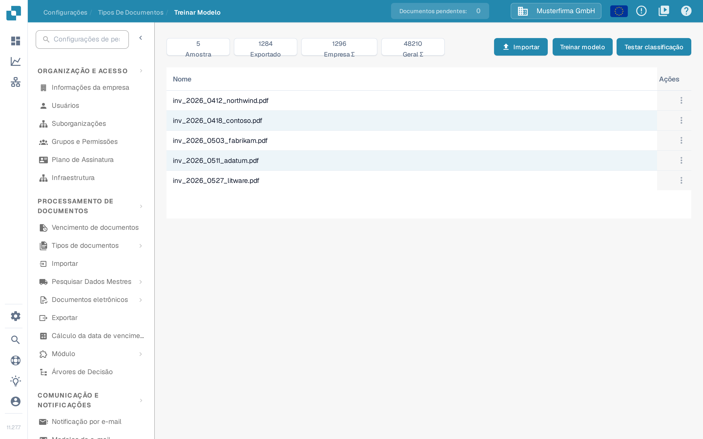

# Testando o modelo

## Avalie com documentos de teste independentes

<figure><picture><source srcset="../../../../../.gitbook/assets/intro-process-05-modelltest-pt-dark-20261029.png" media="(prefers-color-scheme: dark)"></picture><figcaption>
Avalie com documentos de teste independentes
</figcaption></figure>

Os dados de treinamento e os documentos de teste têm finalidades diferentes. Para documentos de teste independentes, defina os tipos de documentos e valores de campo esperados e compare-os com as previsões. Registre a versão do modelo, amostra, discrepâncias e falhas técnicas. Faça melhorias direcionadas e repita o teste com o mesmo protocolo de avaliação. Os valores mostrados são um exemplo e não uma medida de precisão.

Teste com documentos representativos que não tenham sido usados no treino. Prepare as respostas esperadas para cada documento: o tipo e, para avaliar a extração, os valores dos campos.

## Executar o teste

1. Abra o treino do modelo para o tipo de documento a avaliar.
2. Escolha **Testar classificação**, quando essa função estiver disponível na sua versão.
3. Selecione a amostra e inicie a avaliação com as opções disponíveis.
4. Aguarde a conclusão e registe os resultados e os erros. Uma falha técnica ou um teste incompleto não equivale a uma classificação correta.

<figure><figcaption>
Vista de Treinar Modelo com dados de exemplo: os números Amostra, Exportado, Empresa ∑ e Geral ∑, os botões Importar, Treinar modelo e Testar classificação e a lista de documentos de treino. Não foi iniciado nenhum treino nem nenhum teste.
</figcaption></figure>

As entradas seguintes explicam o que faz cada comando e onde encontrar o procedimento completo:

* **Importar**: abre a seleção de novos dados de treino; o procedimento está em [Importar documentos de exemplo para o treinamento do modelo](import-data-model-training.md).
* **Treinar modelo**: inicia o treino do tipo de documento; a utilização está em [Objetivo e Uso: Treinamento do Modelo](purpose-and-use-model-training.md).
* **Testar classificação**: inicia a verificação descrita acima na secção «Executar o teste»; os resultados leem-se na secção «Interpretar os resultados».
* **Amostra**, **Exportado**, **Empresa ∑** e **Geral ∑**: os números dos documentos de treino, explicados em [Treino de modelos](README.md).
* **Ações**: o menu da linha remove um documento de treino; o procedimento está em [Gerenciar dados de treinamento](manage-training-data.md).

## Interpretar os resultados

Compare as previsões com as respostas esperadas e analise os erros por tipo e formato. Se calcular exatidão, precisão, sensibilidade ou pontuação F1, indique também o tamanho da amostra e as categorias avaliadas. Não atribua ao produto métricas que a sua versão não apresenta. Pode calculá-las separadamente a partir dos resultados exportados ou registados.

As regras de classificação e extração são configurações distintas do treino. Verifique o seu efeito quando intervêm no processamento. Não altere uma regra apenas para ocultar um erro na amostra de teste.

## Corrigir e repetir

Corrija os dados de treino, as etiquetas ou as configurações efetivamente disponíveis na sua instalação e volte a treinar o modelo, se necessário. Repita o teste com o mesmo protocolo e mantenha uma amostra independente. Documente a versão, os dados, os resultados e as regressões. Um bom resultado na amostra não garante o mesmo desempenho em todos os documentos futuros.
