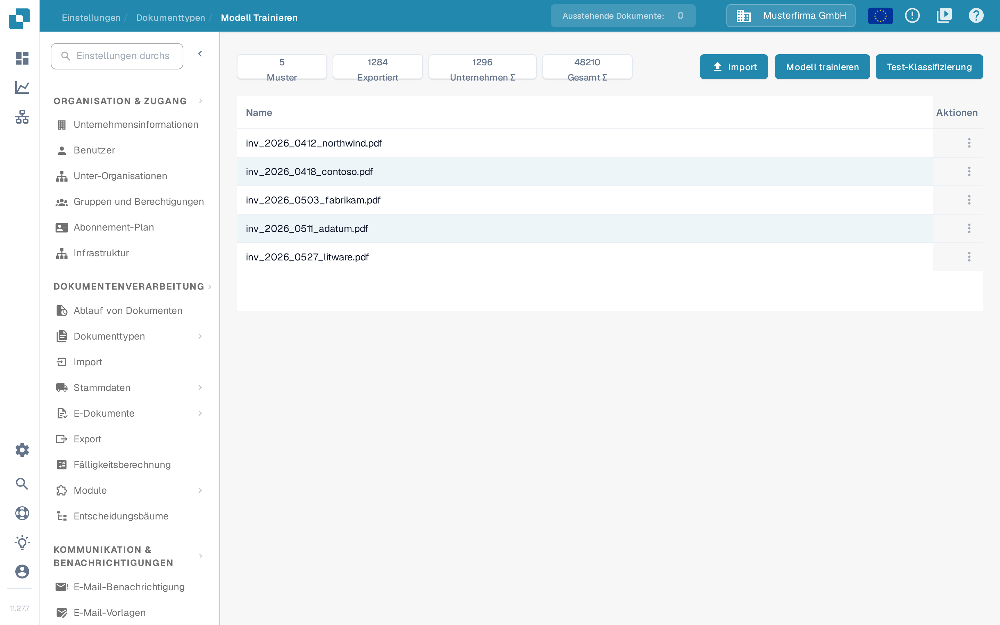

# Testen des Modells

## Mit unabhängigen Testbelegen prüfen

<figure><picture><source srcset="../../../../../.gitbook/assets/intro-process-05-modelltest-de-dark-20261029.png" media="(prefers-color-scheme: dark)"></picture><figcaption>
Mit unabhängigen Testbelegen prüfen
</figcaption></figure>

Trainingsdaten und Testbelege erfüllen unterschiedliche Aufgaben. Legen Sie für unabhängige Testbelege die erwarteten Dokumenttypen und Feldwerte fest und vergleichen Sie diese mit den Vorhersagen. Dokumentieren Sie Modellversion, Stichprobe, Abweichungen und technische Fehler. Verbessern Sie gezielt und wiederholen Sie den Test mit demselben Prüfprotokoll. Die dargestellten Werte sind ein Beispiel und keine Genauigkeitsmessung.

Testen Sie mit repräsentativen Dokumenten, die nicht für das Training verwendet wurden. Halten Sie für jedes Dokument die erwarteten Antworten fest: den Dokumenttyp und bei einer Bewertung der Extraktion auch die Feldwerte.

## Test durchführen

1. Öffnen Sie das Modelltraining des zu prüfenden Dokumenttyps.
2. Wählen Sie den Klassifikationstest, sofern Ihre Version diese Funktion bietet.
3. Wählen Sie die Stichprobe und starten Sie die Bewertung mit den verfügbaren Optionen.
4. Warten Sie den Abschluss ab und dokumentieren Sie Ergebnisse und Fehler. Ein technischer Fehler oder ein unvollständiger Test gilt nicht als korrekte Klassifikation.

<figure><figcaption>
Modelltrainingsansicht des Dokumenttyps Rechnung mit Beispielwerten: Aktionen Import, Modell trainieren und Test-Klassifizierung sowie die Liste der Trainingsbelege; es wurde kein Training gestartet.
</figcaption></figure>

Die Ansicht bietet drei Aktionen und die Liste der Trainingsbelege. Wohin jede Aktion führt, beschreiben die folgenden Seiten:

- **Import** öffnet die Auswahl für neue Trainingsdaten: [Datenimport: Modelltraining](import-data-model-training.md).
- **Modell trainieren** startet das Training für den Dokumenttyp: [Zweck und Verwendung: Modelltraining](purpose-and-use-model-training.md).
- **Test-Klassifizierung** startet die Prüfung, die der Abschnitt „Test durchführen“ oben beschreibt.
- Die Kennzahlen **Muster**, **Exportiert**, **Unternehmen ∑** und **Gesamt ∑** erklärt [Modelltraining](README.md).
- Das Menü in der Spalte **Aktionen** entfernt einen Trainingsbeleg: [Trainingsdaten verwalten](manage-training-data.md).

## Ergebnisse bewerten

Vergleichen Sie Vorhersagen mit den erwarteten Antworten und untersuchen Sie Fehler nach Typ und Format. Wenn Sie Genauigkeit, Präzision, Recall oder F1-Wert berechnen, nennen Sie auch Stichprobengröße und bewertete Kategorien. Schreiben Sie dem Produkt keine Kennzahlen zu, die Ihre Version nicht anzeigt. Sie können sie getrennt aus exportierten oder protokollierten Ergebnissen berechnen.

Klassifikations- und Extraktionsregeln sind vom Modelltraining getrennte Einstellungen. Prüfen Sie ihren Einfluss, wenn sie an der Verarbeitung beteiligt sind. Ändern Sie eine Regel nicht allein, um einen Fehler in der Teststichprobe zu verdecken.

## Verbessern und erneut testen

Korrigieren Sie Trainingsdaten, Kennzeichnungen oder tatsächlich verfügbare Einstellungen und trainieren Sie das Modell bei Bedarf erneut. Wiederholen Sie den Test nach demselben Verfahren und behalten Sie eine unabhängige Stichprobe. Dokumentieren Sie Version, Daten, Ergebnisse und Regressionen. Ein gutes Stichprobenergebnis garantiert keine identische Leistung bei allen zukünftigen Dokumenten.
