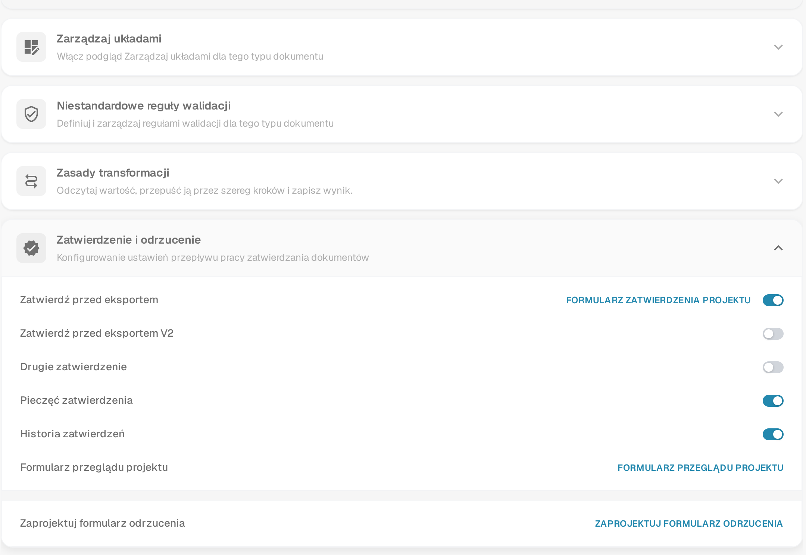
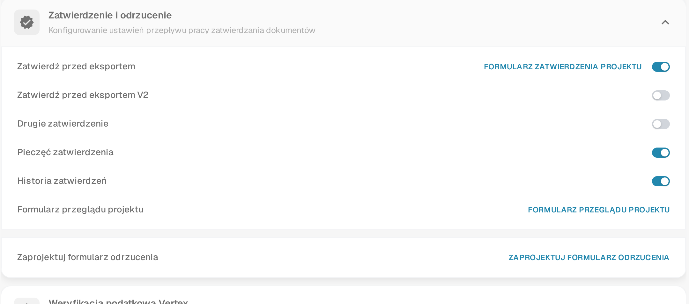

# Konfiguruj i testuj zatwierdzanie faktur

Skonfiguruj odrębny proces zatwierdzania i sprawdź pierwsze zatwierdzenie, drugiego, innego zatwierdzającego oraz odrzucenie.


Konfiguruj i testuj zatwierdzanie faktur


[Obejrzyj z napisami](https://docbits-videos.fra1.cdn.digitaloceanspaces.com/settings-assistant/invoice-approval-admin/v2/pl.html)

Nagranie pokazuje prawdziwą aplikację. Nazwy opcji mogą się różnić w zależności od wdrożonej wersji.

Zatwierdzanie skonfiguruj dla typu dokumentu, którego używa Twój proces. Wskaż osoby, które mają zatwierdzać, i zdecyduj, czy potrzebne jest drugie, niezależne zatwierdzenie. Na nagraniu użyto osobnego typu dokumentu oraz tymczasowych, zwykłych kont zatwierdzających.

## Konfiguracja typu dokumentu

Otwórz **Ustawienia → Typy Dokumentów**, wybierz właściwy typ i otwórz **Więcej Ustawień → Zatwierdzenie i odrzucenie**. Wybierz ustawienia, których wymaga Twój proces, a następnie odśwież stronę i sprawdź, co zostało zapisane.

| Ustawienie | Do czego służy |
| --- | --- |
| Zatwierdź przed eksportem | Wymaga decyzji zatwierdzającej, zanim dokument przejdzie do eksportu. |
| Zatwierdź przed eksportem V2 | Włącza nowszy ekran zatwierdzania. Przy włączonej opcji V2 ekran **Gotowe do zatwierdzenia** pokazuje przebudowany formularz zatwierdzenia, który może ograniczać pola dla zatwierdzającego. Pozostaw V2 wyłączone, aby zachować poprzedni ekran zatwierdzania. Gdzie dokument czeka na zatwierdzenie, opisuje strona [Status dokumentu](../../../../../../end-user-and-partner-section/end-user-section/dashboard/document-status.md). |
| Drugie zatwierdzenie | Dodaje drugi etap zatwierdzania do skonfigurowanego procesu. |
| Historia zatwierdzeń | Zachowuje zapisane decyzje do wglądu. |
| Pieczęć zatwierdzenia | Ustawia oznaczenie na zatwierdzonym dokumencie; opis znajduje się w osobnym przewodniku. |

Projektanci formularzy są opisani w sekcji Projektowanie formularzy zatwierdzania poniżej. W tym samouczku użyto gotowych, standardowych formularzy zatwierdzania.

## Testowanie z właściwymi rolami

1. Przydziel pierwszemu i drugiemu zatwierdzającemu osobne grupy oraz dostęp do przypisanych dokumentów, którego wymaga proces. W tym przykładzie pierwsze konto ma uprawnienie do pierwszego etapu zatwierdzania, a drugie konto do drugiego etapu. Sam przełącznik nie przypisuje osoby ani nie przyznaje uprawnienia.
2. Na pierwszym zwykłym koncie sprawdź przypisaną, już zwalidowaną fakturę, dodaj notatkę i udziel pierwszego zatwierdzenia. Sprawdź, że zapisany dokument nadal czeka na drugie zatwierdzenie. Sprawdź też, że to konto nie może wykonać drugiego etapu, gdy jego uprawnienia na to nie pozwalają.
3. Przypisz oczekującą fakturę innemu uprawnionemu zatwierdzającemu. Na drugim zwykłym koncie sprawdź ją i udziel drugiego zatwierdzenia z osobną notatką.
4. Otwórz ponownie historię i sprawdź dwóch różnych zatwierdzających, godziny i notatki. Odrzuć też osobną fakturę testową z podaniem powodu i sprawdź tę decyzję po odświeżeniu strony.

<figure><figcaption>
Ustawienia widoczne dla przykładowego typu dokumentu: Zatwierdź przed eksportem, Pieczęć zatwierdzenia i Historia zatwierdzeń są włączone; V2 i Drugie zatwierdzenie są wyłączone. Ten zrzut nie jest zaleceniem konfiguracji.
</figcaption></figure>

## Sprawdzenie wyniku

Pierwsze zatwierdzenie, oczekujące drugie zatwierdzenie i odrzucenie traktuj jako różne wyniki. Potwierdź, że wartości faktury pozostają niezmienione po każdej decyzji. W tym odrębnym teście kanał testowy czeka na pobranie danych i nie ma zewnętrznego celu ERP. Techniczny status `pending_data_fetch`, jeśli jest wyświetlany, oznacza oczekiwanie na pobranie danych. Sama historia zatwierdzeń nie dowodzi transferu do ERP.

Przetestuj skonfigurowane role, przypisanie i całą ścieżkę decyzji, zanim zastosujesz proces do dokumentów produkcyjnych.

## Projektowanie formularzy zatwierdzania

Każdy etap zatwierdzania pokazuje zatwierdzającemu własny formularz. Zaprojektuj formularz, zanim włączysz dany etap, aby zatwierdzający zobaczył właściwe pola we właściwej kolejności.

Przy włączonej opcji **Zatwierdź przed eksportem** panel pokazuje link obok każdego etapu zatwierdzania. Wybierz link, aby otworzyć kreator formularza dla tego formularza:

| Link w panelu | Obok | Formularz widoczny dla zatwierdzającego |
| --- | --- | --- |
| **FORMULARZ ZATWIERDZENIA PROJEKTU** | **Zatwierdź przed eksportem** | Standardowy formularz zatwierdzenia dla dokumentu, który czeka na zatwierdzenie. |
| link formularza V2, widoczny po włączeniu opcji | **Zatwierdź przed eksportem V2** | Formularz zatwierdzenia dla nowszego ekranu zatwierdzania. |
| link formularza drugiego zatwierdzenia, widoczny po włączeniu opcji | **Drugie zatwierdzenie** | Formularz drugiego etapu zatwierdzania. |
| **FORMULARZ PRZEGLĄDU PROJEKTU** | osobny wiersz, wyświetlany przy włączonej opcji **Zatwierdź przed eksportem** | Formularz, którego zatwierdzający używa podczas sprawdzania dokumentu w przeglądzie. |
| **ZAPROJEKTUJ FORMULARZ ODRZUCENIA** | osobny wiersz | Formularz, którego zatwierdzający używa do odrzucenia dokumentu, aby mógł zapisać powód. |

Link pojawia się tylko wtedy, gdy odpowiedni etap jest włączony. Wiersz **Formularz przeglądu projektu** jest wyświetlany tak długo, jak włączona jest opcja **Zatwierdź przed eksportem**; wiersz **Zaprojektuj formularz odrzucenia** jest zawsze dostępny w panelu. Panel na ilustracji powyżej ma włączoną opcję **Zatwierdź przed eksportem**, więc pokazuje już link **FORMULARZ ZATWIERDZENIA PROJEKTU** oraz wiersze **Formularz przeglądu projektu** i **Zaprojektuj formularz odrzucenia**:

<figure><figcaption>
Etapy zatwierdzania i ich linki projektowania. Każdy link otwiera kreator formularza dla danego etapu.
</figcaption></figure>

Wybranie linku otwiera **kreator formularzy** dla tego formularza. To ten sam kreator, którego używa się do układów dokumentów: górny pasek zaczyna się od wyboru języka źródłowego, a obok znajduje się kolorowa plakietka z nazwą edytowanego formularza — zatwierdzenie, przegląd albo odrzucenie. Lewy panel ma trzy zakładki:

- **Ustawienia** (ikona koła zębatego) — sterują zachowaniem formularza: kolejnością zakładek, wyłączaniem ekstrakcji oraz licznikiem czasu walidacji.
- **Elementy** — rozwiń grupy, pola i elementy formularza i przeciągnij potrzebne na kanwę. Pola obejmują pola dokumentu; elementy formularza to kontrolki umieszczane na formularzu, takie jak tekst, etykieta, pole wyboru, separator poziomy, notatki i przycisk, a także kontrolki zatwierdzającego: zatwierdzający dokument i drugi zatwierdzający.
- **Właściwości** — wybierz element na kanwie, aby zmienić jego etykietę, rozmiar, kolor i inne ustawienia.

Górny pasek oferuje też przywrócenie domyślnego szablonu, edycję JSON i zapis. Zapis przechowuje formularz tylko dla tego etapu i tego typu dokumentu, więc formularz zatwierdzenia, formularz przeglądu i formularz odrzucenia są prowadzone osobno i żaden z nich nie zmienia układu dokumentu. Dokładne nazwy przycisków i zakładek mogą się różnić w zależności od wersji aplikacji.

Opis paneli kreatora znajdziesz w przewodniku [Poruszanie się po kreatorze układów](../../layout-manager/navigating-the-layout-manager.md), a opis zapisywania w sekcji [Zapisywanie i stosowanie zmian](../../layout-manager/save-and-apply-changes.md).

## Powiązane strony

- [Grupy, użytkownicy i uprawnienia](../../../groups-users-and-permissions/README.md)
- [Historia zatwierdzeń](approval-history.md)
- [Pieczęć zatwierdzenia](approval-stamp.md)
