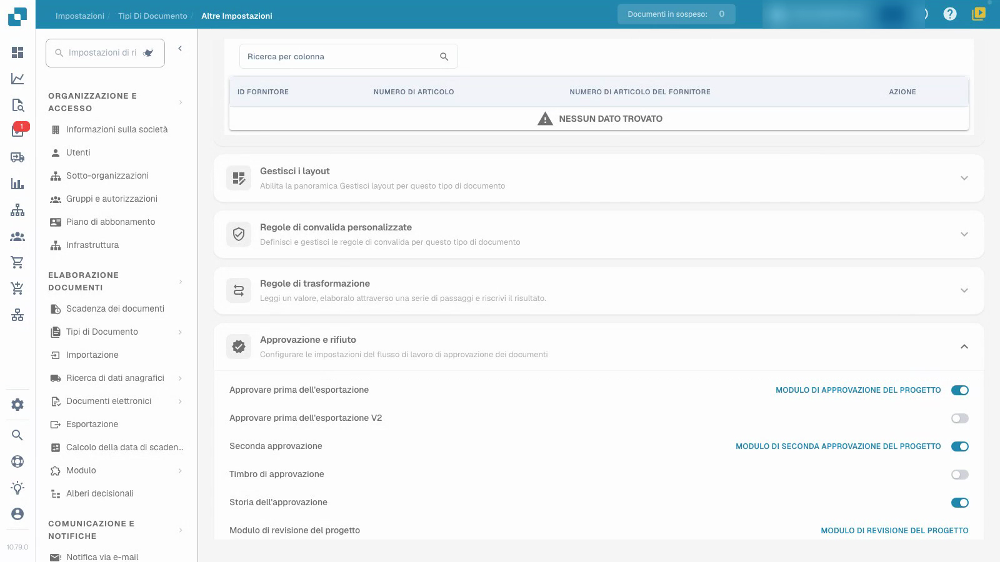
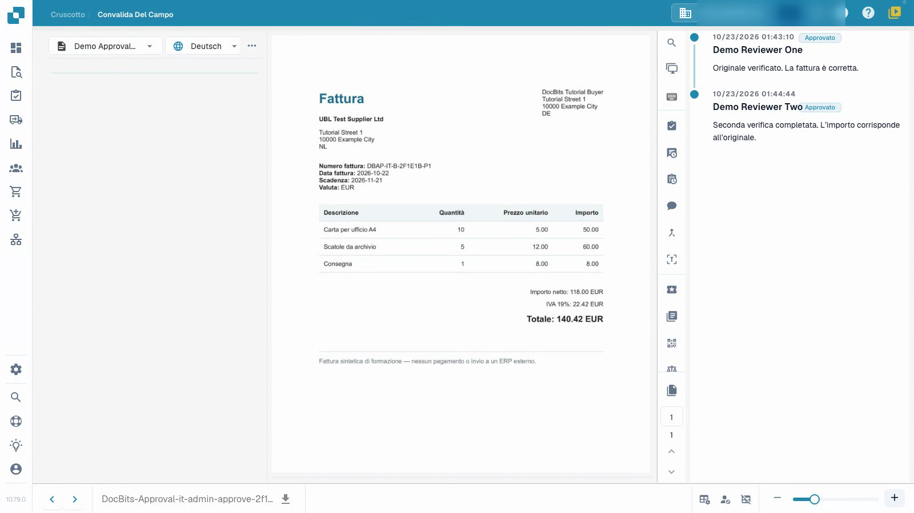
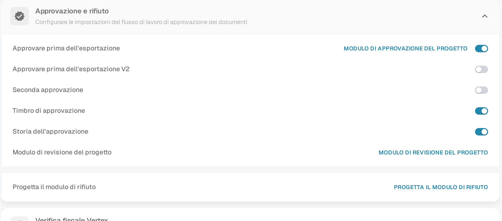

# Configurare e testare le approvazioni delle fatture

Configura un processo di approvazione isolato e verifica la prima approvazione, un secondo verificatore diverso e il rifiuto.


Configurare e testare le approvazioni delle fatture


[Guarda il video con i sottotitoli](https://docbits-videos.fra1.cdn.digitaloceanspaces.com/settings-assistant/invoice-approval-admin/v2/it.html)

Viene mostrata l'applicazione reale; la formulazione delle opzioni può dipendere dalla versione distribuita.

Configura l'approvazione per il tipo di documento utilizzato dal tuo processo. Identifica i verificatori previsti e decidi se hai bisogno di una seconda revisione indipendente. Il video utilizza un tipo di documento separato e account di verifica temporanei senza privilegi amministrativi.

## Configura il tipo di documento

Apri **Impostazioni → Tipi di Documento**, seleziona il tipo previsto e apri **Altre impostazioni → Approvazione e rifiuto**. Scegli le impostazioni di cui il tuo processo ha bisogno, quindi ricarica la pagina per controllare cosa è stato salvato.

| Impostazione | Scopo |
| --- | --- |
| Approvare prima dell'esportazione | Richiedi una decisione di approvazione prima che il documento proceda all'esportazione. |
| Approvare prima dell'esportazione V2 | Usa la schermata di approvazione più recente. Con V2 attivo, la schermata di approvazione mostra un modulo ricostruito che può limitare i campi per il verificatore. Lascia V2 disattivato per mantenere la schermata di approvazione precedente. Vedi [Stato dei documenti](../../../../../../end-user-and-partner-section/end-user-section/dashboard/document-status.md) per il punto in cui un documento attende l'approvazione. |
| Seconda approvazione | Aggiungi una seconda fase di approvazione al processo configurato. |
| Storia dell'approvazione | Mantieni le decisioni registrate disponibili per la revisione. |
| Timbro di approvazione | Configura un segno su un documento approvato; vedi la guida separata sui timbri. |

Gli editor dei moduli sono descritti in [Progetta i moduli di approvazione](#progetta-i-moduli-di-approvazione) qui sotto. Questo tutorial utilizza moduli di approvazione standard preparati.

## Testa con i ruoli previsti

1. Assegna al primo e al secondo verificatore gruppi separati e l'accesso previsto ai documenti assegnati. In questo esempio, il primo account ha l'autorizzazione di approvazione di prima fase e il secondo account ha l'autorizzazione di seconda fase. Un interruttore da solo non assegna una persona né concede tale autorizzazione.
2. Usa il primo normale account di verifica per controllare la fattura assegnata e già convalidata, aggiungi una nota e dai la prima approvazione. Verifica che il documento salvato attenda ancora la seconda approvazione. Controlla che questo account non possa eseguire la seconda fase quando le sue autorizzazioni lo vietano.
3. Assegna la fattura in attesa all'altro verificatore autorizzato. Usa quel secondo normale account di verifica per controllarla e dare la seconda approvazione con una nota separata.
4. Riapri la cronologia e verifica entrambi i diversi verificatori, orari e note. Rifiuta anche una fattura di test separata con un motivo e verifica quella decisione dopo aver ricaricato.

<figure><figcaption>
Impostazioni di approvazione salvate nel proprio tipo di test.
</figcaption></figure>

<figure><figcaption>
Due verificatori distinti ed entrambe le note salvate.
</figcaption></figure>

## Verifica il risultato

Mantieni la prima approvazione, la seconda approvazione in sospeso e il rifiuto come risultati diversi. Conferma che i valori della fattura rimangono invariati dopo ogni decisione. In questo esempio, il canale di test attende il recupero dei dati e non ha una destinazione ERP esterna. Lo stato tecnico `pending_data_fetch`, quando visualizzato, significa in attesa del recupero dei dati. La cronologia delle approvazioni da sola non dimostra un trasferimento ERP.

Testa i ruoli configurati, l'assegnazione e il percorso decisionale completo prima di applicare il processo ai documenti reali in produzione.

## Progetta i moduli di approvazione

Ogni fase di approvazione mostra al verificatore un proprio modulo. Progetta il modulo prima di attivare la fase, così il verificatore vede i campi giusti nell'ordine giusto.

Con **Approvare prima dell'esportazione** attivo, il pannello mostra un collegamento accanto a ogni fase di approvazione. Seleziona il collegamento per aprire l'editor del modulo di quella fase:

| Collegamento nel pannello | Accanto a | Modulo che il verificatore vede |
| --- | --- | --- |
| **MODULO DI APPROVAZIONE DEL PROGETTO** | **Approvare prima dell'esportazione** | Il modulo di approvazione standard per un documento in attesa di approvazione. |
| Il collegamento accanto a **Approvare prima dell'esportazione V2** | **Approvare prima dell'esportazione V2** | Il modulo di approvazione per la schermata di approvazione più recente. |
| **MODULO DI SECONDA APPROVAZIONE DEL PROGETTO** | **Seconda approvazione** | Il modulo per la seconda fase di approvazione. |
| **MODULO DI REVISIONE DEL PROGETTO** | riga propria, visibile mentre **Approvare prima dell'esportazione** è attivo | Il modulo che il verificatore usa mentre controlla un documento in revisione. |
| **PROGETTA IL MODULO DI RIFIUTO** | riga propria | Il modulo che il verificatore usa per rifiutare un documento, così può registrare un motivo. |

Un collegamento compare solo quando la fase corrispondente è attiva. La riga **Modulo di revisione del progetto** è visibile finché **Approvare prima dell'esportazione** è attivo; la riga **Progetta il modulo di rifiuto** è sempre disponibile nel pannello. Il pannello dell'esempio qui sopra ha **Approvare prima dell'esportazione** attivo, quindi mostra già il collegamento **MODULO DI APPROVAZIONE DEL PROGETTO** insieme alle righe **Modulo di revisione del progetto** e **Progetta il modulo di rifiuto**:

<figure><figcaption>
Le fasi di approvazione e i rispettivi collegamenti di progettazione. Ogni collegamento apre l'editor del modulo di quella fase.
</figcaption></figure>

Selezionando un collegamento si apre l'editor del modulo di quella fase. È lo stesso editor utilizzato per il layout dei documenti: la barra superiore inizia con il selettore della lingua di origine (qui **DEFAULT**), seguito da un badge colorato che indica il modulo in modifica: approvazione, revisione o rifiuto. Il pannello a sinistra contiene tre schede:

- La scheda delle impostazioni (icona ingranaggio) controlla il comportamento del modulo: l'ordine delle schede, la disattivazione dell'estrazione e un contatore del tempo di convalida.
- La scheda degli elementi contiene i blocchi da trascinare sull'area di lavoro, raggruppati in gruppi, campi ed elementi di modulo. I campi sono quelli del documento; gli elementi di modulo sono i controlli che posizioni sul modulo, come **Text**, **Label**, **Check Box**, **Horizontal Separator**, **Notes** e **Button**, insieme ai controlli del verificatore **Document Approver** e **Second Approver**. I nomi degli elementi di modulo restano in inglese nel prodotto.
- La scheda delle proprietà mostra le impostazioni dell'elemento selezionato sull'area di lavoro: etichetta, dimensione, colore e altro.

La barra superiore offre anche il ripristino del modello predefinito, la modifica diretta della definizione JSON e **Salva**. Il salvataggio conserva il modulo solo per quella fase e quel tipo di documento, quindi il modulo di approvazione, quello di revisione e quello di rifiuto restano separati e nessuno di essi cambia il layout del documento.

Vedi [Navigare il Layout Manager](../../layout-manager/navigating-the-layout-manager.md) per una panoramica dei pannelli e [Salvare e Applicare le Modifiche](../../layout-manager/save-and-apply-changes.md) per sapere cosa fa il salvataggio.

## Pagine correlate

- [Gruppi, utenti e autorizzazioni](../../../groups-users-and-permissions/README.md)
- [Storia dell'approvazione](approval-history.md)
- [Timbro di approvazione](approval-stamp.md)
