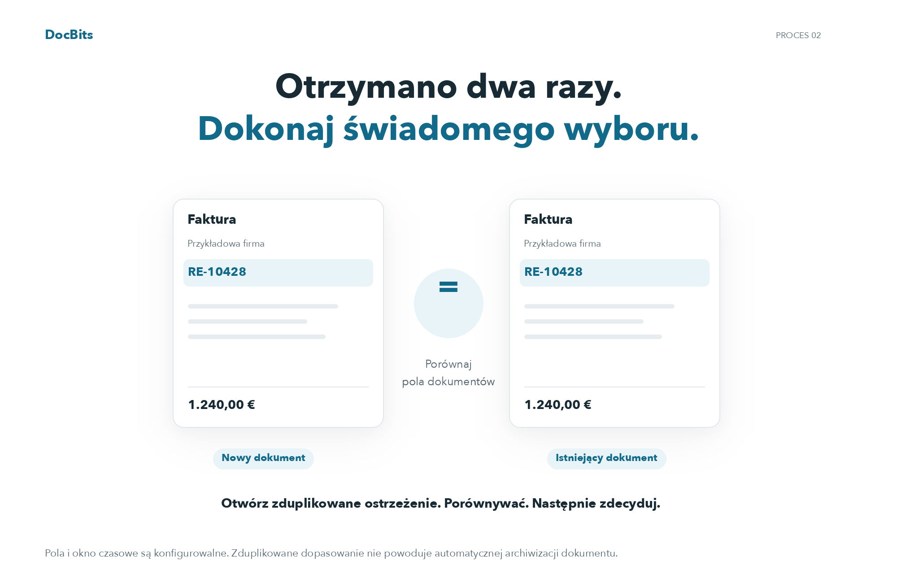
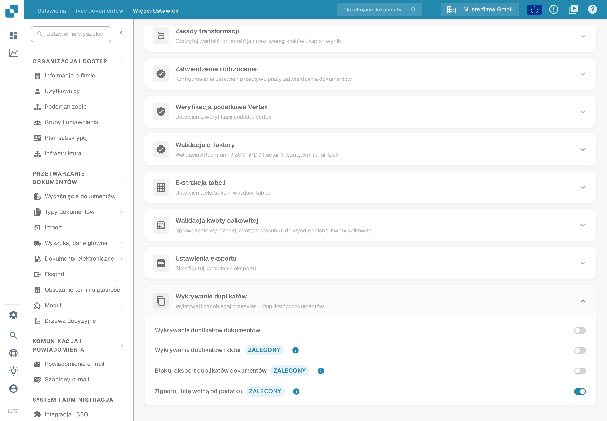
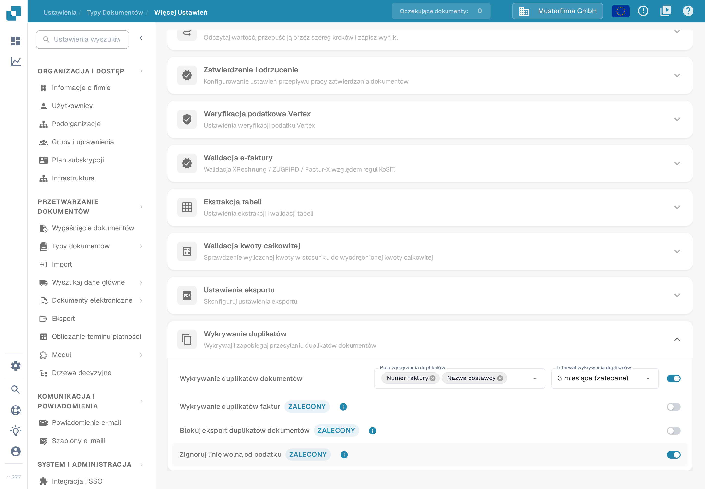
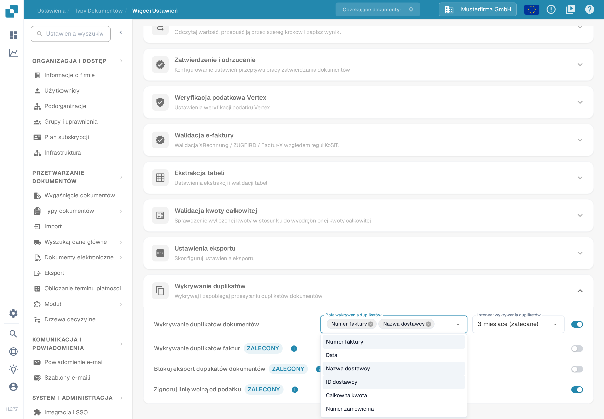
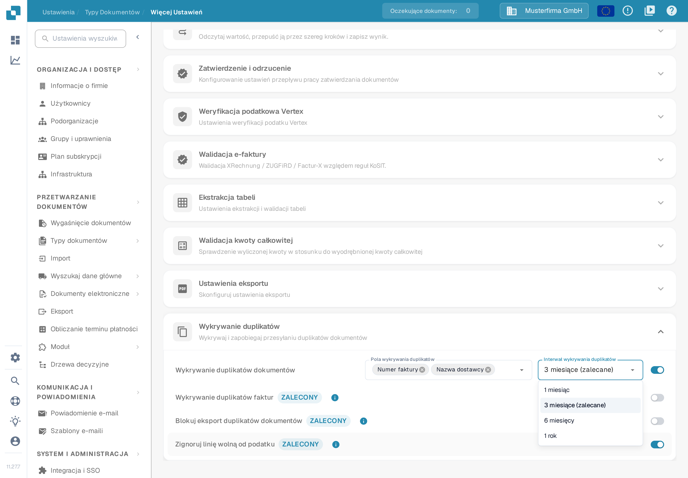

# Wykrywanie duplikatów

## Wykrywaj duplikaty i podejmuj świadomą decyzję

<figure><picture><source srcset="../../../../../.gitbook/assets/intro-process-02-dubletten-pl-dark-20261029.png" media="(prefers-color-scheme: dark)"></picture><figcaption>
Wykrywaj duplikaty i podejmuj świadomą decyzję
</figcaption></figure>

DocBits porównuje skonfigurowane pola w wybranym oknie czasowym. Po znalezieniu dopasowania otwórz ostrzeżenie o duplikacie i porównaj dokumenty przed kontynuowaniem lub archiwizacją. Blokowanie eksportu duplikatów to osobne ustawienie; dopasowanie nie archiwizuje dokumentu automatycznie.

Funkcja **Wykrywanie duplikatów** oznacza dokumenty, które w wybranym okresie pasują do innego dokumentu według wybranych pól. Opcje te dotyczą każdego typu dokumentu osobno.

## Otwieranie ustawień

1. Otwórz **Ustawienia → Typy dokumentów**.
2. Przy typie dokumentu, który chcesz skonfigurować, wybierz **Ustawienia**.
3. W sekcji **Więcej Ustawień** otwórz **Wykrywanie duplikatów**.

<figure><figcaption>
Ustawienia faktury pokazują cztery osobne przełączniki. Selektory pól i interwału pojawiają się po włączeniu wykrywania.
</figcaption></figure>

## Wybieranie kryteriów duplikatu

1. Włącz **Wykrywanie duplikatów dokumentów**. Pojawią się selektory **Pola wykrywania duplikatów** i **Interwał wykrywania duplikatów**.
2. Wybierz pola, które muszą się zgadzać. Dla faktury możesz wybrać **Numer faktury** i **Nazwa dostawcy**. Wybierz pola, które odróżniają dokumenty w Twoim procesie.
3. Wybierz interwał: **1 miesiąc**, **3 miesiące (zalecane)**, **6 miesięcy** lub **1 rok**. Dłuższy interwał sprawdza szerszy zakres dat i może wydłużać ładowanie.

Każda zmiana jest zapisywana od razu po jej dokonaniu; w tej sekcji nie ma osobnego przycisku zapisu. Po wyłączeniu wykrywania selektory pól i interwału są ukrywane.

<figure><figcaption>
Po włączeniu wykrywania wybierz pola porównania i interwał czasowy.
</figcaption></figure>

<figure><figcaption>
Do wyboru są numer faktury, data, nazwa dostawcy, ID dostawcy, całkowita kwota i numer zamówienia.
</figcaption></figure>

<figure><figcaption>
Trzy miesiące są w menu oznaczone jako interwał zalecany.
</figcaption></figure>

Dla typu dokumentu **Faktura** sekcja oferuje dodatkowo przełączniki **Wykrywanie duplikatów faktur**, **Blokuj eksport duplikatów dokumentów** oraz **Zignoruj linię wolną od podatku**. To osobne przełączniki; włącz tylko zachowania, których wymaga Twój proces obsługi faktur. Dodatkowe przełączniki nie są widoczne dla innych typów dokumentów.

## Sprawdzanie oznaczonego dokumentu

Gdy DocBits znajdzie dopasowanie, wiersz dokumentu na **Pulpicie** pokazuje ikonę duplikatu. Wybierz ikonę, aby porównać pasujące rekordy w panelu bocznym. Ikona pojawia się tylko wtedy, gdy istnieje dopasowanie.

Gdy otworzysz oznaczony dokument, ostrzeżenie o duplikacie oferuje przyciski **View Duplicate** (pokaż duplikat), **Proceed Anyway** (kontynuuj mimo to) oraz — jeśli dokument nie został jeszcze zarchiwizowany — **Archive** (archiwizuj). Przejrzyj pasujące rekordy, zanim wybierzesz działanie. Listę dokumentów opisuje [przewodnik po Pulpicie](../../dashboard/README.md).

Przy sprawdzaniu domniemanych duplikatów porównaj numer faktury, dostawcę, datę i kwotę. Na podstawie ostrzeżenia o duplikacie i danych pasującego dokumentu zdecyduj, co wymaga poprawy.
