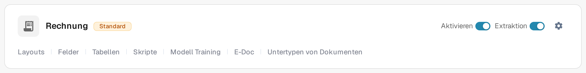
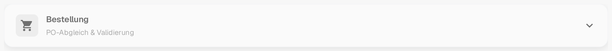

# Bestellung

Die Karte **Bestellung** in den **Weiteren Einstellungen** eines Dokumenttyps legt fest, wie Dokumente dieses Typs mit Bestellungen abgeglichen werden. Die Einstellungen gelten jeweils für einen Dokumenttyp. Öffnen Sie deshalb zuerst den Dokumenttyp, den Sie ändern möchten, unter **Einstellungen → Dokumenttypen**.

So finden Sie die Einstellungen für eine Rechnung:

1. Öffnen Sie **Einstellungen → Dokumenttypen**.
2. Suchen Sie die Karte **Rechnung** und wählen Sie das Zahnrad-Symbol (**Weitere Einstellungen**).
3. Öffnen Sie den Abschnitt **Bestellung**, um die Optionen für Abgleich und Validierung zu prüfen.

<figure><figcaption>
Die Karte <strong>Rechnung</strong> in der aktuellen deutschen Sandbox. Das Zahnrad öffnet die Weiteren Einstellungen; die übrigen Bedienelemente der Karte gelten für den Dokumenttyp.
</figcaption></figure>

Auf der Karte stehen außerdem **Aktivieren**, **Extraktion** und die Verknüpfungen unter dem Dokumentnamen. Diese Bedienelemente gelten für den Dokumenttyp selbst und sind auf der Seite [Dokumenttypen](../../README.md) unter „Steuerelemente einer Dokumenttyp-Karte“ erklärt. Was die einklappbaren Karten der Weiteren Einstellungen sind, steht unter [Weitere Einstellungen](../README.md).

<figure><figcaption>
Der Abschnitt <strong>Bestellung</strong> in den Weiteren Einstellungen, eingeklappt. Öffnen Sie die Kopfzeile, um die Optionen zu sehen; für diese Aufnahme wurde keine Einstellung geändert.
</figcaption></figure>

Beginnen Sie mit den Abgleichsregeln und den Toleranzen und passen Sie anschließend das Verhalten nach einem Abgleich und beim Export an:

* [Regeln für die Übereinstimmung von Bestellungen](purchase-order-matching-rules.md) und [Einstellungen zur Toleranz von Bestellungen / Zusätzliche Toleranz für Bestellungen](purchase-order-tolerance-settings-additional-purchase-order-tolerance.md) legen fest, wie Rechnungs- und Bestellpositionen verglichen werden.
* [Optionen für Auto Match & Export](auto-match-and-export-options.md), [Export nicht übereinstimmender PO-Zeilen](export-not-matched-po-lines.md) und [Alternativer Export](alternate-export.md) regeln, was nach einem Abgleich geschieht.
* [Auftragstabelle im Layout-Builder](po-table-in-layout-builder.md), [Status verbrauchter Bestellpositionen](consumed-po-line-status.md) und [PO-Stückpreis berechnen](calculate-po-unit-price.md) ändern, was Benutzer in der Abgleichsansicht sehen.
* [Automatische Prüfung auf PO-Aktualisierungen](auto-check-for-po-updates.md), [PO-Deaktivierungsstatus](purchase-order-disable-statuses.md) und [Aktualisieren des Dokuments Bestellstatus](update-document-purchase-order-status.md) steuern, wie Bestelldaten und Status aktuell gehalten werden.
* [Lieferantenartikelnummer-Zuordnung - Admin-Dokumentation](supplier-item-number-map-admin-documentation.md) und die allgemeine Seite [Bestellung](purchase-order.md) bieten weiterführende Hintergründe.

Einstellungen können sich auf laufende Dokumente auswirken. Prüfen Sie Änderungen mit einem Testdokument, bevor Sie sie in der Produktion speichern.

Diese Übersicht zeigt, wo Sie die Einstellungen finden. Sie bestätigt keinen abgeschlossenen PO-Abgleich und keinen Export.
