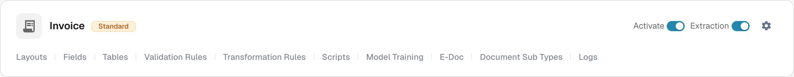

# 采购订单

文档类型 **More Settings** 中的 **Purchase Order** 卡片决定该类型的文档如何与采购订单匹配。设置一次只对一个文档类型生效，因此请先在 **Settings → Document Types** 中打开要更改的文档类型。

查找发票的设置：

1. 打开 **Settings → Document Types**。
2. 找到 **Invoice** 卡片并选择其齿轮图标（**More Settings**）。
3. 打开 **Purchase Order** 部分，查看其匹配和校验选项。

<figure><figcaption>
当前英文 Dev 测试环境中的 Invoice 卡片。使用齿轮图标打开 More Settings；其他控件针对该文档类型。
</figcaption></figure>

<figure><figcaption>
More Settings 中的 Purchase Order 部分（已折叠）。展开其标题可查看选项；本次截图未更改任何设置。
</figcaption></figure>

先从匹配规则和容差入手，然后调整匹配与导出相关的行为：

* [采购订单匹配规则](purchase-order-matching-rules.md) 和 [采购订单容差设置 / 其他采购订单容差](purchase-order-tolerance-settings-additional-purchase-order-tolerance.md) 定义如何比较发票行和采购订单行。
* [自动匹配和导出选项](auto-match-and-export-options.md)、[导出未匹配的采购订单行](export-not-matched-po-lines.md) 和 [备用导出](alternate-export.md) 说明匹配之后会发生什么。
* [以基本计量单位导出数量](export-quantity-in-base-unit-of-measure.md) 将导出的数量和单价换算为基本计量单位，用于 Infor LN 导出。
* [布局构建器中的采购订单表](po-table-in-layout-builder.md)、[已消耗采购订单行状态](consumed-po-line-status.md) 和 [计算采购订单单价](calculate-po-unit-price.md) 改变用户在匹配视图中看到的内容。
* [PO 更新自动检查](auto-check-for-po-updates.md)、[采购订单禁用状态](purchase-order-disable-statuses.md) 和 [更新文档采购订单状态](update-document-purchase-order-status.md) 控制采购订单数据和状态如何保持最新。
* [供应商物料编号映射 - 管理员文档](supplier-item-number-map-admin-documentation.md) 和通用的 [采购订单](purchase-order.md) 页面提供更多背景。

设置可能影响生产文档。请用测试文档检查更改，再在生产环境中保存。

本概览说明在哪里找到这些设置。它不验证已完成的 PO 匹配或导出。
