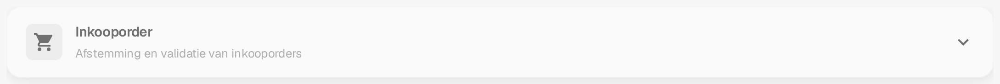

# Inkooporder

De kaart **Inkooporder** in de **Meer instellingen** van een documenttype bepaalt hoe documenten van dat type met inkooporders worden afgestemd. De instellingen gelden telkens voor één documenttype. Open daarom eerst het documenttype dat je wilt wijzigen onder **Instellingen → Documenttypen**.

Zo vind je de instellingen voor een factuur:

1. Open **Instellingen → Documenttypen**.
2. Zoek de kaart **Factuur** en kies het tandwielpictogram (**Meer instellingen**).
3. Open het onderdeel **Inkooporder** om de opties voor afstemming en validatie te bekijken.

<figure><figcaption>
De kaart <strong>Factuur</strong> in de huidige Nederlandse sandbox. Het tandwiel opent de Meer instellingen; de overige bedieningselementen gelden voor het documenttype.
</figcaption></figure>

Op de kaart staan ook **Activeren**, **Extractie** en de koppelingen onder de documentnaam. Deze bedieningselementen gelden voor het documenttype zelf en worden uitgelegd op de pagina [Documenttypen](../../README.md) onder „Bedieningselementen op een documenttypekaart”. Wat de uitklapbare kaarten van de Meer instellingen zijn, staat op de pagina [Meer instellingen](../README.md).

<figure><figcaption>
Het onderdeel <strong>Inkooporder</strong> in de Meer instellingen, ingeklapt. Open de kop om de opties te zien; voor deze opname is geen instelling gewijzigd.
</figcaption></figure>

Begin met de matchingregels en de toleranties en pas daarna het gedrag na een match en bij de export aan:

* [Regels voor het matchen van inkooporders](purchase-order-matching-rules.md) en [Aankooporder tolerantie-instellingen / Extra aankooporder tolerantie](purchase-order-tolerance-settings-additional-purchase-order-tolerance.md) bepalen hoe factuur- en inkooporderregels worden vergeleken.
* [Opties voor Auto Match & Export](auto-match-and-export-options.md), [Export niet gematchte PO-regels](export-not-matched-po-lines.md) en [Alternatieve export](alternate-export.md) regelen wat er na een match gebeurt.
* [PO-tabel in Layout Builder](po-table-in-layout-builder.md), [Status van geconsumeerde PO-regel](consumed-po-line-status.md) en [Bereken PO eenheidsprijs](calculate-po-unit-price.md) wijzigen wat gebruikers in de afstemmingsweergave zien.
* [Automatische controle op PO-updates](auto-check-for-po-updates.md), [PO-uitschakelstatussen](purchase-order-disable-statuses.md) en [Status van documentinkooporder bijwerken](update-document-purchase-order-status.md) bepalen hoe inkoopordergegevens en statussen actueel blijven.
* [Mapping van leveranciersartikelnummers: beheerdersdocumentatie](supplier-item-number-map-admin-documentation.md) en de algemene pagina [Inkooporder](purchase-order.md) geven achtergrondinformatie.

Instellingen kunnen lopende documenten beïnvloeden. Controleer wijzigingen met een testdocument voordat je ze in productie opslaat.

Dit overzicht laat zien waar je de instellingen vindt. Het bevestigt geen afgeronde PO-match en geen export.
