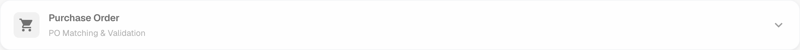

# Inkooporder

De kaart **Purchase Order** in de **More Settings** van een documenttype bepaalt hoe documenten van dat type tegen inkooporders worden gematcht. Instellingen gelden telkens voor één documenttype; open daarom eerst het documenttype dat u wilt wijzigen onder **Settings → Document Types**.

Zo vindt u de instellingen voor een factuur:

1. Open **Settings → Document Types**.
2. Zoek de kaart **Invoice** en selecteer het tandwielpictogram (**More Settings**).
3. Open het gedeelte **Purchase Order** om de opties voor matching en validatie te bekijken.

<figure><figcaption>
De kaart Invoice in de huidige Engelse Dev-testomgeving. Met het tandwielpictogram opent u More Settings; de overige bedieningselementen gelden voor het documenttype.
</figcaption></figure>

<figure><figcaption>
Het gedeelte Purchase Order in More Settings, gesloten weergegeven. Klap de kopregel open om de opties te zien; voor deze opname is geen instelling gewijzigd.
</figcaption></figure>

Begin met de matchingregels en toleranties en pas daarna het gedrag rond matching en export aan:

* [Regels voor het matchen van inkooporders](purchase-order-matching-rules.md) en [Aankooporder tolerantie-instellingen / Extra aankooporder tolerantie](purchase-order-tolerance-settings-additional-purchase-order-tolerance.md) bepalen hoe factuur- en inkooporderregels worden vergeleken.
* [Opties voor Auto Match & Export](auto-match-and-export-options.md), [Export niet gematchte PO-regels](export-not-matched-po-lines.md) en [Alternatieve export](alternate-export.md) behandelen wat er na een match gebeurt.
* [Exporthoeveelheid in basiseenheid](export-quantity-in-base-unit-of-measure.md) rekent de geëxporteerde hoeveelheid en eenheidsprijs om naar de basiseenheid, voor de Infor LN-export.
* [PO-tabel in Layout Builder](po-table-in-layout-builder.md), [Status van geconsumeerde PO-regel](consumed-po-line-status.md) en [Bereken PO-eenheidsprijs](calculate-po-unit-price.md) wijzigen wat gebruikers in de matchingweergave zien.
* [Automatische controle op PO-updates](auto-check-for-po-updates.md), [PO-uitschakelstatussen](purchase-order-disable-statuses.md) en [De inkooporderstatus van het document bijwerken](update-document-purchase-order-status.md) bepalen hoe inkoopordergegevens en statussen actueel blijven.
* [Mapping van leveranciersartikelnummers: beheerdersdocumentatie](supplier-item-number-map-admin-documentation.md) en de algemene pagina [Inkooporder](purchase-order.md) geven meer achtergrond.

Instellingen kunnen live documenten beïnvloeden. Controleer wijzigingen met een testdocument voordat u ze in productie opslaat.

Dit overzicht laat zien waar de instellingen staan. Het verifieert geen afgeronde PO-match of export.
